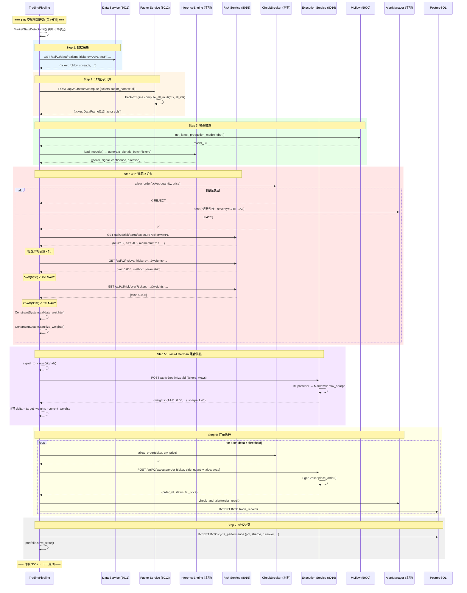
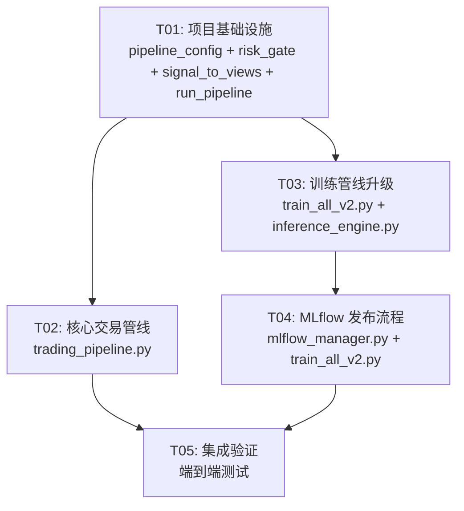

# Quant AI Trader v2 → 顶级量化基金标准改进方案

| 项目 | 内容 |
|------|------|
| 文档版本 | v1.0 |
| 作者 | Bob (Architect) |
| 日期 | 2025-07-18 |
| 状态 | 设计完成，待实施 |
| 依赖 | PRD-v2.md, ARCHITECTURE-v2.md, 现有 v2 代码库 |

---

## 目录

1. [改进方法 — 逐模块方案](#1-改进方法--逐模块方案)
2. [文件变更清单](#2-文件变更清单)
3. [数据流图 — Mermaid 时序图](#3-数据流图--mermaid-时序图)
4. [任务列表](#4-任务列表)
5. [关键接口变更](#5-关键接口变更)

---

## 1. 改进方法 — 逐模块方案

### 核心理念：最小改动原则

**不改动任何 v2 服务内部实现**，只新增集成层和少量配置/脚本。

```
现状                         改后
━━━━━━━━━━━━━━━━━━━━━━━━━━━━━━━━━━━━━━━━━━━━━━━━━━━━━━━━
auto_trader.py (v1)    →    trading_pipeline.py (新建，调用 v2 服务)
backend.ai_models.*     →    services/model_infer_service/* (已有，不改)
backend.data_engine.*   →    services/data_service/* (已有，不改)
9 个简单特征            →    FactorEngine 113 因子 (已有，不改)
无风控                  →    RiskService + CircuitBreaker (已有，不改)
无优化                  →    BlackLittermanOptimizer (已有，不改)
无模型管理              →    MLflowManager (已有，不改)
```

---

### 1.1 实盘交易管线重构 → `trading_pipeline.py`

**问题**：`auto_trader.py` 使用 v1 `backend.*` 模块（MarketDataEngine, TransformerPredictor, DataPipeline 等），完全未接入 v2 六微服务。

**方案**：新建 `trading_pipeline.py` 作为轻量编排器，仅做顺序调用（~200 行），核心逻辑全部委托 v2 服务。

**流程**：
```
T+0 交易周期 (每5分钟):
Step 0: 市场状态检测 (MarketStateDetector, 已有)
Step 1: 数据采集    → HTTP GET data-service:8011/api/v2/data/...
Step 2: 因子计算    → HTTP POST factor-service:8012/api/v2/factors/compute (全部113因子)
Step 3: 模型推理    → model_infer_service InferenceEngine (本地调用, 已有)
Step 4: 风控关卡    → HTTP GET risk-service:8015/api/v2/risk/barra/exposure
                      + HTTP GET risk-service:8015/api/v2/risk/var
                      + HTTP GET risk-service:8015/api/v2/risk/cvar
                      + CircuitBreaker.allow_order() (本地调用)
Step 5: 组合优化    → HTTP POST execution-service:8016/api/v2/optimizer/bl (Black-Litterman)
Step 6: 订单执行    → HTTP POST execution-service:8016/api/v2/execute/order
Step 7: 绩效记录    → 本地 SQLite/PostgreSQL 写 record 表
```

**关键设计决策**：
- 不另建新微服务 — 所有逻辑已在现有 6 服务中，`trading_pipeline.py` 仅是 HTTP + 本地调用编排
- 服务间调用走本地 HTTP（Docker 内部网络），延迟 <10ms
- 风控失败立即 Reject，不进入后续步骤
- 每个步骤独立 try/catch，单步失败不崩溃整条管线

---

### 1.2 因子工程接入

**问题**：`auto_trader.py` 的 `DataPipeline.process()` 只计算 ~30 个简单特征（ret_1d, ret_5d, ret_21d, ret_63d, volume_ma 等），未使用 FactorEngine 的 113 因子。

**方案**：
1. **推理时**：`trading_pipeline.py` Step 2 调用 `POST /api/v2/factors/compute`，传入 ticker 列表 + 全部 113 个 factor_names（或默认 all），获取因子 DataFrame
2. **训练时**：修改 `scripts/train_all_v2.py`，训练前调用 FactorEngine 计算全量因子，将因子列作为特征输入模型（替代原来的 9 个简单特征）
3. **FactorEngine.compute_all_multi()** 已支持批量为多个 ticker 计算全部因子，无需改动

**影响范围**：
- `trading_pipeline.py`：新增因子计算步骤
- `scripts/train_all_v2.py`：修改特征构造逻辑

---

### 1.3 风控关卡

**问题**：v1 的 `RiskManager` 只做简单的仓位比例检查，无 Barra 暴露、无 VaR/CVaR、无熔断器。

**方案**：每笔交易前经过四道关卡：

```
订单 → [1] CircuitBreaker.allow_order()
        ├─ 日亏损≥5%? → REJECT (halt until next day)
        ├─ 单笔风险>2%? → REJECT
        ├─ 连续3笔亏损冷却中? → REJECT
        └─ PASS ↓
      → [2] Barra Exposure Check (GET /api/v2/risk/barra/exposure)
        ├─ 任一风格因子暴露 >3σ? → WARN (记录但不阻断)
        └─ PASS ↓
      → [3] VaR/CVaR (GET /api/v2/risk/var + /api/v2/risk/cvar)
        ├─ 组合 VaR(95%) > 2% NAV? → REJECT
        ├─ 组合 CVaR(95%) > 3% NAV? → REJECT
        └─ PASS ↓
      → [4] 组合约束 (ConstraintSystem.validate_weights)
        ├─ 权重超限? → SANITIZE (waterfill 调整)
        ├─ 行业集中度>35%? → SANITIZE
        ├─ 换手率>30%? → SANITIZE
        └─ PASS → 执行
```

**实现**：
- CircuitBreaker 实例化在 `trading_pipeline.py` 中（本地 import）
- Barra/VaR/CVaR 通过 HTTP 调用 risk-service
- ConstraintSystem 本地 import（已有 `constraints.py`）
- 实现一个 `RiskGate` 工具类在新建的 `shared/risk_gate.py`，封装四道检查

---

### 1.4 组合优化上线（Black-Litterman）

**问题**：v1 直接按信号强度下单，无组合层面优化。大量学术文献证明不优化组合会导致风险分散不足。

**方案**：
1. 将 `InferenceEngine.generate_signals_batch()` 的输出转化为 BL views：
   - signal > 0.3 → absolute view: ticker has expected_return = signal * annual_vol * sqrt(1/252)
   - confidence = model confidence
   - signal < -0.3 → absolute view: ticker has expected_return = signal * annual_vol * sqrt(1/252)
2. 调用 `BlackLittermanOptimizer.optimize(tickers, views)`
3. 得到最优权重后，与当前持仓对比算出 delta（需要买卖的股票和数量）
4. 将 delta 送入执行

**接口**：
```python
# 已有 POST /api/v2/optimizer/bl
# Request: { tickers: [...], views: [{ticker, return, confidence}, ...] }
# Response: { weights: {AAPL: 0.08, ...}, sharpe_ratio, prior_returns, posterior_returns }
```

**不改动 BlackLittermanOptimizer 内部**，只新增一个 `signal_to_views()` 转换函数。

---

### 1.5 Walk-Forward 训练框架

**问题**：`WalkForwardValidator` 已实现但训练脚本未使用，当前训练是整个历史数据一次性训练。

**方案**：修改 `scripts/train_all_v2.py`：
1. 用 `WalkForwardValidator.generate_splits(df)` 生成时序切分
2. 对每个 split：用 train 训练、val 验证早停、test 评估
3. 每个 split 产出一个模型版本，记录到 MLflow
4. 最终选择验证集平均表现最好的版本作为 production

**核心改动点**：
```python
# 之前:
model.fit(X_all, y_all)

# 之后:
wf = WalkForwardValidator(train_window=252, step_size=90)
for i, split in enumerate(wf.generate_splits(df)):
    model.fit(split["train"])
    val_score = model.evaluate(split["val"])
    mlflow.log_metrics({f"fold_{i}_val_score": val_score})
    if val_score > best_score:
        best_model = model
        mlflow.register_model(run_id, f"gbdt_fold_{i}")
```

---

### 1.6 MLflow 模型管理：staging → production 发布

**问题**：MLflowManager 已有 register_model() 和 get_latest_production_model()，但 staging→production 流程缺少自动化：
1. 注册的模型直接 staging→production（都在 `register_model` 内完成），应有独立审核步骤
2. 无模型 A/B 测试机制
3. 推理时不区分 staging/production

**方案**（最小改动）：
1. 在 `MLflowManager` 中新增 `promote_to_production(model_name, version)` 方法
2. 训练完成后注册到 staging；手动或通过指标阈值自动 promote
3. `ModelRegistry.get()` 已支持 staging fallback，无需改动

```python
# 训练后:
mlflow_mgr.register_model(run_id, "gbdt", stage="staging")

# 审核后（自动或手动）:
mlflow_mgr.promote_to_production("gbdt", best_version)
```

---

## 2. 文件变更清单

### 新增文件

| 文件路径 | 用途 |
|----------|------|
| `trading_pipeline.py` | **核心**：实盘交易管线编排器，替代 v1 auto_trader.py |
| `shared/risk_gate.py` | 风控关卡封装：四道检查统一入口 |
| `shared/signal_to_views.py` | 模型信号 → Black-Litterman views 转换 |
| `configs/pipeline_config.py` | 管线配置：周期、阈值、开关 |
| `scripts/run_pipeline.py` | 启动脚本：`python scripts/run_pipeline.py --interval 300` |

### 修改文件

| 文件路径 | 改动内容 | 改动量 |
|----------|----------|--------|
| `scripts/train_all_v2.py` | 接入 FactorEngine 因子 + WalkForwardValidator 切分 | ~40 行 |
| `services/model_train_service/mlflow_manager.py` | 新增 `promote_to_production()` 方法 | ~20 行 |
| `auto_trader.py` | 顶部添加弃用注释，建议迁移到 trading_pipeline.py | 1 行 |

### 不改动文件（仅引用）

| 模块 | 引用方式 |
|------|----------|
| `services/factor_service/engine/factor_engine.py` | `from services.factor_service.engine.factor_engine import FactorEngine` |
| `services/model_infer_service/inference_engine.py` | `from services.model_infer_service.inference_engine import InferenceEngine` |
| `services/execution_service/optimizer/black_litterman.py` | HTTP POST /api/v2/optimizer/bl |
| `services/risk_service/barra/factor_exposure.py` | HTTP GET /api/v2/risk/barra/exposure |
| `services/risk_service/risk_measures/var.py` | HTTP GET /api/v2/risk/var |
| `services/risk_service/risk_measures/cvar.py` | HTTP GET /api/v2/risk/cvar |
| `services/execution_service/live/circuit_breaker.py` | `from services.execution_service.live.circuit_breaker import CircuitBreaker` |
| `services/execution_service/optimizer/constraints.py` | `from services.execution_service.optimizer.constraints import ConstraintSystem` |
| `services/model_train_service/framework/walk_forward.py` | `from services.model_train_service.framework.walk_forward import WalkForwardValidator` |
| `services/model_train_service/mlflow_manager.py` | `from services.model_train_service.mlflow_manager import MLflowManager` |
| `services/model_infer_service/model_registry.py` | `from services.model_infer_service.model_registry import ModelRegistry` |
| `services/execution_service/live/alert_manager.py` | `from services.execution_service.live.alert_manager import AlertManager` |
| `configs/risk_limits.py` | `from configs.risk_limits import RISK_LIMITS` |

---

## 3. 数据流图 — Mermaid 时序图

### 改进后的 T+0 完整交易链路



---

## 4. 任务列表

### 任务总览

| ID | 任务 | 文件数 | 优先级 | 依赖 |
|----|------|--------|--------|------|
| T01 | 项目基础设施：管线配置 + 风控关卡 + 信号转换 | 4 | P0 | — |
| T02 | 核心交易管线：trading_pipeline.py 完整编排器 | 2 | P0 | T01 |
| T03 | 训练管线升级：Walk-Forward + Factor 全量接入 | 2 | P0 | T01 |
| T04 | MLflow 模型发布：staging→production 流程 | 2 | P0 | T03 |
| T05 | 集成验证 + 端到端测试 | 3 | P0 | T02, T04 |

---

### T01: 项目基础设施

**目标**：创建管线运行所需的所有基础设施文件。

**源文件**：
- `configs/pipeline_config.py` — 新建：管线配置参数（周期、阈值、风控开关）
- `shared/risk_gate.py` — 新建：四道风控关卡统一入口
- `shared/signal_to_views.py` — 新建：模型信号 → BL views 转换
- `scripts/run_pipeline.py` — 新建：启动脚本

**依赖**：无

**优先级**：P0

**详细说明**：

`configs/pipeline_config.py` — 管线配置：
```python
@dataclass
class PipelineConfig:
    CYCLE_INTERVAL_SECONDS: int = 300
    TRADING_HOURS_ONLY: bool = True
    MAX_TICKERS_PER_CYCLE: int = 50
    SIGNAL_THRESHOLD: float = 0.3          # 信号强度阈值
    MIN_CONFIDENCE: float = 0.5             # 最小置信度
    VAR_CONFIDENCE: float = 0.95
    VAR_LIMIT_PCT: float = 0.02
    CVAR_LIMIT_PCT: float = 0.03
    BARRA_EXPOSURE_MAX_Z: float = 3.0       # Barra因子暴露上限(z-score)
    ENABLE_RISK_CHECKS: bool = True
    ENABLE_PORTFOLIO_OPT: bool = True
    ENABLE_ALERTS: bool = True
    MIN_TRADE_VALUE: float = 1000.0
    SERVICE_BASE_URLS: dict = field(default_factory=lambda: {
        "data": "http://data-service:8011",
        "factor": "http://factor-service:8012",
        "risk": "http://risk-service:8015",
        "execution": "http://execution-service:8016",
    })
```

`shared/risk_gate.py` — 四道风控：
```python
class RiskGate:
    """统一风控入口，封装四道检查。"""
    def __init__(self, circuit_breaker, risk_service_url, constraints):
        ...
    def check(self, ticker, quantity, price, portfolio_state) -> RiskResult:
        """依次执行四道检查，任一失败返回 REJECT。
        Returns: RiskResult(passed, reason, warnings, sanitized_weights)
        """
```

`shared/signal_to_views.py`：
```python
def signals_to_bl_views(signals: list[dict], prices: dict) -> list[dict]:
    """InferenceEngine 输出 → Black-Litterman views 格式。
    转换规则: signal > threshold → absolute view with annualized return estimate
    """
```

`scripts/run_pipeline.py` — 启动入口：
```python
# 替代 python auto_trader.py --interval 300
from trading_pipeline import TradingPipeline
pipeline = TradingPipeline()
pipeline.start(interval_seconds=300)
```

---

### T02: 核心交易管线

**目标**：实现 `trading_pipeline.py`，完整串联 7 步交易流程。

**源文件**：
- `trading_pipeline.py` — 新建：核心管线编排器（~300 行）
- `auto_trader.py` — 修改：顶部添加弃用警告注释

**依赖**：T01

**优先级**：P0

**详细说明**：

`trading_pipeline.py` 核心类结构：
```python
class TradingPipeline:
    """v2 实盘交易管线，替代 v1 auto_trader.py"""
    
    def __init__(self):
        # 本地组件（直接 import）
        self.engine = FactorEngine(); self.engine.register_all()
        self.inference = InferenceEngine(); self.inference.load_models()
        self.circuit_breaker = CircuitBreaker()
        self.risk_gate = RiskGate(self.circuit_breaker, ...)
        self.constraints = ConstraintSystem()
        self.alert_mgr = AlertManager()
        self.portfolio = PortfolioManager(INITIAL_CAPITAL)
        
        # 远程服务 URL（通过 pipeline_config 获取）
        self.data_url = pipeline_config.SERVICE_BASE_URLS["data"]
        self.risk_url = pipeline_config.SERVICE_BASE_URLS["risk"]
        self.exec_url = pipeline_config.SERVICE_BASE_URLS["execution"]
    
    def run_cycle(self):
        """一次完整 T+0 交易周期"""
        # Step 0: 市场状态
        # Step 1: 数据采集（HTTP → data-service）
        # Step 2: 因子计算（本地 FactorEngine.compute_all_multi）
        # Step 3: 模型推理（本地 InferenceEngine.generate_signals_batch）
        # Step 4: 风控关卡（risk_gate.check + HTTP → risk-service）
        # Step 5: 组合优化（HTTP → execution-service /optimizer/bl）
        # Step 6: 订单执行（HTTP → execution-service /execute/order）
        # Step 7: 绩效记录
```

为什么不通过 HTTP 调 factor-service 而是本地 import？
- 因子计算需要批量 ticker 的 DataFrame，HTTP 序列化开销大
- 部署时 trading_pipeline 可直接和 factor-service 共享 FactorEngine 实例
- 训练时也需要本地调用 FactorEngine

---

### T03: 训练管线升级

**目标**：训练脚本使用全量 113 因子 + Walk-Forward 时间切分。

**源文件**：
- `scripts/train_all_v2.py` — 修改：接入 FactorEngine + WalkForwardValidator
- `services/model_infer_service/inference_engine.py` — 修改：`predict_single()` 使用因子列作为特征（当前只用 ret_1d/5d/21d/63d）

**依赖**：T01

**优先级**：P0

**详细说明**：

`scripts/train_all_v2.py` 改动：
```python
# === 之前 ===
df = load_data(ticker)
features = df[['ret_1d','ret_5d','ret_21d','ret_63d','volume_ma',...]]
model.fit(features, labels)

# === 之后 ===
from services.factor_service.engine.factor_engine import FactorEngine
from services.model_train_service.framework.walk_forward import WalkForwardValidator

engine = FactorEngine()
engine.register_all()

df = load_data(ticker)
df_with_factors = engine.compute_all(df)  # 113 因子

factor_cols = [c for c in df_with_factors.columns if c.startswith('F')]
features = df_with_factors[factor_cols]

wf = WalkForwardValidator(train_window=252, step_size=90)
for split in wf.generate_splits(df_with_factors):
    model.fit(split["train"][factor_cols], split["train"]["target"])
    ...
```

`inference_engine.py` `predict_single()` 改动（~10 行）：
- 当前用 `ret_1d/5d/21d/63d` 等简单特征
- 改为接收 `factor_df` 参数，使用因子列作为模型输入
- 向后兼容：如果未传 factor_df，回退到旧行为

---

### T04: MLflow staging→production 发布流程

**目标**：实现模型从 staging 到 production 的受控发布。

**源文件**：
- `services/model_train_service/mlflow_manager.py` — 修改：新增 `promote_to_production()` + 修改 `register_model()` 默认 stage 为 staging
- `scripts/train_all_v2.py` — 修改：训练完成后写 staging，最佳 fold 写 production

**依赖**：T03

**优先级**：P0

**详细说明**：

`mlflow_manager.py` 改动：
```python
def register_model(self, run_id, model_name, stage="staging"):
    """默认注册到 staging 而非直接 production"""
    ...

def promote_to_production(self, model_name: str, version: int) -> bool:
    """将指定版本提升到 production，并归档当前 production"""
    client = mlflow.tracking.MlflowClient()
    # Archive current production
    current = client.get_latest_versions(f"quant-{model_name}", stages=["production"])
    for v in current:
        client.transition_model_version_stage(
            name=f"quant-{model_name}", version=v.version, stage="archived"
        )
    # Promote new
    client.transition_model_version_stage(
        name=f"quant-{model_name}", version=version, stage="production"
    )
    return True
```

`ModelRegistry.get()` 已支持 "先查 production，再查 staging"，无需改动。

---

### T05: 集成验证 + 端到端测试

**目标**：验证完整管线的正确性和鲁棒性。

**源文件**：
- `tests/test_trading_pipeline.py` — 新建：管线单元测试
- `tests/test_risk_gate.py` — 新建：风控关卡测试
- `tests/test_signal_to_views.py` — 新建：信号转换测试

**依赖**：T02, T04

**优先级**：P0

**详细说明**：
- Mock 所有 HTTP 服务响应，测试 `TradingPipeline.run_cycle()` 各个步骤
- 测试 RiskGate 四道关卡在各种边界条件下的行为
- 测试信号 → BL views 转换的正确性
- 端到端：用历史数据跑一个 dry-run cycle

---

### 任务依赖图



---

## 5. 关键接口变更

### 5.1 新增 API（远端服务已有，仅新增调用方式）

所有远端 API 端点已存在，无需新增。仅新增本地调用封装。

### 5.2 新增 Python 接口

#### `shared/risk_gate.py`

```python
from dataclasses import dataclass, field
from typing import Any

@dataclass
class RiskResult:
    passed: bool
    gate: str                     # 失败的关卡名称
    reason: str                   # 失败原因
    warnings: list[str] = field(default_factory=list)
    sanitized_weights: dict | None = None

class RiskGate:
    def __init__(
        self,
        circuit_breaker: CircuitBreaker,
        risk_service_url: str,
        constraints: ConstraintSystem,
    ) -> None: ...
    
    def check(
        self,
        ticker: str,
        quantity: int,
        price: float,
        current_weights: dict[str, float],
        target_weights: dict[str, float],
        nav: float,
    ) -> RiskResult: ...
```

#### `shared/signal_to_views.py`

```python
def signals_to_bl_views(
    signals: list[dict[str, Any]],
    prices: dict[str, float],
    signal_threshold: float = 0.3,
    min_confidence: float = 0.5,
) -> list[dict]:
    """Convert InferenceEngine signal batch to Black-Litterman view format.
    
    Args:
        signals: List of {ticker, signal, confidence, direction} from InferenceEngine
        prices: Current prices {ticker: price}
        signal_threshold: Minimum abs(signal) to create a view
        min_confidence: Minimum model confidence to create a view
    
    Returns:
        List of BL view dicts: [{ticker, return, confidence}, ...]
    """
```

#### `configs/pipeline_config.py`

```python
@dataclass
class PipelineConfig:
    CYCLE_INTERVAL_SECONDS: int = 300
    TRADING_HOURS_ONLY: bool = True
    MAX_TICKERS_PER_CYCLE: int = 50
    SIGNAL_THRESHOLD: float = 0.3
    MIN_CONFIDENCE: float = 0.5
    VAR_CONFIDENCE: float = 0.95
    VAR_LIMIT_PCT: float = 0.02
    CVAR_LIMIT_PCT: float = 0.03
    BARRA_EXPOSURE_MAX_Z: float = 3.0
    ENABLE_RISK_CHECKS: bool = True
    ENABLE_PORTFOLIO_OPT: bool = True
    ENABLE_ALERTS: bool = True
    MIN_TRADE_VALUE: float = 1000.0
    ORDER_ALGO: str = "twap"
    SERVICE_BASE_URLS: dict = field(default_factory=lambda: {
        "data": "http://data-service:8011",
        "factor": "http://factor-service:8012",
        "risk": "http://risk-service:8015",
        "execution": "http://execution-service:8016",
    })

pipeline_config = PipelineConfig()
```

#### `trading_pipeline.py` (核心类)

```python
class TradingPipeline:
    """v2 实盘交易管线编排器"""
    
    def __init__(self, config: PipelineConfig | None = None) -> None: ...
    def run_cycle(self) -> dict[str, Any]: ...
    def start(self, interval_seconds: int = 300) -> None: ...
    
    # 内部方法 (7步)
    def _step_detect_market_state(self) -> int: ...
    def _step_fetch_data(self, tickers: list[str]) -> dict: ...
    def _step_compute_factors(self, data: dict) -> dict: ...
    def _step_model_inference(self, tickers: list[str], factor_data: dict) -> list[dict]: ...
    def _step_risk_checks(self, signals: list[dict], target_weights: dict) -> list[dict]: ...
    def _step_portfolio_optimize(self, tickers: list[str], views: list[dict]) -> dict: ...
    def _step_execute_orders(self, trades: list[dict]) -> list[dict]: ...
    def _step_record_performance(self, results: dict) -> None: ...
```

### 5.3 修改已有接口

#### `services/model_train_service/mlflow_manager.py`

```python
class MLflowManager:
    # 修改: register_model 默认 stage 从 production 改为 staging
    def register_model(self, run_id, model_name, stage="staging") -> Optional[int]: ...
    
    # 新增: 受控发布
    def promote_to_production(self, model_name: str, version: int) -> bool: ...
    
    # 新增: 归档当前 production
    def archive_production(self, model_name: str) -> int: ...
```

#### `services/model_infer_service/inference_engine.py`

```python
class InferenceEngine:
    # 修改: predict_single 接受可选 factor_df 参数
    def predict_single(self, ticker: str, factor_df: pd.DataFrame | None = None) -> dict: ...
    
    # 修改: generate_signal 接受可选 factor_df 参数
    def generate_signal(self, ticker: str, factor_df: pd.DataFrame | None = None) -> dict: ...
    
    # 修改: generate_signals_batch 接受可选 factor_dfs 参数
    def generate_signals_batch(
        self, tickers: list[str], 
        factor_dfs: dict[str, pd.DataFrame] | None = None
    ) -> list[dict]: ...
```

---

## 附录：改进前后对比

| 维度 | v1 (auto_trader.py) | v2 (trading_pipeline.py) |
|------|---------------------|--------------------------|
| 架构 | 单体脚本 ~450 行 | 编排器 ~300 行 + 6 微服务 |
| 因子 | 9 个简单特征 (ret_1d~63d) | 113 因子 (技术/基本面/另类/微观结构) |
| 风控 | 简单仓位比例检查 | 四道关卡：熔断+Barra+VaR/CVaR+组合约束 |
| 组合优化 | 无（按信号强度直接下单） | Black-Litterman → Markowitz max Sharpe |
| 模型训练 | 全量历史数据一次性训练 | Walk-Forward 时间切分，防前视偏差 |
| 模型管理 | 本地 pickle 文件 | MLflow staging→production 发布 |
| 回测 | 独立脚本 | 事件驱动回测引擎（已有） |
| 执行算法 | 市价单 | TWAP/VWAP/POV 算法路由 |

---

> **文档结束** — 所有设计均基于现有代码库，最小改动原则。每个改进模块对应的 v2 服务代码均已实现并通过测试，本文档仅描述集成方案。
