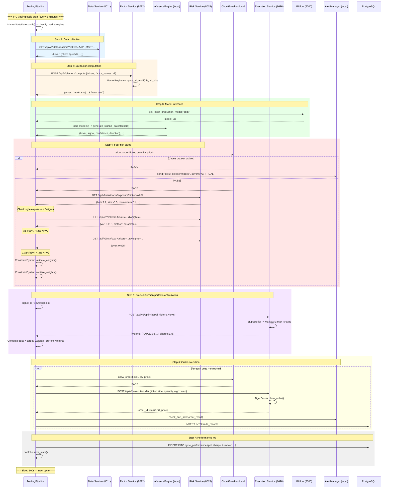
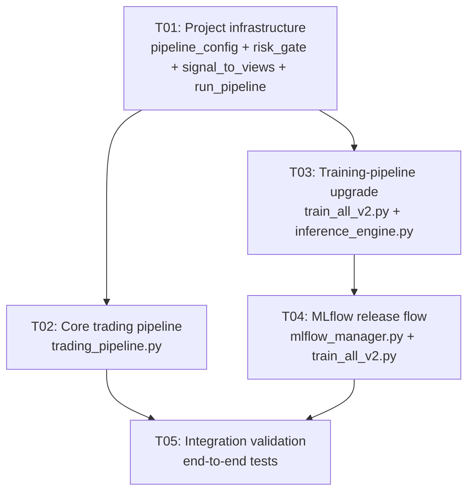

# Quant AI Trader v2 — Improvement Plan Toward Top Quant-Fund Standards

| Item | Content |
|------|------|
| Document version | v1.0 |
| Author | Bob (Architect) |
| Date | 2025-07-18 |
| Status | Design complete, pending implementation |
| Depends on | PRD-v2.md, ARCHITECTURE-v2.md, existing v2 codebase |

---

## Table of Contents

1. [Improvement Methods — Per-Module Plan](#1-improvement-methods--per-module-plan)
2. [File Change List](#2-file-change-list)
3. [Data-Flow Diagram — Mermaid Sequence](#3-data-flow-diagram--mermaid-sequence)
4. [Task List](#4-task-list)
5. [Key Interface Changes](#5-key-interface-changes)

---

## 1. Improvement Methods — Per-Module Plan

### Core principle: minimal change

**Do not change any v2 service internals.** Add only an integration layer plus a small amount of config / scripts.

```
Current                        After
━━━━━━━━━━━━━━━━━━━━━━━━━━━━━━━━━━━━━━━━━━━━━━━━━━━━━━━━
auto_trader.py (v1)    ->    trading_pipeline.py (new; calls v2 services)
backend.ai_models.*     ->    services/model_infer_service/* (existing; unchanged)
backend.data_engine.*   ->    services/data_service/* (existing; unchanged)
9 simple features       ->    FactorEngine 113 factors (existing; unchanged)
No risk controls        ->    RiskService + CircuitBreaker (existing; unchanged)
No optimization         ->    BlackLittermanOptimizer (existing; unchanged)
No model management     ->    MLflowManager (existing; unchanged)
```

---

### 1.1 Live Trading Pipeline Rebuild -> `trading_pipeline.py`

**Problem**: `auto_trader.py` uses v1 `backend.*` modules (`MarketDataEngine`, `TransformerPredictor`, `DataPipeline`, etc.) and is not wired into the v2 six-microservice stack.

**Plan**: Create `trading_pipeline.py` as a thin orchestrator of sequential calls (~200 lines). All core logic is delegated to v2 services.

**Flow**:
```
T+0 trading cycle (every 5 minutes):
Step 0: Market-regime detection (MarketStateDetector, existing)
Step 1: Data collection    -> HTTP GET data-service:8011/api/v2/data/...
Step 2: Factor computation -> HTTP POST factor-service:8012/api/v2/factors/compute (all 113 factors)
Step 3: Model inference    -> model_infer_service InferenceEngine (local call, existing)
Step 4: Risk gates         -> HTTP GET risk-service:8015/api/v2/risk/barra/exposure
                             + HTTP GET risk-service:8015/api/v2/risk/var
                             + HTTP GET risk-service:8015/api/v2/risk/cvar
                             + CircuitBreaker.allow_order() (local call)
Step 5: Portfolio opt      -> HTTP POST execution-service:8016/api/v2/optimizer/bl (Black-Litterman)
Step 6: Order execution    -> HTTP POST execution-service:8016/api/v2/execute/order
Step 7: Performance log    -> local SQLite / PostgreSQL write to record table
```

**Key design decisions**:
- Do not add another microservice — all logic already lives in the six services; `trading_pipeline.py` is HTTP + local-call orchestration only
- Inter-service calls go over local HTTP (Docker internal network); latency < 10 ms
- Risk failure immediately Rejects and does not proceed
- Each step has independent try / catch; a single-step failure does not crash the pipeline

---

### 1.2 Factor-Engineering Integration

**Problem**: `auto_trader.py`'s `DataPipeline.process()` computes only ~30 simple features (`ret_1d`, `ret_5d`, `ret_21d`, `ret_63d`, `volume_ma`, etc.) and does not use FactorEngine's 113 factors.

**Plan**:
1. **Inference**: `trading_pipeline.py` Step 2 calls `POST /api/v2/factors/compute` with the ticker list + all 113 `factor_names` (or default all) and receives a factor DataFrame
2. **Training**: Modify `scripts/train_all_v2.py` to call FactorEngine for the full factor set before training and use factor columns as model features (replacing the original 9 simple features)
3. **`FactorEngine.compute_all_multi()`** already supports batch computation of all factors for multiple tickers; no change required

**Impact**:
- `trading_pipeline.py`: add a factor-computation step
- `scripts/train_all_v2.py`: change feature-construction logic

---

### 1.3 Risk Gates

**Problem**: v1 `RiskManager` only checks simple position-ratio limits; there is no Barra exposure, no VaR / CVaR, and no circuit breaker.

**Plan**: Every order passes four gates:

```
Order -> [1] CircuitBreaker.allow_order()
        |- Daily loss >= 5%? -> REJECT (halt until next day)
        |- Single-order risk > 2%? -> REJECT
        |- In cooldown after 3 consecutive losses? -> REJECT
        |- PASS v
      -> [2] Barra Exposure Check (GET /api/v2/risk/barra/exposure)
        |- Any style-factor exposure > 3-sigma? -> WARN (log, do not block)
        |- PASS v
      -> [3] VaR / CVaR (GET /api/v2/risk/var + /api/v2/risk/cvar)
        |- Portfolio VaR(95%) > 2% NAV? -> REJECT
        |- Portfolio CVaR(95%) > 3% NAV? -> REJECT
        |- PASS v
      -> [4] Portfolio constraints (ConstraintSystem.validate_weights)
        |- Weight breach? -> SANITIZE (waterfill adjustment)
        |- Sector concentration > 35%? -> SANITIZE
        |- Turnover > 30%? -> SANITIZE
        |- PASS -> execute
```

**Implementation**:
- Instantiate CircuitBreaker in `trading_pipeline.py` (local import)
- Barra / VaR / CVaR via HTTP to risk-service
- ConstraintSystem local import (existing `constraints.py`)
- Implement a `RiskGate` utility in new `shared/risk_gate.py` wrapping the four checks

---

### 1.4 Portfolio Optimization Go-Live (Black-Litterman)

**Problem**: v1 places orders directly from signal strength with no portfolio-level optimization. A large academic literature shows unoptimized portfolios are under-diversified.

**Plan**:
1. Convert `InferenceEngine.generate_signals_batch()` output into BL views:
   - signal > 0.3 -> absolute view: ticker expected_return = signal * annual_vol * sqrt(1/252)
   - confidence = model confidence
   - signal < -0.3 -> absolute view: ticker expected_return = signal * annual_vol * sqrt(1/252)
2. Call `BlackLittermanOptimizer.optimize(tickers, views)`
3. Compare optimal weights to current holdings to compute delta (names and quantities to buy / sell)
4. Send the delta to execution

**Interface**:
```python
# Existing POST /api/v2/optimizer/bl
# Request: { tickers: [...], views: [{ticker, return, confidence}, ...] }
# Response: { weights: {AAPL: 0.08, ...}, sharpe_ratio, prior_returns, posterior_returns }
```

**Do not change BlackLittermanOptimizer internals.** Add only a `signal_to_views()` conversion function.

---

### 1.5 Walk-Forward Training Framework

**Problem**: `WalkForwardValidator` is implemented but unused by training scripts; current training fits the entire history in one shot.

**Plan**: Modify `scripts/train_all_v2.py`:
1. Use `WalkForwardValidator.generate_splits(df)` to produce time-series splits
2. For each split: train on train, early-stop on val, evaluate on test
3. Each split produces a model version recorded in MLflow
4. Select the version with the best average validation performance as production

**Core change**:
```python
# Before:
model.fit(X_all, y_all)

# After:
wf = WalkForwardValidator(train_window=252, step_size=90)
for i, split in enumerate(wf.generate_splits(df)):
    model.fit(split["train"])
    val_score = model.evaluate(split["val"])
    mlflow.log_metrics({f"fold_{i}_val_score": val_score})
    if val_score > best_score:
        best_model = model
        mlflow.register_model(run_id, f"gbdt_fold_{i}")
```

---

### 1.6 MLflow Model Management: staging -> production Release

**Problem**: MLflowManager already has `register_model()` and `get_latest_production_model()`, but the staging -> production flow is not automated:
1. Registered models go staging -> production inside `register_model`; there should be a separate review step
2. No model A/B testing
3. Inference does not distinguish staging vs. production

**Plan** (minimal change):
1. Add `promote_to_production(model_name, version)` to `MLflowManager`
2. After training, register to staging; promote manually or automatically by metric threshold
3. `ModelRegistry.get()` already supports staging fallback; no change needed

```python
# After training:
mlflow_mgr.register_model(run_id, "gbdt", stage="staging")

# After review (automatic or manual):
mlflow_mgr.promote_to_production("gbdt", best_version)
```

---

## 2. File Change List

### New Files

| File path | Purpose |
|----------|------|
| `trading_pipeline.py` | **Core**: live trading-pipeline orchestrator, replacing v1 `auto_trader.py` |
| `shared/risk_gate.py` | Risk-gate wrapper: unified entry for the four checks |
| `shared/signal_to_views.py` | Model signal -> Black-Litterman views conversion |
| `configs/pipeline_config.py` | Pipeline config: cycle, thresholds, feature flags |
| `scripts/run_pipeline.py` | Launch script: `python scripts/run_pipeline.py --interval 300` |

### Modified Files

| File path | Change | Size of change |
|----------|----------|--------|
| `scripts/train_all_v2.py` | Wire FactorEngine factors + WalkForwardValidator splits | ~40 lines |
| `services/model_train_service/mlflow_manager.py` | Add `promote_to_production()` | ~20 lines |
| `auto_trader.py` | Add a deprecation comment at the top recommending `trading_pipeline.py` | 1 line |

### Unchanged Files (referenced only)

| Module | How referenced |
|------|----------|
| `services/factor_service/engine/factor_engine.py` | `from services.factor_service.engine.factor_engine import FactorEngine` |
| `services/model_infer_service/inference_engine.py` | `from services.model_infer_service.inference_engine import InferenceEngine` |
| `services/execution_service/optimizer/black_litterman.py` | HTTP POST /api/v2/optimizer/bl |
| `services/risk_service/barra/factor_exposure.py` | HTTP GET /api/v2/risk/barra/exposure |
| `services/risk_service/risk_measures/var.py` | HTTP GET /api/v2/risk/var |
| `services/risk_service/risk_measures/cvar.py` | HTTP GET /api/v2/risk/cvar |
| `services/execution_service/live/circuit_breaker.py` | `from services.execution_service.live.circuit_breaker import CircuitBreaker` |
| `services/execution_service/optimizer/constraints.py` | `from services.execution_service.optimizer.constraints import ConstraintSystem` |
| `services/model_train_service/framework/walk_forward.py` | `from services.model_train_service.framework.walk_forward import WalkForwardValidator` |
| `services/model_train_service/mlflow_manager.py` | `from services.model_train_service.mlflow_manager import MLflowManager` |
| `services/model_infer_service/model_registry.py` | `from services.model_infer_service.model_registry import ModelRegistry` |
| `services/execution_service/live/alert_manager.py` | `from services.execution_service.live.alert_manager import AlertManager` |
| `configs/risk_limits.py` | `from configs.risk_limits import RISK_LIMITS` |

---

## 3. Data-Flow Diagram — Mermaid Sequence

### Improved T+0 End-to-End Trading Path



---

## 4. Task List

### Task Overview

| ID | Task | File count | Priority | Depends |
|----|------|--------|--------|------|
| T01 | Project infrastructure: pipeline config + risk gates + signal conversion | 4 | P0 | — |
| T02 | Core trading pipeline: full `trading_pipeline.py` orchestrator | 2 | P0 | T01 |
| T03 | Training-pipeline upgrade: walk-forward + full factor set | 2 | P0 | T01 |
| T04 | MLflow model release: staging -> production flow | 2 | P0 | T03 |
| T05 | Integration validation + end-to-end tests | 3 | P0 | T02, T04 |

---

### T01: Project Infrastructure

**Goal**: Create all infrastructure files the pipeline needs to run.

**Source files**:
- `configs/pipeline_config.py` — new: pipeline config (cycle, thresholds, risk flags)
- `shared/risk_gate.py` — new: unified entry for the four risk gates
- `shared/signal_to_views.py` — new: model signal -> BL views conversion
- `scripts/run_pipeline.py` — new: launch script

**Depends**: none

**Priority**: P0

**Details**:

`configs/pipeline_config.py` — pipeline config:
```python
@dataclass
class PipelineConfig:
    CYCLE_INTERVAL_SECONDS: int = 300
    TRADING_HOURS_ONLY: bool = True
    MAX_TICKERS_PER_CYCLE: int = 50
    SIGNAL_THRESHOLD: float = 0.3          # signal-strength threshold
    MIN_CONFIDENCE: float = 0.5             # minimum confidence
    VAR_CONFIDENCE: float = 0.95
    VAR_LIMIT_PCT: float = 0.02
    CVAR_LIMIT_PCT: float = 0.03
    BARRA_EXPOSURE_MAX_Z: float = 3.0       # Barra factor-exposure cap (z-score)
    ENABLE_RISK_CHECKS: bool = True
    ENABLE_PORTFOLIO_OPT: bool = True
    ENABLE_ALERTS: bool = True
    MIN_TRADE_VALUE: float = 1000.0
    SERVICE_BASE_URLS: dict = field(default_factory=lambda: {
        "data": "http://data-service:8011",
        "factor": "http://factor-service:8012",
        "risk": "http://risk-service:8015",
        "execution": "http://execution-service:8016",
    })
```

`shared/risk_gate.py` — four risk gates:
```python
class RiskGate:
    """Unified risk entry wrapping the four checks."""
    def __init__(self, circuit_breaker, risk_service_url, constraints):
        ...
    def check(self, ticker, quantity, price, portfolio_state) -> RiskResult:
        """Run the four checks in order; any failure returns REJECT.
        Returns: RiskResult(passed, reason, warnings, sanitized_weights)
        """
```

`shared/signal_to_views.py`:
```python
def signals_to_bl_views(signals: list[dict], prices: dict) -> list[dict]:
    """InferenceEngine output -> Black-Litterman views format.
    Conversion rule: signal > threshold -> absolute view with annualized return estimate
    """
```

`scripts/run_pipeline.py` — launch entry:
```python
# Replaces python auto_trader.py --interval 300
from trading_pipeline import TradingPipeline
pipeline = TradingPipeline()
pipeline.start(interval_seconds=300)
```

---

### T02: Core Trading Pipeline

**Goal**: Implement `trading_pipeline.py` and wire the 7-step trading flow.

**Source files**:
- `trading_pipeline.py` — new: core pipeline orchestrator (~300 lines)
- `auto_trader.py` — modify: add a deprecation warning comment at the top

**Depends**: T01

**Priority**: P0

**Details**:

`trading_pipeline.py` core class structure:
```python
class TradingPipeline:
    """v2 live trading pipeline, replacing v1 auto_trader.py."""
    
    def __init__(self):
        # Local components (direct import)
        self.engine = FactorEngine(); self.engine.register_all()
        self.inference = InferenceEngine(); self.inference.load_models()
        self.circuit_breaker = CircuitBreaker()
        self.risk_gate = RiskGate(self.circuit_breaker, ...)
        self.constraints = ConstraintSystem()
        self.alert_mgr = AlertManager()
        self.portfolio = PortfolioManager(INITIAL_CAPITAL)
        
        # Remote service URLs (from pipeline_config)
        self.data_url = pipeline_config.SERVICE_BASE_URLS["data"]
        self.risk_url = pipeline_config.SERVICE_BASE_URLS["risk"]
        self.exec_url = pipeline_config.SERVICE_BASE_URLS["execution"]
    
    def run_cycle(self):
        """One complete T+0 trading cycle."""
        # Step 0: Market regime
        # Step 1: Data collection (HTTP -> data-service)
        # Step 2: Factor computation (local FactorEngine.compute_all_multi)
        # Step 3: Model inference (local InferenceEngine.generate_signals_batch)
        # Step 4: Risk gates (risk_gate.check + HTTP -> risk-service)
        # Step 5: Portfolio optimization (HTTP -> execution-service /optimizer/bl)
        # Step 6: Order execution (HTTP -> execution-service /execute/order)
        # Step 7: Performance log
```

Why local import of FactorEngine instead of HTTP to factor-service?
- Factor computation needs batch ticker DataFrames; HTTP serialization is expensive
- At deploy time, `trading_pipeline` can share a FactorEngine instance with factor-service
- Training also needs a local FactorEngine call

---

### T03: Training-Pipeline Upgrade

**Goal**: Training scripts use the full 113 factors + walk-forward time splits.

**Source files**:
- `scripts/train_all_v2.py` — modify: wire FactorEngine + WalkForwardValidator
- `services/model_infer_service/inference_engine.py` — modify: `predict_single()` uses factor columns as features (currently only `ret_1d` / `5d` / `21d` / `63d`)

**Depends**: T01

**Priority**: P0

**Details**:

`scripts/train_all_v2.py` change:
```python
# === Before ===
df = load_data(ticker)
features = df[['ret_1d','ret_5d','ret_21d','ret_63d','volume_ma',...]]
model.fit(features, labels)

# === After ===
from services.factor_service.engine.factor_engine import FactorEngine
from services.model_train_service.framework.walk_forward import WalkForwardValidator

engine = FactorEngine()
engine.register_all()

df = load_data(ticker)
df_with_factors = engine.compute_all(df)  # 113 factors

factor_cols = [c for c in df_with_factors.columns if c.startswith('F')]
features = df_with_factors[factor_cols]

wf = WalkForwardValidator(train_window=252, step_size=90)
for split in wf.generate_splits(df_with_factors):
    model.fit(split["train"][factor_cols], split["train"]["target"])
    ...
```

`inference_engine.py` `predict_single()` change (~10 lines):
- Currently uses simple features such as `ret_1d` / `5d` / `21d` / `63d`
- Change to accept a `factor_df` argument and use factor columns as model input
- Backward compatible: if `factor_df` is omitted, fall back to the old behavior

---

### T04: MLflow staging -> production Release Flow

**Goal**: Controlled promotion of models from staging to production.

**Source files**:
- `services/model_train_service/mlflow_manager.py` — modify: add `promote_to_production()` + change `register_model()` default stage to staging
- `scripts/train_all_v2.py` — modify: after training write staging; best fold writes production

**Depends**: T03

**Priority**: P0

**Details**:

`mlflow_manager.py` change:
```python
def register_model(self, run_id, model_name, stage="staging"):
    """Register to staging by default rather than directly to production."""
    ...

def promote_to_production(self, model_name: str, version: int) -> bool:
    """Promote the specified version to production and archive the current production."""
    client = mlflow.tracking.MlflowClient()
    # Archive current production
    current = client.get_latest_versions(f"quant-{model_name}", stages=["production"])
    for v in current:
        client.transition_model_version_stage(
            name=f"quant-{model_name}", version=v.version, stage="archived"
        )
    # Promote new
    client.transition_model_version_stage(
        name=f"quant-{model_name}", version=version, stage="production"
    )
    return True
```

`ModelRegistry.get()` already supports "production first, then staging"; no change needed.

---

### T05: Integration Validation + End-to-End Tests

**Goal**: Validate correctness and robustness of the full pipeline.

**Source files**:
- `tests/test_trading_pipeline.py` — new: pipeline unit tests
- `tests/test_risk_gate.py` — new: risk-gate tests
- `tests/test_signal_to_views.py` — new: signal-conversion tests

**Depends**: T02, T04

**Priority**: P0

**Details**:
- Mock all HTTP service responses and test each step of `TradingPipeline.run_cycle()`
- Test RiskGate four-gate behavior at various boundaries
- Test correctness of signal -> BL views conversion
- End-to-end: run one dry-run cycle on historical data

---

### Task Dependency Graph



---

## 5. Key Interface Changes

### 5.1 New APIs (remote services already exist; only new call patterns)

All remote API endpoints already exist; none need to be added. Only local call wrappers are new.

### 5.2 New Python Interfaces

#### `shared/risk_gate.py`

```python
from dataclasses import dataclass, field
from typing import Any

@dataclass
class RiskResult:
    passed: bool
    gate: str                     # name of the failed gate
    reason: str                   # failure reason
    warnings: list[str] = field(default_factory=list)
    sanitized_weights: dict | None = None

class RiskGate:
    def __init__(
        self,
        circuit_breaker: CircuitBreaker,
        risk_service_url: str,
        constraints: ConstraintSystem,
    ) -> None: ...
    
    def check(
        self,
        ticker: str,
        quantity: int,
        price: float,
        current_weights: dict[str, float],
        target_weights: dict[str, float],
        nav: float,
    ) -> RiskResult: ...
```

#### `shared/signal_to_views.py`

```python
def signals_to_bl_views(
    signals: list[dict[str, Any]],
    prices: dict[str, float],
    signal_threshold: float = 0.3,
    min_confidence: float = 0.5,
) -> list[dict]:
    """Convert InferenceEngine signal batch to Black-Litterman view format.
    
    Args:
        signals: List of {ticker, signal, confidence, direction} from InferenceEngine
        prices: Current prices {ticker: price}
        signal_threshold: Minimum abs(signal) to create a view
        min_confidence: Minimum model confidence to create a view
    
    Returns:
        List of BL view dicts: [{ticker, return, confidence}, ...]
    """
```

#### `configs/pipeline_config.py`

```python
@dataclass
class PipelineConfig:
    CYCLE_INTERVAL_SECONDS: int = 300
    TRADING_HOURS_ONLY: bool = True
    MAX_TICKERS_PER_CYCLE: int = 50
    SIGNAL_THRESHOLD: float = 0.3
    MIN_CONFIDENCE: float = 0.5
    VAR_CONFIDENCE: float = 0.95
    VAR_LIMIT_PCT: float = 0.02
    CVAR_LIMIT_PCT: float = 0.03
    BARRA_EXPOSURE_MAX_Z: float = 3.0
    ENABLE_RISK_CHECKS: bool = True
    ENABLE_PORTFOLIO_OPT: bool = True
    ENABLE_ALERTS: bool = True
    MIN_TRADE_VALUE: float = 1000.0
    ORDER_ALGO: str = "twap"
    SERVICE_BASE_URLS: dict = field(default_factory=lambda: {
        "data": "http://data-service:8011",
        "factor": "http://factor-service:8012",
        "risk": "http://risk-service:8015",
        "execution": "http://execution-service:8016",
    })

pipeline_config = PipelineConfig()
```

#### `trading_pipeline.py` (core class)

```python
class TradingPipeline:
    """v2 live trading-pipeline orchestrator."""
    
    def __init__(self, config: PipelineConfig | None = None) -> None: ...
    def run_cycle(self) -> dict[str, Any]: ...
    def start(self, interval_seconds: int = 300) -> None: ...
    
    # Internal methods (7 steps)
    def _step_detect_market_state(self) -> int: ...
    def _step_fetch_data(self, tickers: list[str]) -> dict: ...
    def _step_compute_factors(self, data: dict) -> dict: ...
    def _step_model_inference(self, tickers: list[str], factor_data: dict) -> list[dict]: ...
    def _step_risk_checks(self, signals: list[dict], target_weights: dict) -> list[dict]: ...
    def _step_portfolio_optimize(self, tickers: list[str], views: list[dict]) -> dict: ...
    def _step_execute_orders(self, trades: list[dict]) -> list[dict]: ...
    def _step_record_performance(self, results: dict) -> None: ...
```

### 5.3 Changes to Existing Interfaces

#### `services/model_train_service/mlflow_manager.py`

```python
class MLflowManager:
    # Change: register_model default stage from production to staging
    def register_model(self, run_id, model_name, stage="staging") -> Optional[int]: ...
    
    # New: controlled release
    def promote_to_production(self, model_name: str, version: int) -> bool: ...
    
    # New: archive current production
    def archive_production(self, model_name: str) -> int: ...
```

#### `services/model_infer_service/inference_engine.py`

```python
class InferenceEngine:
    # Change: predict_single accepts optional factor_df
    def predict_single(self, ticker: str, factor_df: pd.DataFrame | None = None) -> dict: ...
    
    # Change: generate_signal accepts optional factor_df
    def generate_signal(self, ticker: str, factor_df: pd.DataFrame | None = None) -> dict: ...
    
    # Change: generate_signals_batch accepts optional factor_dfs
    def generate_signals_batch(
        self, tickers: list[str], 
        factor_dfs: dict[str, pd.DataFrame] | None = None
    ) -> list[dict]: ...
```

---

## Appendix: Before vs. After

| Dimension | v1 (`auto_trader.py`) | v2 (`trading_pipeline.py`) |
|------|---------------------|--------------------------|
| Architecture | Monolithic script ~450 lines | Orchestrator ~300 lines + 6 microservices |
| Factors | 9 simple features (`ret_1d`–`63d`) | 113 factors (technical / fundamental / alternative / microstructure) |
| Risk | Simple position-ratio check | Four gates: circuit breaker + Barra + VaR / CVaR + portfolio constraints |
| Portfolio opt | None (orders by signal strength) | Black-Litterman -> Markowitz max Sharpe |
| Model training | One-shot fit on full history | Walk-forward time splits; look-ahead-bias prevention |
| Model management | Local pickle files | MLflow staging -> production release |
| Backtest | Standalone script | Event-driven backtest engine (existing) |
| Execution algos | Market orders | TWAP / VWAP / POV algo routing |

---

> **End of document** — All design is based on the existing codebase under the minimal-change principle. The v2 service code corresponding to each improvement module is already implemented and tested; this document describes the integration plan only.
