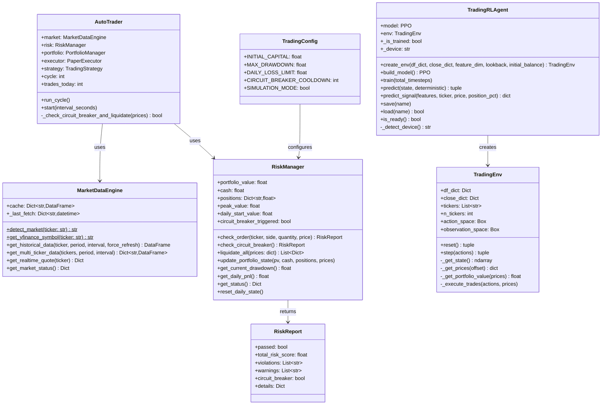
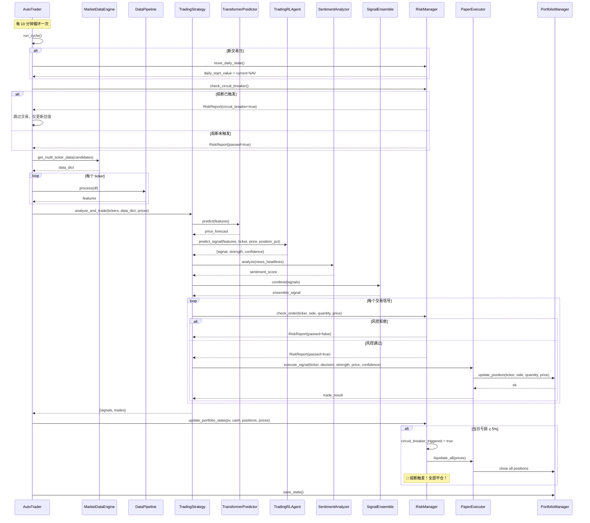
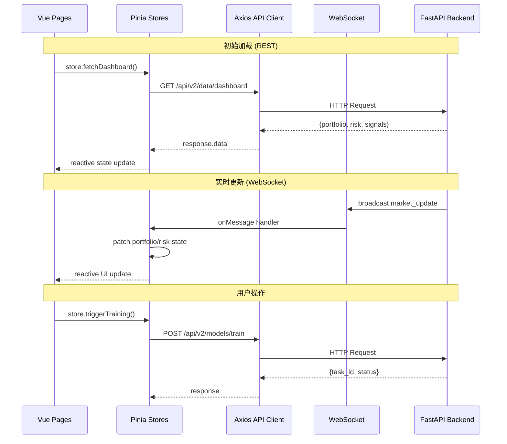
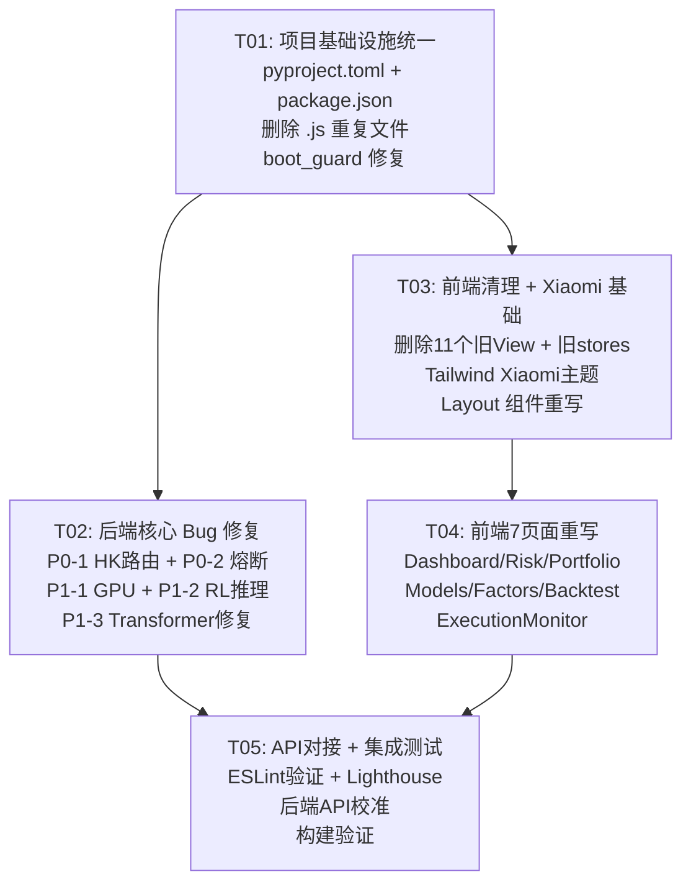

# System Architecture Design — Quant AI Trader v2.1

**Author**: Bob (Architect)  
**Date**: 2025-06-08  
**Based on**: PRD v2.1 by Alice (Product Manager)

---

## Part A: System Design

### 1. Implementation Approach

#### 1.1 核心技术挑战

| # | 挑战 | 分析 | 解决策略 |
|---|------|------|---------|
| C1 | 港股数据路由 | 纯数字代码(00700)未被 yfinance 识别为港股，缺少 `.HK` 后缀自动补全 | `get_yfinance_symbol()` 增加自动后缀检测 |
| C2 | 组合级熔断 | 当前风控仅拒绝单笔开仓，未触发组合级平仓 | 新增 `check_circuit_breaker()` 方法 + `liquidate_all()` |
| C3 | RL GPU 检测 | `device="cpu"` 硬编码 | 改为 `torch.cuda.is_available()` / MPS 自动检测 |
| C4 | predict_signal 不稳定 | 虚拟 ticker 噪声构造依赖启发式 | 重构为单股票专用推理路径，不再复制多 ticker |
| C5 | Transformer 训练崩溃 | numpy/pandas 版本兼容性 | 升级依赖 + 增加 NaN/inf 防护 |
| C6 | 前端小米风格 | 需要完整的 Tailwind 主题系统 | 扩展 tailwind.config.ts，自建组件，不引入重型UI库 |
| C7 | 三重依赖配置 | requirements.txt × 2 + pyproject.toml | 统一为 pyproject.toml |

#### 1.2 框架与库选型（不改技术栈，仅优化）

**前端** (保持不变):
- Vite ^5.1 → `vite.config.ts`（合并 .js 中的 WS proxy + .ts 中的 alias/build 配置）
- Vue 3.4 + Composition API + `<script setup lang="ts">`
- Pinia（状态管理）
- Vue Router 4（SPA 路由）
- ECharts 5 + vue-echarts（图表）
- Tailwind CSS 3.4（自定义小米主题）
- TypeScript 5.4

**后端** (保持不变):
- FastAPI 0.110+ (REST + WebSocket)
- PyTorch 2.2+ (Transformer/PatchTST)
- Stable-Baselines3 2.0+ (PPO RL)
- Transformers (FinBERT 情感分析)
- yfinance (美股/港股数据)
- TigerOpen (老虎证券实盘)

#### 1.3 架构模式

```
┌─────────────────────────────────────────────────────┐
│                   Frontend (Vite :5180)              │
│  main.ts → App.vue → AppLayout → RouterView         │
│  ┌──────────┐  ┌──────────────────────────────────┐ │
│  │ Sidebar  │  │  Pages (7 views, Xiaomi theme)   │ │
│  │ 240px    │  │  Dashboard / Risk / Portfolio ... │ │
│  └──────────┘  └──────────────────────────────────┘ │
└──────────────────────┬──────────────────────────────┘
                       │ HTTP REST + WebSocket
┌──────────────────────┴──────────────────────────────┐
│               Backend (FastAPI :8001)                │
│  ┌─────────┐ ┌──────────┐ ┌──────────────────────┐ │
│  │ API     │ │ WebSocket│ │ Static File Serving   │ │
│  │ Routes  │ │ /ws      │ │ (frontend/dist/)      │ │
│  └────┬────┘ └────┬─────┘ └──────────────────────┘ │
│       │           │                                  │
│  ┌────┴───────────┴──────────────────────────────┐  │
│  │              Service Layer                      │  │
│  │  ┌──────────┐ ┌──────────┐ ┌───────────────┐  │  │
│  │  │AI Models │ │Trading   │ │Data Engine     │  │  │
│  │  │Predictor │ │Strategy  │ │MarketData      │  │  │
│  │  │RL Agent  │ │Risk Mgr  │ │DataPipeline    │  │  │
│  │  │Sentiment │ │Portfolio │ │TigerClient     │  │  │
│  │  │Ensemble  │ │Executor  │ │StockUniverse   │  │  │
│  │  └──────────┘ └──────────┘ └───────────────┘  │  │
│  └────────────────────────────────────────────────┘  │
└──────────────────────┬──────────────────────────────┘
                       │
┌──────────────────────┴──────────────────────────────┐
│              Auto Trader (独立进程)                   │
│  auto_trader.py: 定时循环 → 信号生成 → 风控 → 下单   │
└─────────────────────────────────────────────────────┘
```

**关键设计决策**:
- **前端**: 全量重写 7 页面，统一 Xiaomi 风格，删除所有旧 View 和 .js 文件
- **后端**: 保持单体 backend/ 架构（P2 架构统一延后），仅修 bug + 增强风控
- **配置**: 统一为 `pyproject.toml`，删除 `requirements.txt` 和 `backend/requirements.txt`

---

### 2. File List

#### 2.1 需创建的文件

```text
frontend/src/assets/styles/xiaomi.css          ← Xiaomi 设计系统基础样式
frontend/src/components/ui/XmButton.vue         ← 小米风格按钮组件
frontend/src/components/ui/XmCard.vue           ← 小米风格卡片组件
frontend/src/components/ui/XmBadge.vue          ← 状态徽章组件
frontend/src/components/ui/XmSparkline.vue      ← 迷你趋势图组件
frontend/src/components/ui/XmGauge.vue          ← 仪表盘组件 (风险仪表)
frontend/src/components/ui/XmStatusDot.vue      ← 状态指示灯
docs/system_design.md                           ← 本文档
docs/sequence-diagram.mermaid                   ← 时序图
docs/class-diagram.mermaid                      ← 类图
```

#### 2.2 需修改的文件

```text
# === 后端 Bug 修复 ===
backend/data_engine/market_data.py              ← P0-1: HK 后缀自动补全
backend/trading_engine/risk_manager.py          ← P0-2: 组合级熔断机制
backend/ai_models/rl_agent.py                   ← P1-1: GPU 自动检测 + P1-2: predict_signal 重构
backend/ai_models/trainer.py                    ← P1-3: Transformer 训练崩溃修复
backend/config.py                               ← 新增 DAILY_LOSS_LIMIT / CIRCUIT_BREAKER 配置
auto_trader.py                                  ← P0-2: 熔断检查集成到交易循环

# === 前端重构 ===
frontend/package.json                           ← P0-4: 添加 eslint 依赖
frontend/vite.config.ts                         ← 合并 .js 的 WS proxy + port 5180
frontend/tailwind.config.ts                     ← Xiaomi 色板 + 动画配置
frontend/index.html                             ← 字体引入 (Inter)
frontend/tsconfig.json                          ← 路径别名确认
frontend/src/main.ts                            ← 引入 xiaomi.css
frontend/src/App.vue                            ← 确认使用 AppLayout
frontend/src/router/index.ts                    ← 确认 7 路由，移除 NotFoundView
frontend/src/assets/styles/main.css             ← 小米风格全局样式
frontend/src/api/index.ts                       ← baseURL 改为 /api (vite proxy)
frontend/src/stores/usePortfolioStore.ts        ← 对接新 API
frontend/src/stores/useRiskStore.ts             ← 增加熔断状态字段
frontend/src/stores/useModelStore.ts            ← 增加训练状态字段
frontend/src/components/layout/AppLayout.vue     ← Xiaomi 240px sidebar 布局
frontend/src/components/layout/AppSidebar.vue    ← Xiaomi 导航菜单
frontend/src/components/layout/AppHeader.vue     ← Xiaomi 顶栏

# === 前端页面重写 (7 pages) ===
frontend/src/views/Dashboard.vue                ← 重写：KPI 卡片 + sparklines
frontend/src/views/FactorResearch.vue           ← 重写：因子表格 + IC 图表
frontend/src/views/ModelCenter.vue              ← 重写：模型训练进度 + PnL 归因
frontend/src/views/RiskDashboard.vue            ← 重写：熔断指示器 + VaR 仪表盘
frontend/src/views/PortfolioOptimizer.vue       ← 重写：持仓列表 + 颜色编码
frontend/src/views/BacktestAnalysis.vue         ← 重写：回测曲线 + 绩效指标
frontend/src/views/ExecutionMonitor.vue         ← 重写：交易日志时间线

# === 前端子组件重写 ===
frontend/src/components/dashboard/AccountSummary.vue   ← KPI 卡片
frontend/src/components/dashboard/MarketStatusBar.vue   ← 市场状态栏
frontend/src/components/risk/CircuitBreakerStatus.vue   ← 熔断状态组件 (P0-2)
frontend/src/components/model/ModelStatusCard.vue       ← 模型状态卡片
frontend/src/components/execution/OrderSliceProgress.vue ← 订单进度

# === 守护进程 ===
boot_guard.bat                                  ← P1-4: 增强重启逻辑
boot_start.bat                                  ← 端口号确认

# === 依赖统一 ===
pyproject.toml                                  ← P1-5: 合并所有 Python 依赖
```

#### 2.3 需删除的文件

```text
# P0-3: 前端 JS/TS 残留
frontend/src/main.js                            ← 删除（仅保留 main.ts）
frontend/src/router/index.js                    ← 删除（仅保留 index.ts）
frontend/vite.config.js                         ← 删除（仅保留 vite.config.ts）

# P1-6: 旧 View 清理（11个文件）
frontend/src/views/Portfolio.vue                ← 删除
frontend/src/views/Strategy.vue                 ← 删除
frontend/src/views/Backtest.vue                 ← 删除
frontend/src/views/DashboardView.vue            ← 删除
frontend/src/views/FactorView.vue               ← 删除
frontend/src/views/RiskView.vue                 ← 删除
frontend/src/views/ModelView.vue                ← 删除
frontend/src/views/ExecutionView.vue            ← 删除
frontend/src/views/PortfolioView.vue            ← 删除
frontend/src/views/NotFoundView.vue             ← 删除
frontend/src/views/BacktestView.vue             ← 删除

# 旧 JS stores
frontend/src/stores/portfolio.js                ← 删除（已有 TS 版本）
frontend/src/stores/market.js                   ← 删除（已有 TS 版本）

# P1-5: 冗余依赖文件
requirements.txt                                ← 删除（统一为 pyproject.toml）
backend/requirements.txt                        ← 删除（统一为 pyproject.toml）

# 旧组件（精简）
frontend/src/components/SignalCard.vue          ← 删除（未使用）
frontend/src/components/SignalPanel.vue         ← 删除（未使用）
frontend/src/components/SignalTrendChart.vue    ← 保留（在 Dashboard 中使用）
```

---

### 3. Data Structures and Interfaces

#### 3.1 后端核心类图



#### 3.2 关键函数签名变更

**P0-1: market_data.py — 港股后缀自动补全**

```python
# MarketDataEngine 新增方法
@staticmethod
def normalize_ticker(ticker: str) -> str:
    """
    自动补全港股后缀。纯数字且不以 .HK/.SI/.AX/.NZ 结尾 → 添加 .HK
    同时处理 00700 → 0700.HK 的映射
    """
    ...

# get_yfinance_symbol 修改
@staticmethod
def get_yfinance_symbol(ticker: str) -> str:
    """确保 yfinance 可识别：自动补全 .HK 后缀"""
    return MarketDataEngine.normalize_ticker(ticker)
```

**P0-2: risk_manager.py — 组合级熔断**

```python
class RiskManager:
    # 新增属性
    daily_start_value: float = 0.0
    circuit_breaker_triggered: bool = False
    circuit_breaker_time: Optional[datetime] = None

    def check_circuit_breaker(self) -> RiskReport:
        """
        组合级熔断检查（每个交易循环调用）：
        1. 当日亏损 ≥ DAILY_LOSS_LIMIT (5%) → 触发熔断
        2. 回撤 ≥ MAX_DRAWDOWN → 触发熔断
        返回 RiskReport，标记 circuit_breaker=True
        """

    def liquidate_all(self, prices: Dict[str, float]) -> List[Dict]:
        """
        熔断后平仓所有持仓。
        返回平仓交易记录列表。
        """

    def reset_daily_state(self):
        """新交易日重置熔断状态和当日起始净值"""
```

**P1-1: rl_agent.py — GPU 自动检测**

```python
class TradingRLAgent:
    @staticmethod
    def _detect_device() -> str:
        """自动检测可用设备: cuda > mps > cpu"""
        ...

    def build_model(self):
        # L124: device=self._detect_device() 替代 device="cpu"
        ...

    def load(self, name="ppo_trader.zip"):
        # L153: device=self._detect_device() 替代 device="auto"
        ...
```

**P1-2: rl_agent.py — predict_signal 重构**

```python
def predict_signal(
    self,
    features: np.ndarray,  # (seq_len, n_features)
    ticker: str = "",
    price: float = 0.0,
    position_pct: float = 0.0,
) -> dict:
    """
    单股票信号推理（重构版）。
    不再构造虚拟多 ticker 状态，改用降维投影：
    - 用 PCA/均值投影将 (n_features) 映射到单股票观测空间
    - 维度假定：obs_shape = n_tickers * feat_dim + n_tickers + 1
    - 新方法：取特征均值填充非首 ticker 位置，消除随机噪声
    """
```

**P1-3: trainer.py — Transformer 训练修复**

```python
def _train_transformer(self, processed_dict, tickers, min_length):
    # 增强 NaN/inf 防护
    X = np.nan_to_num(X, nan=0.0, posinf=1.0, neginf=-1.0)
    y = np.nan_to_num(y, nan=0.0, posinf=1.0, neginf=-1.0)
    # 显式转换为 float32 避免 numpy 属性错误
    X = X.astype(np.float32)
    y = y.astype(np.float32)
```

---

### 4. Program Call Flow

#### 4.1 主循环：训练 → 信号 → 交易 → 风控



#### 4.2 前端数据流



---

### 5. Anything UNCLEAR

| # | 事项 | 假设 |
|---|------|------|
| Q1 | 实盘启动策略 | 按 PRD 建议：先模拟盘验证 1 周，确认 P0 修复后充值 $50K 启动实盘。当前代码保持 SIMULATION_MODE=True |
| Q2 | Tiger API 熔断联动 | 假设 Tiger API 支持市价单批量平仓。若不支持，降级为逐个限价单平仓 |
| Q3 | 前端 WebSocket 重连 | 假设使用简单的指数退避重连策略，不引入专门的重连库 |
| Q4 | 港股后缀映射 | 00700 → 0700.HK 的映射表已在 config.py ALL_TICKERS 中。其他纯数字港股同理处理 |
| Q5 | 训练数据 | 当前仅用美股 S&P 500 训练。港股加入训练延后到 P2 |

---

## Part B: Task Decomposition

### 6. Required Packages

#### 6.1 需新增的前端包

```
- eslint@^8.57.0: JS/TS/Vue linting (P0-4 修复)
- @typescript-eslint/parser@^7.0.0: TS parser for ESLint
- @typescript-eslint/eslint-plugin@^7.0.0: TS rules for ESLint
- eslint-plugin-vue@^9.22.0: Vue linting rules
```

#### 6.2 需统一到 pyproject.toml 的后端包

以下包存在于 `requirements.txt` 或 `backend/requirements.txt` 但不在 `pyproject.toml` 中，需要合并：

```
- stable-baselines3>=2.2.0    ← 在 requirements.txt，不在 pyproject.toml
- gymnasium>=0.29.0           ← 同上
- transformers>=4.30.0        ← 在 backend/requirements.txt，不在 pyproject.toml
- websockets>=12.0            ← 同上
- schedule>=1.2.0             ← 在 requirements.txt，不在 pyproject.toml
- psutil>=5.9.0               ← 同上
```

#### 6.3 需删除的依赖（不再使用）

```
- flask, flask-cors           ← 不再使用，移除
- baostock, akshare           ← 不再使用，移除
- backtrader                  ← 不再使用（自建回测引擎）
- ta-lib                      ← 不再使用
```

---

### 7. Task List (ordered by dependency)

#### T01: 项目基础设施统一

| Field | Value |
|-------|-------|
| **Task ID** | T01 |
| **Task Name** | 项目基础设施统一（配置 + 依赖 + 入口文件清理） |
| **Priority** | P0 |
| **Dependencies** | 无 |

**包含文件**:

| 操作 | 文件 | 说明 |
|------|------|------|
| 修改 | `pyproject.toml` | 合并 requirements.txt 和 backend/requirements.txt 的所有实际使用依赖；移除 flask/baostock/akshare/backtrader/ta-lib |
| 修改 | `frontend/package.json` | P0-4: 添加 eslint + @typescript-eslint/parser + eslint-plugin-vue；更新 scripts |
| 删除 | `requirements.txt` | P1-5: 统一到 pyproject.toml |
| 删除 | `backend/requirements.txt` | P1-5: 统一到 pyproject.toml |
| 删除 | `frontend/src/main.js` | P0-3: 仅保留 main.ts |
| 删除 | `frontend/src/router/index.js` | P0-3: 仅保留 index.ts |
| 删除 | `frontend/vite.config.js` | P0-3: 仅保留 vite.config.ts |
| 修改 | `frontend/vite.config.ts` | 合并 .js 中的 WS proxy (`/ws` → `ws://localhost:8001`) 和 port 5180 |
| 修改 | `frontend/tsconfig.json` | 确认路径别名 `@/*` → `src/*` |
| 修改 | `boot_guard.bat` | P1-4: 增强重启逻辑，添加重试计数、最大重试限制、健康检查超时；使用 `tasklist` 替代 `wmic` |
| 修改 | `boot_start.bat` | 确认端口号 5180，添加前端 dev server 端口一致性 |

#### T02: 后端核心 Bug 修复（P0 + P1 后端）

| Field | Value |
|-------|-------|
| **Task ID** | T02 |
| **Task Name** | 后端核心 Bug 修复（港股路由 / 熔断机制 / RL GPU / Transformer 修复） |
| **Priority** | P0 |
| **Dependencies** | T01 |

**包含文件**:

| 操作 | 文件 | 说明 |
|------|------|------|
| 修改 | `backend/data_engine/market_data.py` | P0-1: 新增 `normalize_ticker()` + 修改 `get_yfinance_symbol()` 自动补全 .HK |
| 修改 | `backend/trading_engine/risk_manager.py` | P0-2: 新增 `check_circuit_breaker()`, `liquidate_all()`, `reset_daily_state()`；新增 `daily_start_value`, `circuit_breaker_triggered` 属性 |
| 修改 | `backend/ai_models/rl_agent.py` | P1-1: 新增 `_detect_device()`，`build_model()` L124 和 `load()` L153 改用自动检测；P1-2: 重构 `predict_signal()` 使用均值投影替代随机噪声 |
| 修改 | `backend/ai_models/trainer.py` | P1-3: `_train_transformer()` 增加 `np.nan_to_num()` + `astype(np.float32)` 显式转换 |
| 修改 | `backend/config.py` | 新增 `DAILY_LOSS_LIMIT = 0.05` 和 `CIRCUIT_BREAKER_COOLDOWN = 900` 到 `TradingConfig` |
| 修改 | `auto_trader.py` | P0-2: 在 `run_cycle()` 中集成 `check_circuit_breaker()` + `liquidate_all()` 调用 |

#### T03: 前端清理 + Xiaomi 设计系统基础

| Field | Value |
|-------|-------|
| **Task ID** | T03 |
| **Task Name** | 前端文件清理 + Xiaomi 设计系统 Tailwind 主题 + 布局组件重写 |
| **Priority** | P0 |
| **Dependencies** | T01 |

**包含文件**:

| 操作 | 文件 | 说明 |
|------|------|------|
| 删除 | `frontend/src/views/Portfolio.vue` | P1-6: 旧 View 清理 |
| 删除 | `frontend/src/views/Strategy.vue` | P1-6: 旧 View 清理 |
| 删除 | `frontend/src/views/Backtest.vue` | P1-6: 旧 View 清理 |
| 删除 | `frontend/src/views/DashboardView.vue` | P1-6: 旧 View 清理 |
| 删除 | `frontend/src/views/FactorView.vue` | P1-6: 旧 View 清理 |
| 删除 | `frontend/src/views/RiskView.vue` | P1-6: 旧 View 清理 |
| 删除 | `frontend/src/views/ModelView.vue` | P1-6: 旧 View 清理 |
| 删除 | `frontend/src/views/ExecutionView.vue` | P1-6: 旧 View 清理 |
| 删除 | `frontend/src/views/PortfolioView.vue` | P1-6: 旧 View 清理 |
| 删除 | `frontend/src/views/NotFoundView.vue` | P1-6: 旧 View 清理 |
| 删除 | `frontend/src/views/BacktestView.vue` | P1-6: 旧 View 清理 |
| 删除 | `frontend/src/stores/portfolio.js` | 旧 JS store 清理 |
| 删除 | `frontend/src/stores/market.js` | 旧 JS store 清理 |
| 删除 | `frontend/src/components/SignalCard.vue` | 未使用组件 |
| 删除 | `frontend/src/components/SignalPanel.vue` | 未使用组件 |
| 修改 | `frontend/tailwind.config.ts` | Xiaomi 色板 (#FF6700, #FAFAFA, #1A1A1A, #666666, #F5F5F5, #EEEEEE, #E0E0E0)；字体 Inter + system-ui；动画 cubic-bezier(0.4,0,0.2,1) |
| 创建 | `frontend/src/assets/styles/xiaomi.css` | Xiaomi 设计系统 CSS 变量、按钮/卡片/表格基础类 |
| 修改 | `frontend/src/assets/styles/main.css` | 引入 xiaomi.css；全局 body/html 样式 |
| 修改 | `frontend/src/main.ts` | 引入 xiaomi.css；确认 tailwind 入口 |
| 修改 | `frontend/index.html` | 引入 Inter 字体 CDN |
| 修改 | `frontend/src/components/layout/AppLayout.vue` | 240px 左侧栏 + 主内容区布局；小米风格 |
| 修改 | `frontend/src/components/layout/AppSidebar.vue` | Logo + 7 导航项 (Dashboard/Factors/Models/Risk/Portfolio/Backtest/Execution)；小米橙高亮 |
| 修改 | `frontend/src/components/layout/AppHeader.vue` | 简洁顶栏：系统状态 + 当前时间 |
| 创建 | `frontend/src/components/ui/XmCard.vue` | 通用卡片组件 |
| 创建 | `frontend/src/components/ui/XmBadge.vue` | 状态徽章 (success/warning/danger) |
| 创建 | `frontend/src/components/ui/XmStatusDot.vue` | 绿/黄/红状态指示灯 |

#### T04: 前端 7 页面 Xiaomi 风格重写

| Field | Value |
|-------|-------|
| **Task ID** | T04 |
| **Task Name** | 前端 7 页面 Xiaomi 风格全量重写 |
| **Priority** | P1 |
| **Dependencies** | T03 |

**包含文件**:

| 操作 | 文件 | 说明 |
|------|------|------|
| 重写 | `frontend/src/views/Dashboard.vue` | KPI 卡片行 (NAV/日盈亏/回撤/夏普比率) + sparkline 迷你趋势图；使用 XmCard + XmSparkline |
| 重写 | `frontend/src/views/FactorResearch.vue` | 因子数据表格 + IC 排名柱状图 + 因子相关性热力图 |
| 重写 | `frontend/src/views/ModelCenter.vue` | 模型训练进度条 (小米橙) + 各模型 PnL 归因瀑布图 + 训练触发按钮 |
| 重写 | `frontend/src/views/RiskDashboard.vue` | P0-2 熔断状态指示器 (绿/黄/红三态) + 实时回撤仪表盘 + VaR 数值卡片 |
| 重写 | `frontend/src/views/PortfolioOptimizer.vue` | 持仓列表 (涨绿跌红，小米灰调) + 有效前沿散点图 |
| 重写 | `frontend/src/views/BacktestAnalysis.vue` | 回测净值曲线 + 年度收益柱状图 + 绩效指标表 |
| 重写 | `frontend/src/views/ExecutionMonitor.vue` | 交易日志时间线 + 实时订单状态卡片 |
| 修改 | `frontend/src/router/index.ts` | 确认 7 路由映射正确 (移除 NotFoundView 引用) |
| 修改 | `frontend/src/stores/useRiskStore.ts` | 增加 `circuitBreakerTriggered`, `dailyPnl`, `dailyPnlPct` 状态字段 |
| 修改 | `frontend/src/stores/usePortfolioStore.ts` | 增加 `positionsWithColors` getter (涨绿跌红) |
| 修改 | `frontend/src/stores/useModelStore.ts` | 增加 `trainingProgress`, `trainingEpoch` 状态字段 |
| 创建 | `frontend/src/components/ui/XmSparkline.vue` | ECharts 迷你趋势图 |
| 创建 | `frontend/src/components/ui/XmGauge.vue` | ECharts 仪表盘 (用于风险指示) |
| 修改 | `frontend/src/components/dashboard/AccountSummary.vue` | 重构为 Xiaomi 风格 KPI 卡片 |
| 修改 | `frontend/src/components/risk/CircuitBreakerStatus.vue` | P0-2: 熔断状态指示器组件 |

#### T05: API 对接 + 集成测试 + 最终验证

| Field | Value |
|-------|-------|
| **Task ID** | T05 |
| **Task Name** | API 对接校准 + 集成测试 + Lighthouse 验证 |
| **Priority** | P1 |
| **Dependencies** | T02, T04 |

**包含文件**:

| 操作 | 文件 | 说明 |
|------|------|------|
| 修改 | `frontend/src/api/index.ts` | baseURL 改为 `/api` (利用 vite proxy)；确认 API key 注入 |
| 修改 | `frontend/src/api/dataApi.ts` | 确认 /api/v2/data/* 端点对齐后端 |
| 修改 | `frontend/src/api/riskApi.ts` | 新增熔断状态 API 调用 |
| 修改 | `frontend/src/api/modelApi.ts` | 新增训练触发 API |
| 修改 | `backend/main.py` | 确认 CORS origins 包含 localhost:5180；确认 /api/push/cycle-data 端点正常 |
| 修改 | `frontend/src/stores/usePortfolioStore.ts` | 对接实际 API 响应格式 |
| 修改 | `frontend/src/stores/useExecutionStore.ts` | 对接实际交易数据 |
| 新建 | `frontend/.eslintrc.cjs` | ESLint 配置 (Vue3 + TS) |
| 验证 | `frontend/` | `npm run lint` 通过 (P0-4)；`npm run build` 无错误 |
| 验证 | `frontend/` | Lighthouse 性能审计 ≥ 90 |
| 验证 | `backend/` | `python -c "from backend.data_engine.market_data import MarketDataEngine; print(MarketDataEngine.normalize_ticker('00700'))"` 输出 `0700.HK` |

---

### 8. Shared Knowledge

```yaml
# ── API 约定 ──────────────────────────────────
api_response_format:
  success: {code: 0, data: ..., message: "ok"}
  error: {code: number, data: null, message: "error description"}

api_base_path:
  frontend_dev: /api  (vite proxy → localhost:8001)
  frontend_prod: /api/v2  (same-origin)

# ── 小米设计系统 Tailwind 扩展 ──────────────────
xiaomi_colors:
  primary: "#FF6700"       # 小米橙 — CTA 按钮、关键指标、选中态
  primary_hover: "#E55A00"
  primary_light: "#FFF0E6"
  bg_page: "#FAFAFA"       # 页面背景
  bg_card: "#FFFFFF"       # 卡片背景
  bg_surface: "#F5F5F5"    # 次级背景
  border_default: "#E0E0E0"
  border_light: "#EEEEEE"
  text_primary: "#1A1A1A"
  text_secondary: "#666666"
  text_tertiary: "#999999"
  profit: "#16A34A"        # 涨 (小米调低饱和度)
  profit_bg: "#F0FDF4"
  loss: "#DC2626"          # 跌 (小米调低饱和度)
  loss_bg: "#FEF2F2"
  risk_green: "#22C55E"    # 熔断安全
  risk_yellow: "#EAB308"   # 熔断警告
  risk_red: "#EF4444"      # 熔断触发

xiaomi_typography:
  font_sans: "Inter, system-ui, -apple-system, 'PingFang SC', 'Microsoft YaHei', sans-serif"
  font_mono: "'JetBrains Mono', 'Fira Code', monospace"
  font_size: {xs: "0.75rem", sm: "0.8125rem", base: "0.9375rem", lg: "1.0625rem", xl: "1.25rem", 2xl: "1.5rem", 3xl: "1.875rem"}

xiaomi_animation:
  default_easing: "cubic-bezier(0.4, 0, 0.2, 1)"
  default_duration: "200ms"
  page_transition: "cubic-bezier(0.4, 0, 0.2, 1) 300ms"

# ── 代码约定 ──────────────────────────────────
naming:
  python: snake_case (files, functions, variables)
  typescript: camelCase (functions, variables), PascalCase (components, types), kebab-case (files)
  vue_components: PascalCase in template, kebab-case.vue files
  stores: use[Name]Store.ts

imports:
  frontend: use '@/' path alias for src/
  backend: relative imports within backend/, absolute from project root for cross-module

# ── 风控约定 ──────────────────────────────────
risk_constants:
  daily_loss_limit: 0.05       # 5% 单日亏损 → 熔断
  max_drawdown: 0.25           # 25% 最大回撤
  circuit_breaker_cooldown: 900 # 15 分钟冷却期
  stop_loss: 0.05              # 5% 个股止损

# ── 数据约定 ──────────────────────────────────
data:
  dates_iso8601_utc: true
  hk_ticker_format: "NNNN.HK"  # 港股 yfinance 格式
  feature_columns: 63          # DataPipeline.FEATURE_COLUMNS

# ── 前端页面列表 (7 pages) ──────────────────
routes:
  - {path: "/", name: "Dashboard", file: "Dashboard.vue"}
  - {path: "/factors", name: "FactorResearch", file: "FactorResearch.vue"}
  - {path: "/models", name: "ModelCenter", file: "ModelCenter.vue"}
  - {path: "/risk", name: "RiskDashboard", file: "RiskDashboard.vue"}
  - {path: "/portfolio", name: "PortfolioOptimizer", file: "PortfolioOptimizer.vue"}
  - {path: "/backtest", name: "BacktestAnalysis", file: "BacktestAnalysis.vue"}
  - {path: "/execution", name: "ExecutionMonitor", file: "ExecutionMonitor.vue"}
```

---

### 9. Task Dependency Graph



---

## Appendix: 关键 Issue → 文件映射速查表

| PRD ID | 描述 | 修改文件 | Task |
|--------|------|---------|------|
| P0-1 | 港股数据路由错误 | `backend/data_engine/market_data.py` | T02 |
| P0-2 | 投资组合无熔断机制 | `backend/trading_engine/risk_manager.py`, `backend/config.py`, `auto_trader.py` | T02 |
| P0-3 | 前端 JS/TS 迁移残留 | 删除 `main.js`, `router/index.js`, `vite.config.js` | T01 |
| P0-4 | eslint 依赖缺失 | `frontend/package.json` | T01 |
| P1-1 | RL PPO 强制 CPU | `backend/ai_models/rl_agent.py` | T02 |
| P1-2 | RL predict_signal 不稳定 | `backend/ai_models/rl_agent.py` | T02 |
| P1-3 | Transformer 训练崩溃 | `backend/ai_models/trainer.py` | T02 |
| P1-4 | 守护进程稳定性 | `boot_guard.bat` | T01 |
| P1-5 | 三重依赖配置统一 | `pyproject.toml`, 删除 `requirements.txt` × 2 | T01 |
| P1-6 | Views 双版本清理 | 删除 11 个旧 View + 2 个旧 store | T03 |
