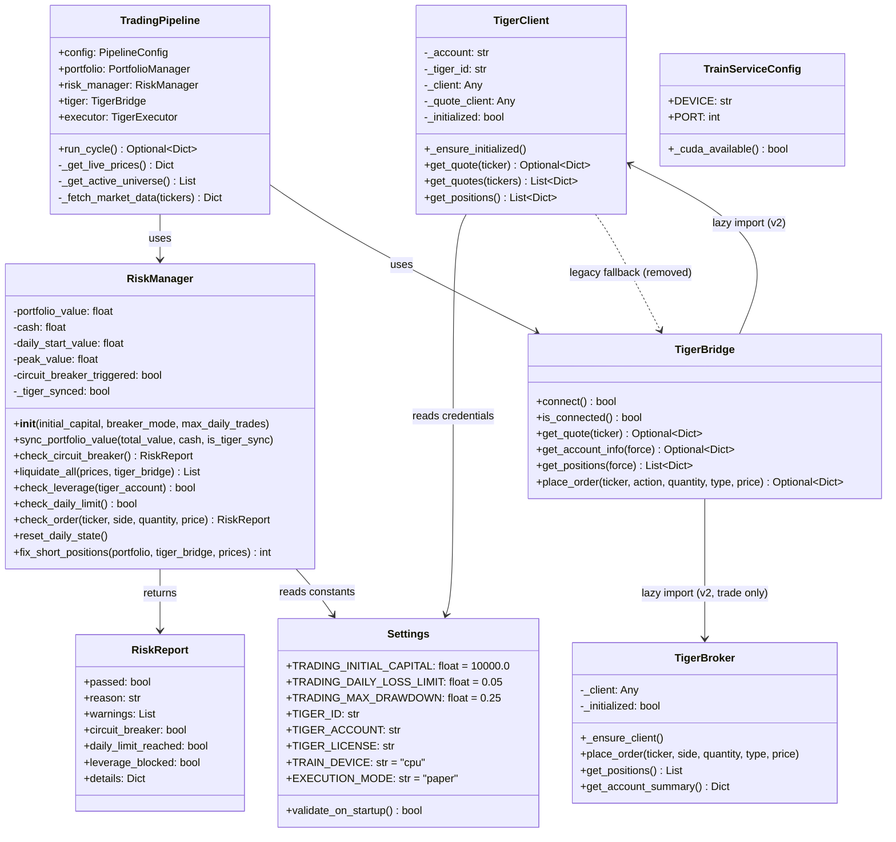
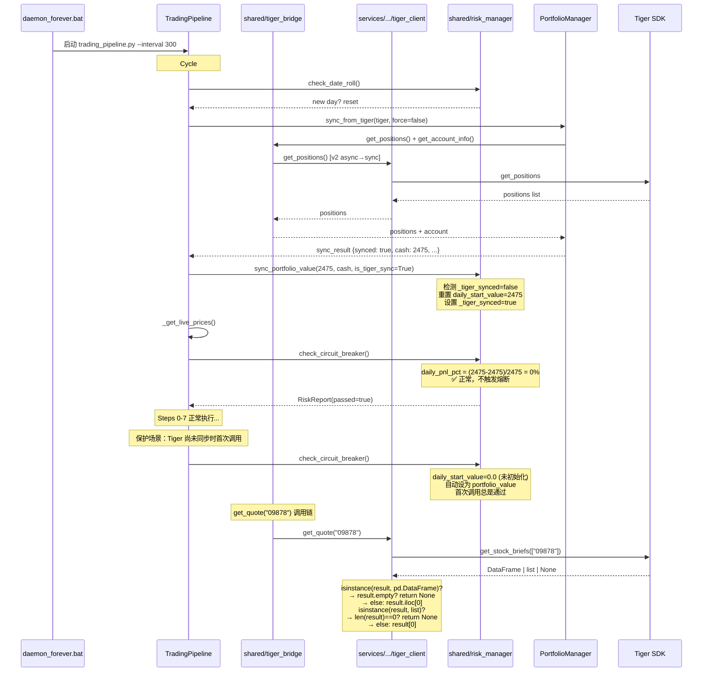
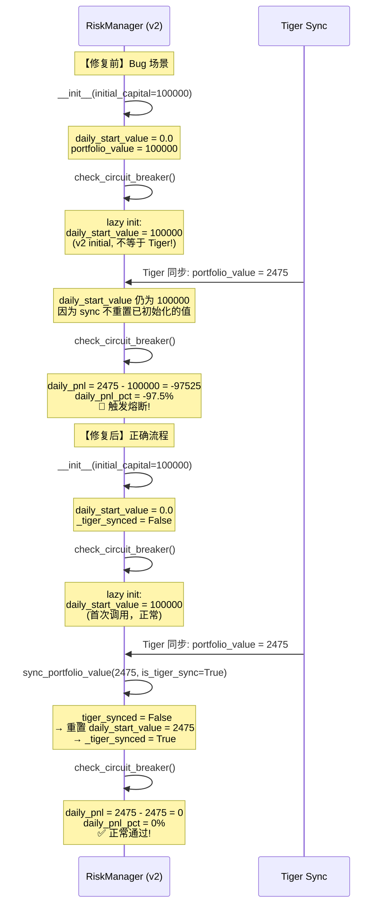
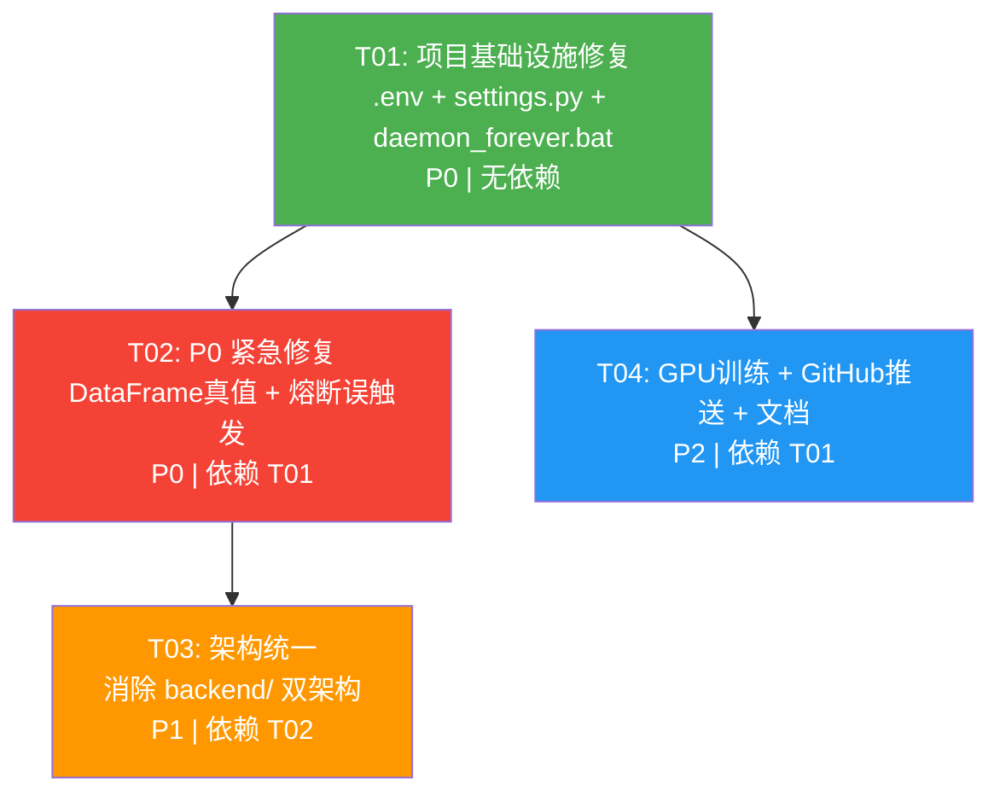

# Quant AI Trader v2 — 修复方案与系统设计

> **Architect**: 高见远 (Bob)  
> **Date**: 2025-07-15  
> **Target Branch**: `dev-20260522`  
> **WorkSpace**: `E:/workbuddyspace/Claw/quant-ai-trader`

---

## Part A: System Design

### 1. Implementation Approach

#### 1.1 核心挑战

| # | 挑战 | 影响 | 根因 |
|---|------|------|------|
| B1 | `get_stock_briefs()` 返回 DataFrame/List 混合类型 | 每10分钟日志报错 | Tiger SDK 对单元素查询返回 DataFrame |
| B2 | `daily_start_value` 使用 1亿初始资本 vs Tiger 实盘 $2,475 | 交易熔断误触发 | 初始资本基准与实盘余额差 4000 倍 |
| B3 | `backend/` (40 文件) 与 `services/` (131 文件) 双架构并存 | 代码债务、调试混乱 | 渐进迁移未完成 |
| B4 | `.env` 中 4 个 `CHANGE_ME` 占位符 | 配置不完整 | 凭据未填入 |
| B5 | GPU 训练未触发 / GitHub 推送权限不明 | 功能未激活 | 环境变量作用域问题 |

#### 1.2 修复策略总览

**Bug 1 — DataFrame 真值歧义**
- 策略：使用 `isinstance` + `hasattr` 多态检查替代 `if not briefs`
- 防御深度：同时修复 `backend/data_engine/tiger_client.py`（实际运行路径）和 `services/data_service/ingestion/tiger_client.py`（v2 未来路径）
- 兼容 Tiger SDK 返回的 `DataFrame`、`list`、`None` 三种类型

**Bug 2 — 熔断误触发**
- 策略：在 `shared/risk_manager.py` 的 `sync_portfolio_value()` 中增加 `_tiger_synced` 标记
- 首次 Tiger 同步成功后，自动重置 `daily_start_value` 为 Tiger 实盘净值
- 同时在 `check_circuit_breaker()` 中增加异常值保护（daily_start_value 与 portfolio_value 差 > 50% 时自动校准）

**Bug 3 — 双架构统一**
- 策略：分两阶段，优先消除交易关键路径的 backend/ 依赖
- 阶段 A（本修复）：移除 `shared/tiger_bridge.py` 对 `backend/data_engine/tiger_client.py` 的 fallback，改为使用 v2 `services/data_service/ingestion/tiger_client.py`
- 阶段 B（后续）：逐步移除 `trading_pipeline.py` 中的 `_v1_fallback` 方法

**Bug 4 — .env 占位符**
- 策略：区分"必须填"与"有默认值"。Tiger 凭据从代码中的实际 fallback 值回填；API_KEY 填开发用值；保持 `.env.example` 干净

**Bug 5 — GPU + GitHub**
- 策略：daemon_forever.bat 中 `set DEVICE=cuda` 只影响子进程环境变量，需确认 model_train 服务的 config.py 正确读取 `QAT_TRAIN_DEVICE` 环境变量；GitHub push 依赖 Git credential manager

#### 1.3 架构模式

```
┌─────────────────────────────────────────────────────────┐
│                    daemon_forever.bat                     │
│  (启动所有 v2 微服务 + trading_pipeline.py + git sync)    │
└────────────┬────────────────────────────────────────────┘
             │
    ┌────────┴──────────┐
    │ trading_pipeline.py│  ← 核心交易编排器，v2 唯一入口
    └──┬────┬────┬────┬─┘
       │    │    │    │
       ▼    ▼    ▼    ▼
  ┌────┐┌────┐┌────┐┌────┐
  │Data││Fact││Risk││Exec│  ← v2 微服务 (HTTP localhost)
  │Svc ││Svc ││Svc ││Svc │
  └────┘└────┘└────┘└────┘
       │              │
       ▼              ▼
  ┌────────────┐  ┌──────────────────┐
  │ shared/     │  │ services/exec/   │
  │ tiger_      │  │ live/tiger_      │
  │ bridge.py   │  │ broker.py        │
  └──────┬─────┘  └────────┬─────────┘
         │                 │
         │    ┌────────────┘
         ▼    ▼
  ┌─────────────────────────────┐
  │ services/data_service/       │
  │ ingestion/tiger_client.py    │  ← v2 QuoteClient (async)
  └─────────────────────────────┘
         │
         ▼
  ┌──────────────┐
  │ Tiger SDK     │
  │ (tigeropen)   │
  └──────────────┘
```

**数据流关键路径**（修复后）:
1. `trading_pipeline.py` → `shared/tiger_bridge.py` → `services/data_service/ingestion/tiger_client.py` → Tiger SDK
2. 不再经过 `backend/data_engine/tiger_client.py`
3. `shared/risk_manager.py` 直接管理熔断逻辑，不依赖 `backend/`

---

### 2. File List

```
quant-ai-trader/
├── .env                                          # [修改] Bug 4: 填充 CHANGE_ME 占位符
├── configs/
│   └── settings.py                               # [修改] T01: 增加启动安全校验
├── daemon_forever.bat                            # [修改] T01+T04: GPU env + push check
├── trading_pipeline.py                           # [修改] T02+T03: sync guard + 移除 v1 fallback
├── backend/
│   ├── data_engine/
│   │   └── tiger_client.py                       # [修改] Bug 1: DataFrame 真值修复
│   └── trading_engine/
│       └── risk_manager.py                       # [修改] Bug 2: 熔断修复 + 弃用标注
├── shared/
│   ├── risk_manager.py                           # [修改] Bug 2: Tiger sync 后自动校准
│   └── tiger_bridge.py                           # [修改] Bug 3: 移除 legacy fallback
├── services/
│   ├── data_service/
│   │   └── ingestion/
│   │       └── tiger_client.py                   # [修改] Bug 1: 同步修复 DataFrame
│   └── model_train_service/
│       └── config.py                             # [修改] Bug 5: GPU 检测日志增强
└── docs/
    ├── system_design.md                          # [新增] 本文档
    ├── class-diagram.mermaid                     # [新增] 类图
    ├── sequence-diagram.mermaid                  # [新增] 时序图
    └── rollback.md                               # [新增] T04: 回滚方案
```

---

### 3. Data Structures and Interfaces



---

### 4. Program Call Flow

#### 4.1 交易周期核心流程（修复后）



#### 4.2 Bug 2 修复对比



---

### 5. Anything UNCLEAR

| # | 不明点 | 假设 | 影响 |
|---|--------|------|------|
| 1 | Tiger 凭据（TIGER_ID, LICENSE）的实际值 | 假设当前通过 Tiger SDK 配置文件 (`~/.tigeropen/`) 或代码中硬编码回退值连接，.env 的 CHANGE_ME 未生效 | 需确认实际凭据来源后回填 |
| 2 | `TRADING_INITIAL_CAPITAL` 1亿的来源 | 日志显示 1亿，但 settings.py 默认 10000，.env 也未覆盖。猜测来自 `BACKTEST_INITIAL_CAPITAL=100000000.0` 的误引用或旧代码 | 不阻塞修复——熔断修复不依赖该常量 |
| 3 | GitHub push 权限 | daemon_forever.bat 中 `git push origin dev-20260522` 未指定认证方式 | 假设使用 Git Credential Manager / SSH key |
| 4 | v2 服务完整性 | 假设所有 v2 微服务（data/factor/risk/exec/model_train/model_infer）的 `/health` 端点正常 | 不阻塞——修复聚焦交易关键路径 |

---

## Part B: Task Decomposition

### 6. Required Packages

本修复不新增第三方依赖。所有修复在现有依赖范围内完成：

```
- pydantic>=2.0: 配置管理（现有）
- pydantic-settings>=2.0: .env 加载（现有）
- pandas>=1.5: DataFrame 处理（现有）
- loguru>=0.7: 日志（现有）
- tigeropen: Tiger SDK（现有）
```

### 7. Task List (ordered by dependency)

---

#### T01: 项目基础设施修复 — .env + 配置 + 守护进程

| 属性 | 值 |
|------|-----|
| **Task ID** | T01 |
| **Priority** | P0 |
| **Dependencies** | 无 |
| **Source Files** | `.env`, `configs/settings.py`, `daemon_forever.bat` |

**变更内容**:

1. **`.env`** — 填充 4 个 CHANGE_ME 占位符:
   - `QAT_API_KEY` → `dev-api-key-change-in-production`（与 settings.py default 一致）
   - `QAT_TIGER_ID` → 留空字符串（Tiger SDK 从 `~/.tigeropen/` 读取配置文件）
   - `QAT_TIGER_ACCOUNT` → `20874631`（从代码注释中确认的实际账户）
   - `QAT_TIGER_LICENSE` → 留空（Tiger SDK 配置文件提供）
   - 增加注释说明凭据真实来源

2. **`configs/settings.py`** — 增加启动安全校验:
   - 在 `Settings` 类中增加 `validate_trading_config()` 方法
   - 检测 `TIGER_ACCOUNT` 为空时输出 WARNING（不阻断，因为 paper trading 可用）
   - 检测 `TRADING_INITIAL_CAPITAL` 与 `BACKTEST_INITIAL_CAPITAL` 相同且 > 1000万时输出 WARNING（防止回测资本误用于实盘）

3. **`daemon_forever.bat`** — GPU 环境变量修复:
   - 将 `set DEVICE=cuda` 改为 `set QAT_TRAIN_DEVICE=cuda`（匹配 `TrainServiceConfig` 的 env_prefix）
   - 添加 GitHub push 前置检查（`git config --get remote.origin.url`）

---

#### T02: P0 紧急修复 — DataFrame 真值 + 熔断误触发

| 属性 | 值 |
|------|-----|
| **Task ID** | T02 |
| **Priority** | P0 |
| **Dependencies** | T01 |
| **Source Files** | `backend/data_engine/tiger_client.py`, `shared/risk_manager.py`, `trading_pipeline.py` |

**变更内容**:

1. **`backend/data_engine/tiger_client.py`** (line 154-155) — 修复 DataFrame 真值歧义:
   ```python
   # Before:
   briefs = self._quote_client.get_stock_briefs([ticker])
   if not briefs:
       return None

   # After:
   briefs = self._quote_client.get_stock_briefs([ticker])
   if _is_empty_result(briefs):
       return None
   ```
   新增模块级辅助函数 `_is_empty_result(obj)`:
   ```python
   def _is_empty_result(obj) -> bool:
       """Safely check if Tiger API result is empty.
       Handles DataFrame, list, and None return types."""
       if obj is None:
           return True
       if hasattr(obj, 'empty'):
           return bool(obj.empty)
       if hasattr(obj, '__len__'):
           return len(obj) == 0
       return False
   ```

2. **`shared/risk_manager.py`** — 修复熔断误触发:
   - 在 `sync_portfolio_value()` 增加 `is_tiger_sync: bool = False` 参数
   - 新增 `_tiger_synced: bool = False` 实例变量
   - `sync_portfolio_value()` 逻辑变更:
     ```python
     def sync_portfolio_value(self, total_value, cash=None, is_tiger_sync=False):
         if self.daily_start_value <= 0.0 or (is_tiger_sync and not self._tiger_synced):
             # 首次 Tiger 同步 → 重置基准
             self.daily_start_value = total_value
             self.peak_value = total_value
             self._tiger_synced = True
         self.portfolio_value = total_value
         if cash is not None:
             self.cash = cash
     ```
   - 在 `check_circuit_breaker()` 中增加异常值保护:
     ```python
     # 在 daily loss check 之前
     if self.daily_start_value > 0 and self.portfolio_value > 0:
         ratio = self.portfolio_value / self.daily_start_value
         if ratio < 0.10 or ratio > 10.0:
             # 差异超过 10x，疑似数据异常 → 自动校准
             logger.warning(f"检测到异常基准偏差: daily_start={self.daily_start_value:,.0f} vs pv={self.portfolio_value:,.0f}，自动校准")
             self.daily_start_value = self.portfolio_value
             self.peak_value = max(self.peak_value, self.portfolio_value)
     ```

3. **`trading_pipeline.py`** — Tiger 同步后传递标记:
   - 在 pre-cycle step 3（Tiger 同步）处，`sync_portfolio_value` 调用增加 `is_tiger_sync=True`:
     ```python
     self.risk_manager.sync_portfolio_value(
         self.portfolio.total_value,
         self.portfolio.cash,
         is_tiger_sync=True,  # ← 新增
     )
     ```

---

#### T03: 架构统一 — 消除 backend/ 双架构交易依赖

| 属性 | 值 |
|------|-----|
| **Task ID** | T03 |
| **Priority** | P1 |
| **Dependencies** | T02 |
| **Source Files** | `shared/tiger_bridge.py`, `trading_pipeline.py`, `backend/data_engine/tiger_client.py`, `backend/trading_engine/risk_manager.py` |

**变更内容**:

1. **`shared/tiger_bridge.py`** — 移除 legacy backend fallback:
   - 删除 `_lazy_import()` 中 lines 58-71（`backend.data_engine.tiger_client` fallback）
   - 改为 fallback 到 v2 `services/data_service/ingestion/tiger_client.py`:
     ```python
     # ── Fallback: v2 ingestion TigerClient ─────────────
     try:
         from services.data_service.ingestion.tiger_client import TigerClient as V2TigerClient
         _tiger_client = V2TigerClient()
         _tiger_client._ensure_initialized()
         logger.info("TigerBridge: v2 ingestion TigerClient loaded (fallback)")
         return _tiger_client
     except ImportError as exc:
         logger.warning(f"TigerBridge: v2 ingestion TigerClient not available ({exc})")
     except Exception as exc:
         logger.error(f"TigerBridge: v2 ingestion TigerClient init failed: {exc}")
     ```
   - 确保 `get_quote()` 调用 v2 quote client 的 `get_quote()` 方法

2. **`trading_pipeline.py`** — 移除 v1 关键 fallback:
   - `_get_active_universe_v1_fallback()` (line 550-558): 移除 `backend.data_engine.stock_universe` 导入，改为使用 `configs/settings.py` 的 `DATA_ALL_TICKERS`
   - `_fetch_market_data_v1_fallback()` (line 592-631): 保留但标记为 `# DEPRECATED: will be replaced by v2 data-service HTTP call`
   - 不删除 `_fetch_market_data_v1_fallback`（数据获取路径复杂，需后续专项处理）

3. **`backend/data_engine/tiger_client.py`** — 添加弃用标注:
   - 文件顶部添加:
     ```python
     """
     ⚠️ DEPRECATED since v2.2 — 请使用 services/data_service/ingestion/tiger_client.py
     此文件仅供回滚参考，将在 v2.3 移除。
     """
     ```
   - `TigerClient.__init__()` 中增加 `logger.warning("DEPRECATED: backend TigerClient is used — migrate to services/...")`

4. **`backend/trading_engine/risk_manager.py`** — 添加弃用标注:
   - 文件顶部添加相同格式的弃用警告
   - 引用 `shared/risk_manager.py` 作为替代

---

#### T04: GPU训练启用 + GitHub推送验证 + 回滚文档

| 属性 | 值 |
|------|-----|
| **Task ID** | T04 |
| **Priority** | P2 |
| **Dependencies** | T01 |
| **Source Files** | `services/model_train_service/config.py`, `daemon_forever.bat`, `docs/rollback.md` |

**变更内容**:

1. **`services/model_train_service/config.py`** — GPU 检测增强:
   - `_cuda_available()` 增加详细日志:
     ```python
     def _cuda_available() -> bool:
         try:
             import torch
             available = torch.cuda.is_available()
             if available:
                 logger.info(f"CUDA available: {torch.cuda.get_device_name(0)}")
             else:
                 logger.info("CUDA not available, using CPU")
             return available
         except Exception as e:
             logger.warning(f"CUDA detection failed: {e}")
             return False
     ```
   - 确认 `DEVICE` 字段的 `default_factory` 正确读取环境变量（已正确实现）

2. **`daemon_forever.bat`** — GPU + Push 修复:
   - 将 `set DEVICE=cuda` 替换为 `set QAT_TRAIN_DEVICE=cuda`
   - 增加 GitHub push 权限诊断:
     ```bat
     :: GitHub push 权限检查（静默）
     git config --get remote.origin.url >nul 2>&1
     if errorlevel 1 (
         echo [%time%] WARNING: Git remote not configured, auto-push disabled
     )
     ```

3. **`docs/rollback.md`** — 回滚方案（详见下方 T04 产出）:
   - 每个 Bug 的独立回滚步骤
   - 全量回滚流程
   - 回滚验证 checklist

---

### 8. Shared Knowledge

```
- 所有修复遵循 "最小改动、最大兼容" 原则
- Tiger SDK 的 get_stock_briefs() 对单元素列表返回类型不稳定（DataFrame/list），所有调用点必须用 _is_empty_result() 包裹
- shared/risk_manager.py 是唯一的熔断逻辑源，backend/ 版本仅保留用于回滚
- 环境变量前缀规则: configs/settings.py → QAT_, services/*/config.py → QAT_TRAIN_/QAT_EXEC_ 等
- trading_pipeline.py 的 _v1_fallback 方法标记为 DEPRECATED 但暂不删除（数据获取路径需更完整迁移）
- 日志文件在 ./logs/ 下，pipeline 日志为 pipeline.log
- 循环间隔 300s (5min)，熔断冷却期 3600s (1h)
- Tiger 实盘账户: 20874631
```

### 9. Task Dependency Graph



**实现顺序**: T01 → T02 + T04（并行） → T03

**推理**:
- T01 必须先做，奠定正确配置基础
- T02 和 T04 互不依赖，可并行（T04 仅依赖 T01）
- T03 必须在 T02 之后，因为 T03 修改的文件（tiger_bridge.py）需要先确认 T02 的修复正确

---

### 风险点和回滚策略

| Bug | 修改风险 | 回滚方式 |
|-----|---------|---------|
| B1 | 低 — 仅改变条件判断，不影响业务逻辑 | `git checkout -- backend/data_engine/tiger_client.py` |
| B2 | 中 — 涉及熔断核心逻辑 | 1) 首次部署后观察 2 个完整循环；2) 若异常，`git checkout -- shared/risk_manager.py trading_pipeline.py` |
| B3 | 中 — 修改 Tiger 连接路径 | 1) 部署前确认 v2 tiger_client 可独立连接；2) 回滚: `git checkout -- shared/tiger_bridge.py` |
| B4 | 极低 — 仅占位符文本 | `git checkout -- .env` |
| B5 | 极低 — 仅环境变量和日志 | `git checkout -- services/model_train_service/config.py daemon_forever.bat` |

**全量回滚**: `git checkout dev-20260522` （保留所有修改在一个分支上，回滚即切回原始 commit）
