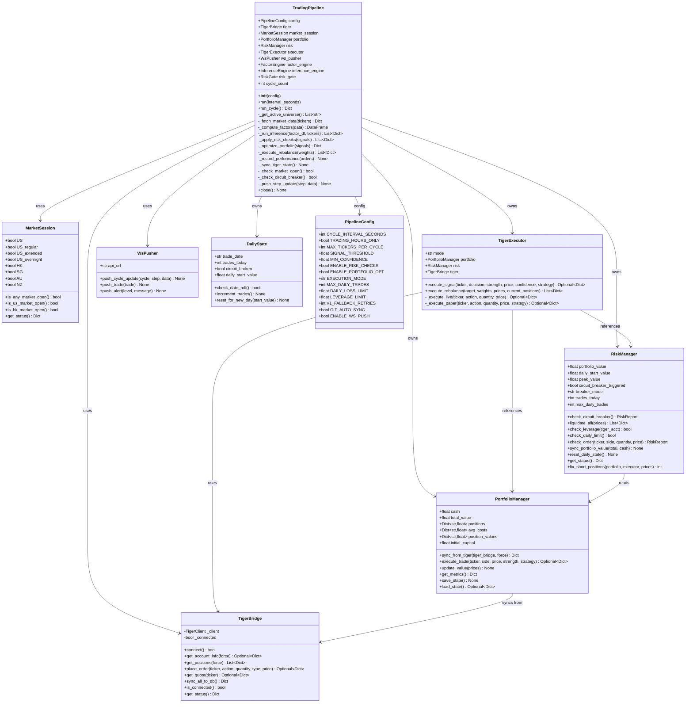
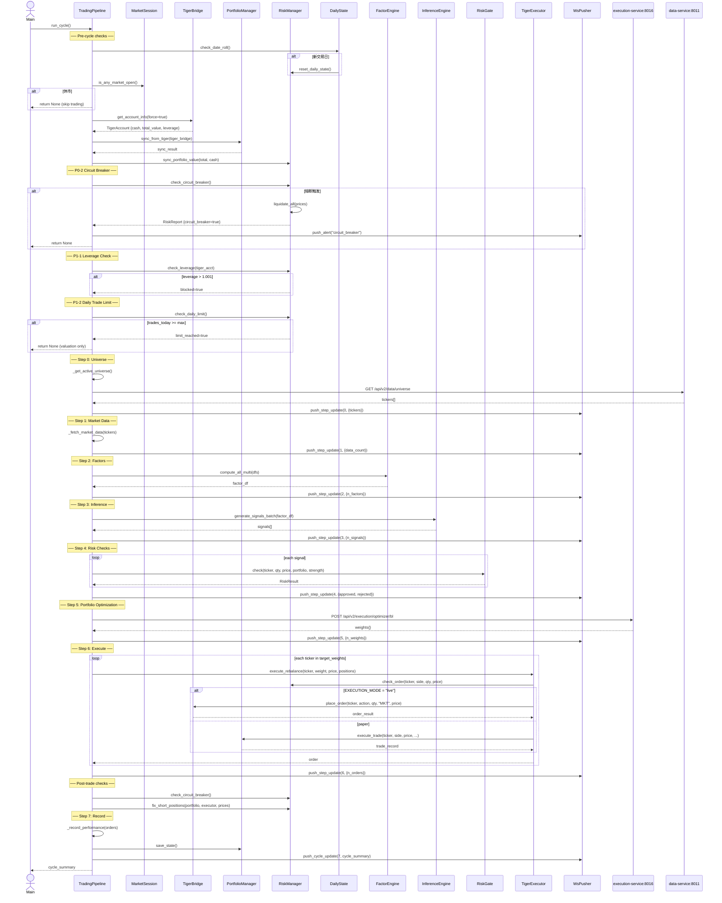
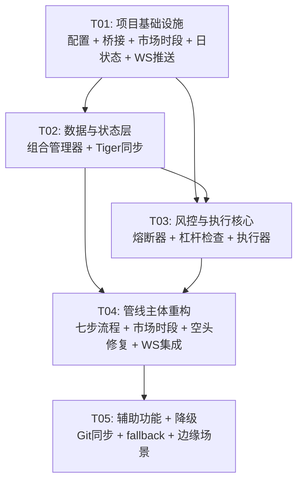

# System Design — Quant AI Trader v2 增量架构

> **作者**: 高见远 (Bob, Architect)  
> **日期**: 2026-07-05  
> **目标**: 基于增量 PRD 修复 trading_pipeline.py，实现 v2 功能 ≥ v1、实盘交易上线、架构清理

---

## Part A: System Design

### 1. Implementation Approach

#### 1.1 核心技术挑战

| # | 挑战 | 分析 |
|---|------|------|
| C1 | **v1→v2 桥接清理** | trading_pipeline.py 有 3 处 backend/ 直接导入，架构约束要求只清理这 3 处，不修改 backend/main.py |
| C2 | **实盘执行通道** | EXECUTION_MODE="live" 时需通过 Tiger API 真实下单，同时保留 paper 模式降级 |
| C3 | **组合级熔断** | 日亏损 ≥ 5% 触发全部平仓 + 停止新交易 + 告警，需正确同步 Tiger 实际资产值 |
| C4 | **市场时段检测** | 支持 US/HK/SG/AU/NZ 五市场 24h 覆盖（含盘前/盘后/夜盘） |
| C5 | **Tiger 状态同步** | 每轮从 Tiger 拉取持仓/现金/总资产，校准本地状态防误判 |

#### 1.2 框架选型与设计策略

| 组件 | 策略 | 理由 |
|------|------|------|
| **TigerClient 桥接** | `shared/tiger_bridge.py` 薄封装层 | 满足架构约束（不在管线中直接 import backend/），通过 `_lazy_import` 延迟加载 backend 单例 |
| **PortfolioManager v2** | `shared/portfolio_manager.py` 新实现 | 替代 backend.trading_engine.portfolio，数据模型独立，支持 Tiger 同步 |
| **RiskManager v2** | `shared/risk_manager.py` 新实现 | 熔断器 + 杠杆检查 + 每日上限 + 空头修复全内置 |
| **TigerExecutor** | `shared/tiger_executor.py` 策略模式 | 统一 live/paper 接口，内部根据 EXECUTION_MODE 切换 |
| **MarketSession** | `shared/market_session.py` 静态工具 | pytz 时区计算，无状态纯函数 |
| **WebSocket Push** | `shared/ws_pusher.py` httpx async | 每 Step 完成后 POST 到 API Gateway WebSocket |

#### 1.3 架构模式

采用 **Pipeline + Strategy** 模式：
- `TradingPipeline` 保持七步编排器角色不变
- 每步内部由新 shared/ 模块实现，通过依赖注入组合
- 执行通道通过 `TigerExecutor` 的策略模式切换 live/paper

---

### 2. File List

#### 2.1 新建文件

```
shared/tiger_bridge.py          — TigerClient 薄桥接层（P0-4, P0-5）
shared/market_session.py        — 市场时段检测工具（P0-3）
shared/portfolio_manager.py     — v2 组合管理器（P0-4, P0-5）
shared/risk_manager.py          — v2 风控管理器（P0-2, P1-1, P1-2）
shared/tiger_executor.py        — 实盘/模拟执行器（P0-1, P1-4）
shared/daily_state.py           — 日状态追踪器（P0-2, P1-2）
shared/ws_pusher.py             — WebSocket 推送工具（P1-5）
shared/git_sync.py              — Git 自动同步（P2-1）
```

#### 2.2 修改文件

```
trading_pipeline.py             — 主体重构：移除 backend/ 导入，集成新模块（P0-1~P0-5, P1-1~P1-5）
configs/pipeline_config.py      — 新增配置项（EXECUTION_MODE, MAX_DAILY_TRADES, etc.）
configs/settings.py             — 添加 EXECUTION_MODE 到 Pydantic Settings
```

#### 2.3 参考但不修改的文件

```
backend/main.py                 — 保持不变（架构约束）
backend/trading_engine/risk_manager.py    — 参考逻辑
backend/trading_engine/executor.py        — 参考逻辑
backend/data_engine/tiger_client.py       — 通过桥接间接使用
_legacy_archive/misc/auto_trader.py       — v1 参考实现
services/execution_service/live/circuit_breaker.py — 参考接口
```

---

### 3. Data Structures and Interfaces

#### 3.1 核心类图



#### 3.2 关键数据结构

```python
# ── RiskReport ──────────────────────────────────────────
@dataclass
class RiskReport:
    passed: bool = True
    reason: str = ""
    warnings: List[str] = field(default_factory=list)
    circuit_breaker: bool = False
    daily_limit_reached: bool = False
    leverage_blocked: bool = False
    details: Dict = field(default_factory=dict)

# ── MarketStatus ────────────────────────────────────────
@dataclass
class MarketStatus:
    US: bool = False
    US_regular: bool = False
    US_extended: bool = False
    US_overnight: bool = False
    HK: bool = False
    SG: bool = False
    AU: bool = False
    NZ: bool = False

# ── TigerAccount ────────────────────────────────────────
# Dict alias:
# {
#     "account": str,
#     "cash": float,
#     "market_value": float,
#     "total_value": float,
#     "buying_power": float,
#     "leverage": float,
#     "unrealized_pnl": float,
#     "realized_pnl": float,
# }

# ── CycleSummary ─────────────────────────────────────────
# {
#     "cycle": int,
#     "timestamp": str (ISO 8601),
#     "trade_date": str,
#     "orders": int,
#     "trades_today": int,
#     "total_value": float,
#     "total_return_pct": float,
#     "num_positions": int,
#     "order_ids": List[str],
# }
```

---

### 4. Program Call Flow

#### 4.1 完整周期时序图 (run_cycle)



---

### 5. Anything UNCLEAR

| # | 事项 | 假设 / 需要确认 |
|---|------|----------------|
| U1 | **WebSocket 后端端点** | 假设 API Gateway (8001) 已暴露 `/api/push/step-update` 和 `/api/push/cycle-data` 端点，如不存在需新建 |
| U2 | **Tiger 私钥加载路径** | 使用 `certs/tiger_private_key.pem`，TigerBridge 内部通过 backend/trading_config 间接加载 |
| U3 | **MAX_DAILY_TRADES 默认值** | PRD 未指定具体数字，设为 0（不限制），与 v1 auto_trader 的一致 |
| U4 | **v1 fallback HTTP 端点** | 假设 data-service (8011) 已有 universe 端点，如不可用则使用硬编码 fallback |
| U5 | **PipelineConfig 中新增字段的 env 覆盖** | 当前 PipelineConfig 是 @dataclass，不从 env 读取。如需 env 覆盖需额外改造 |

---

## Part B: Task Decomposition

### 6. Required Packages

```
- pytz>=2024.1: Timezone handling for market session detection
- httpx>=0.27.0: Async HTTP client (already in use)
- loguru>=0.7.0: Structured logging (already in use)
- numpy>=1.26.0: Numerical computation (already in use)
- pandas>=2.2.0: Data manipulation (already in use)
- tigeropen: Tiger Brokers SDK (already in use, via bridge)
```

**无新增 pip 依赖** — 所有功能基于已有依赖实现。

---

### 7. Task List (ordered by dependency)

---

#### **T01: 项目基础设施 — 配置扩展 + 核心桥接模块骨架**

| 属性 | 值 |
|------|-----|
| **Task ID** | T01 |
| **Priority** | P0 |
| **覆盖需求** | P0-5 (基础), P0-3 (市场时段), P0-4 (Tiger桥接) |

**Source Files:**
- `configs/pipeline_config.py` — 新增 EXECUTION_MODE, MAX_DAILY_TRADES, DAILY_LOSS_LIMIT, LEVERAGE_LIMIT, V1_FALLBACK_RETRIES, ENABLE_WS_PUSH, GIT_AUTO_SYNC 配置项
- `configs/settings.py` — 添加 EXECUTION_MODE 字段（已存在 `EXECUTION_MODE`，需确认 PipelineConfig 可读取）
- `shared/tiger_bridge.py` — **新建** TigerClient 薄桥接层，延迟加载 backend 单例，暴露 get_account_info / get_positions / place_order / get_quote / sync_all_to_db / is_connected
- `shared/market_session.py` — **新建** 基于 pytz 的市场时段检测，支持 US(24h)/HK/SG/AU/NZ，盘前/盘后/夜盘标识
- `shared/daily_state.py` — **新建** 日状态追踪器：交易日检测、交易计数、熔断状态标记
- `shared/ws_pusher.py` — **新建** WebSocket 推送工具，POST 到 API Gateway 的推送端点

**Dependencies:** 无

**验收标准:**
- PipelineConfig 包含所有新增配置字段且有合理默认值
- TigerBridge 可成功延迟导入 backend.data_engine.tiger_client 单例
- MarketSession.is_any_market_open() 对 US/HK 返回正确时段状态
- DailyState.check_date_roll() 能检测跨日并触发重置
- WsPusher 异步发送不阻塞主循环（try/except 静默降级）

---

#### **T02: 数据与状态层 — 组合管理器 + Tiger 同步**

| 属性 | 值 |
|------|-----|
| **Task ID** | T02 |
| **Priority** | P0 |
| **覆盖需求** | P0-4 (Tiger状态同步), P0-5 (消除PortfolioManager导入) |

**Source Files:**
- `shared/portfolio_manager.py` — **新建** v2 组合管理器：替代 backend.trading_engine.portfolio.PortfolioManager，实现 positions / cash / total_value / avg_costs 管理，Tiger 同步 (sync_from_tiger)，交易执行 (execute_trade)，状态持久化 (save_state / load_state)，估值更新 (update_value)，绩效指标 (get_metrics)
- `trading_pipeline.py` — **修改** 移除 `from backend.trading_engine.portfolio import PortfolioManager`，替换为 shared.portfolio_manager
- `shared/tiger_bridge.py` — **扩展** 确保 get_account_info 返回完整的 TigerAccount 结构，get_positions 返回标准化持仓列表

**Dependencies:** T01

**验收标准:**
- PortfolioManager 可从 Tiger 同步持仓和现金到本地
- sync_from_tiger 返回 `{synced: bool, positions: int, cash: float, total_value: float}`
- execute_trade 正确更新 positions / cash / avg_costs
- load_state / save_state 使用 JSON 文件保持与 v1 兼容
- trading_pipeline.py 的 `self.portfolio` 来自 shared.portfolio_manager

---

#### **T03: 风控与执行核心 — 熔断器 + 杠杆检查 + 执行器**

| 属性 | 值 |
|------|-----|
| **Task ID** | T03 |
| **Priority** | P0 |
| **覆盖需求** | P0-1 (实盘执行), P0-2 (组合熔断), P1-1 (杠杆铁律), P1-2 (每日上限) |

**Source Files:**
- `shared/risk_manager.py` — **新建** v2 风控管理器：替代 backend.trading_engine.risk_manager.RiskManager，实现 check_circuit_breaker (日亏损 ≥5% 熔断 + 回撤 ≥25% 熔断)，liquidate_all (平仓全部持仓)，check_leverage (杠杆 >1.001 阻止买入)，check_daily_limit (达到上限停止交易)，check_order (下单前风控)，fix_short_positions (空头自动修复)，breaker_mode 支持 "hard"/"warn"
- `shared/tiger_executor.py` — **新建** 实盘/模拟执行器：统一接口 execute_signal / execute_rebalance，内部根据 EXECUTION_MODE 切换 `_execute_live` (调用 TigerBridge.place_order) 和 `_execute_paper` (调用 PortfolioManager.execute_trade)，港股整手对齐，TWAP/VWAP 支持框架
- `trading_pipeline.py` — **修改** 移除 `from backend.trading_engine.risk_manager import RiskManager`，移除 `from backend.trading_engine.executor import PaperExecutor`，替换为 shared.risk_manager + shared.tiger_executor

**Dependencies:** T01, T02

**验收标准:**
- EXECUTION_MODE="live" + Tiger 已连接 → 真实下单到 Tiger API
- EXECUTION_MODE="paper" → 本地模拟撮合
- 日亏损 ≥ 5% → 熔断触发 + liquidate_all 执行 + 停止新交易
- breaker_mode="warn" → 仅日志告警不阻断
- 杠杆 > 1.001 → 所有买入被阻止
- trades_today ≥ MAX_DAILY_TRADES → 跳过交易仅更新估值
- 空头自动修复：检测负持仓自动买回

---

#### **T04: 管线主体重构 — 七步流程全面升级**

| 属性 | 值 |
|------|-----|
| **Task ID** | T04 |
| **Priority** | P0 |
| **覆盖需求** | P0-3 (市场时段), P0-5 (完成桥接清理), P1-3 (空头修复), P1-5 (WebSocket推送) |

**Source Files:**
- `trading_pipeline.py` — **大规模修改** run_cycle() 和所有 Step 方法：
  - Pre-cycle: 集成 MarketSession 判断休市（P0-3），集成 TigerBridge 同步状态（P0-4），集成 RiskManager 熔断+杠杆+每日上限检查（P0-2, P1-1, P1-2）
  - Step 0: 移除 `self._get_active_universe_v1_fallback` 中的 backend 直接导入，改用 TigerBridge 或 HTTP
  - Step 1: 移除 `self._fetch_market_data_v1_fallback` 中的 backend 直接导入，改为从 data-service HTTP 或 ParquetStore 读取
  - Step 4: 风控检查前先过 RiskManager.check_order
  - Step 6: 移除 `from backend.trading_engine.executor import PaperExecutor`，改用 TigerExecutor
  - Post-cycle: 集成 fix_short_positions（P1-3），集成 WsPusher 推送（P1-5）
  - 清理全部 3 处 backend/ 直接导入（P0-5 完成）
- `shared/signal_to_views.py` — **小改** 添加 `filter_signals_by_risk` 辅助函数
- `configs/pipeline_config.py` — **扩展** 确认所有 P0/P1 新增参数可从配置文件读取

**Dependencies:** T01, T02, T03

**验收标准:**
- trading_pipeline.py 中不再有任何 `from backend.` 直接导入（内部 fallback 方法中的延迟导入除外）
- 休市时 run_cycle 立即返回，不执行交易
- 每 Step 完成后 WebSocket 推送前端可见
- v1 auto_trader.py 全部 20 项功能在 v2 中有对应实现
- --once 模式完整运行不报错

---

#### **T05: 辅助功能 + 降级策略 + 边缘场景**

| 属性 | 值 |
|------|-----|
| **Task ID** | T05 |
| **Priority** | P1/P2 |
| **覆盖需求** | P1-4 (v1 fallback降级), P2-1 (Git自动同步), P2-2 (Tiger全量同步), P2-3 (强制卖出) |

**Source Files:**
- `shared/git_sync.py` — **新建** Git 自动同步模块：add → commit → pull --rebase → push，默认关闭 (GIT_AUTO_SYNC=False)
- `trading_pipeline.py` — **修改** 增强 v1 fallback 降级逻辑：每次 HTTP 调用失败后重试 3 次（指数退避），3 次均失败才走 v1 fallback；集成 git_sync（每 6 周期执行一次，仅当 GIT_AUTO_SYNC=True）；集成 Tiger 全量同步到 DB（可选，try/except 静默降级）；添加 force_sell 支持（从配置读取强制卖出列表）
- `services/execution_service/live/tiger_broker.py` — **修改** 如有需要，确保与 TigerExecutor 接口兼容

**Dependencies:** T04

**验收标准:**
- HTTP 调用 v2 服务失败后自动重试最多 3 次
- GIT_AUTO_SYNC=False 时不执行任何 git 操作
- Tiger 全量同步失败不阻塞交易主循环
- 强制卖出列表中的持仓在首个周期被清仓

---

### 8. Shared Knowledge

跨文件约定，工程师实现时需注意：

```
1. 所有异步 HTTP 调用使用 httpx.AsyncClient，超时 30s（来自 PipelineConfig.HTTP_TIMEOUT）
2. Tiger 相关调用全部通过 shared/tiger_bridge.py 间接访问，绝不直接 import backend.data_engine.tiger_client
3. 风控状态通过 RiskReport dataclass 传递，不使用字符串拼接
4. 所有时间使用 datetime.now() (naive)，日期比较使用字符串 "YYYY-MM-DD" 格式
5. WebSocket 推送采用 fire-and-forget 模式，异常静默降级不阻塞交易
6. 熔断冷却期 900s (15min)，由 backend/config.py 中 TradingConfig.CIRCUIT_BREAKER_COOLDOWN 定义
7. 每日交易上限 0 = 不限制，>=1 则到达上限后只更新估值不交易
8. 港股/新加坡股买入必须整手对齐，卖出不限整手
9. Tiger API 调用频率控制 15s 最小间隔（由 TigerBridge 内部缓存实现）
10. 杠杆检查阈值 1.001（允许微小浮点误差），≥1.001 视为有杠杆
11. logs/ 目录下的日志文件使用 loguru，rotation="1 day"，retention="30 days"
12. 所有新增 shared/ 模块必须支持 try/except ImportError 降级（用于测试环境可能缺少依赖）
```

---

### 9. Task Dependency Graph



**说明：**
- T01 是所有任务的基础（配置 + 桥接骨架），T02/T03 可部分并行
- T02 和 T03 之间有数据依赖（T03 的 RiskManager 需要 PortfolioManager 的 total_value）
- T04 深度依赖 T02/T03 完成（管线集成所有模块）
- T05 是收尾任务，依赖 T04 的主体重构完成

---

### Appendix: P0/P1/P2 需求覆盖矩阵

| 需求 | 描述 | 覆盖任务 | 状态 |
|------|------|----------|------|
| P0-1 | 实盘执行通道 | T03 | TigerExecutor._execute_live |
| P0-2 | 组合级熔断 | T03, T04 | RiskManager.check_circuit_breaker + liquidate_all |
| P0-3 | 市场时段检测 | T01, T04 | MarketSession + run_cycle guard |
| P0-4 | Tiger状态实时同步 | T01, T02, T04 | TigerBridge + PortfolioManager.sync_from_tiger |
| P0-5 | v1→v2桥接清理 | T01, T02, T03, T04 | 移除3处backend/导入 |
| P1-1 | 杠杆铁律 | T03, T04 | RiskManager.check_leverage |
| P1-2 | 每日交易上限 | T03, T04 | DailyState + RiskManager.check_daily_limit |
| P1-3 | 空头自动修复 | T03, T04 | RiskManager.fix_short_positions |
| P1-4 | v1 fallback降级 | T05 | 3次重试 + 指数退避 |
| P1-5 | 前端实时推送 | T01, T04 | WsPusher.push_step_update |
| P2-1 | Git自动同步 | T05 | shared/git_sync.py |
| P2-2 | Tiger全量同步DB | T05 | TigerBridge.sync_all_to_db |
| P2-3 | 强制卖出列表 | T05 | force_sell_positions 集成 |
