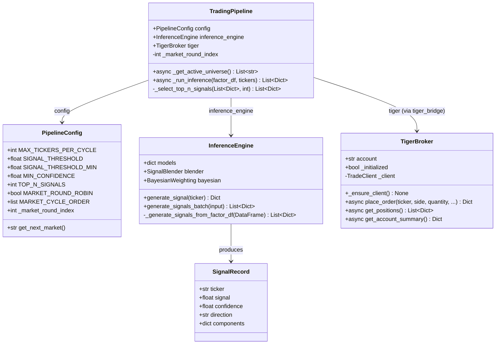
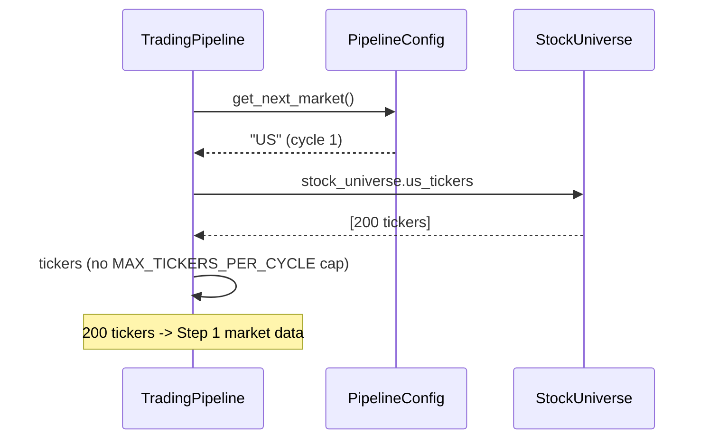
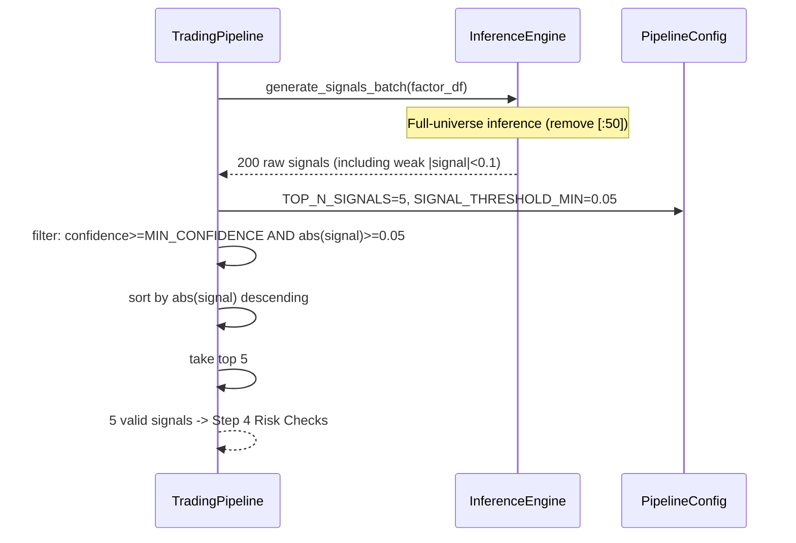
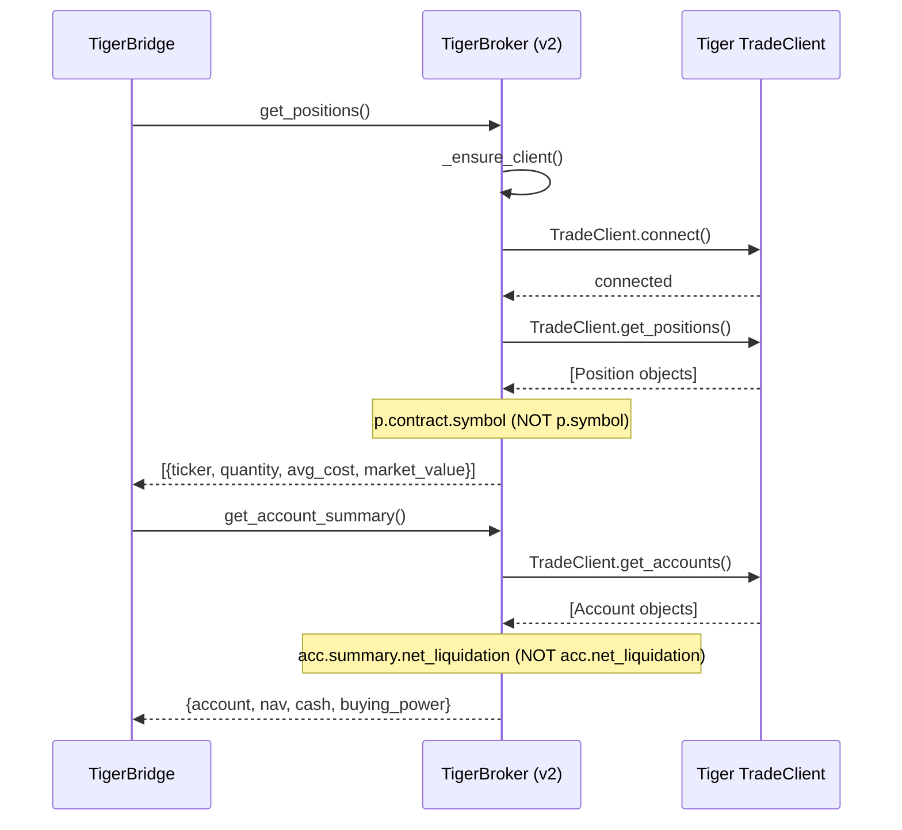
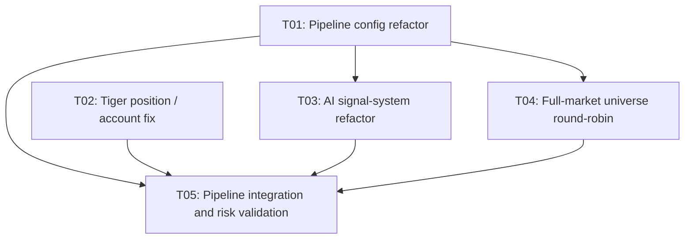

# Quant AI Trader v2 — Enhancement Plan and System Design

> **Architect**: Gao Jianyuan (Bob)  
> **Date**: 2025-07-15  
> **Target**: Full-market universe + AI signal enhancement + Tiger position fix  
> **WorkSpace**: `E:/workbuddyspace/Claw/quant-ai-trader`

---

## Part A: System Design

### 1. Implementation Approach

#### 1.1 Core Challenges

| # | Problem | Current state | Root cause |
|---|------|------|------|
| **P1** | Universe is capped | MAX_TICKERS_PER_CYCLE=50; only 50/514 names analyzed | `inference_engine` also hard-codes `[:50]` |
| **P2** | Signal threshold too high | SIGNAL_THRESHOLD=0.3 -> first round produces 0 signals | Ensemble output is typically \|signal\| in [0.01, 0.15]; 0.3 is never reached |
| **P3** | Tiger returns empty | get_positions / get_account return 0 | v2 TigerBroker missing `connect()`; incorrect field access paths |

#### 1.2 Fix-Strategy Overview

**P1 — Full-market analysis**
- **Strategy**: Remove both `[:50]` limits -> round-robin by market (all names of one market per cycle) -> top-N signal selection
- **Market round-robin**: Cycle 1=US(200), Cycle 2=HK(157), Cycle 3=SG(97), Cycle 4=AU(60), Cycle 5=NZ(30) -> repeat
- **Key changes**: `trading_pipeline.py` — `_get_active_universe` adds market_round_robin; `inference_engine.py` — remove `[:50]`

**P2 — Top-N signal selection**
- **Strategy**: Drop the fixed SIGNAL_THRESHOLD -> infer all tickers each cycle, sort by \|signal\| descending, take top N
- **Keep MIN_CONFIDENCE=0.3** (lowered) as a quality floor
- **New**: TOP_N_SIGNALS=5 (at most 5 trade signals per cycle)
- **Internal floor**: inference_engine internal `abs(strength) >= 0.1` -> `>= 0.01`

**P3 — Tiger position fix**
- **Strategy**: Repair v2 `TigerBroker` using the successful pattern from v1 backend `TigerClient`
- **Root cause 1**: TradeClient is created without `connect()` -> add it
- **Root cause 2**: Position ticker lives on `p.contract.symbol`, not `p.symbol`
- **Root cause 3**: Account fields live on `acc.summary.net_liquidation`, not `acc.net_liquidation`

#### 1.3 Architectural Pattern

```
┌──────────────────────────────────────────────────────┐
│  trading_pipeline.py  (orchestration layer, unchanged) │
│  Step 0->1->2->3->4->5->6->7                         │
│    │                                                  │
│    |- Step 0: MarketRoundRobin (new)                  │
│    │    |- US / HK / SG / AU / NZ round-robin        │
│    │                                                  │
│    |- Step 3: InferenceEngine (modified)              │
│    │    |- Full-universe inference (remove [:50])    │
│    │    |- Top-N ranked selection (replace fixed threshold) │
│    │                                                  │
│    |- Step 6: TigerBroker (fixed)                     │
│         |- connect() -> TradeClient                   │
│         |- p.contract.symbol (fix field access)       │
│         |- acc.summary.net_liquidation (fix nesting)  │
└──────────────────────────────────────────────────────┘
```

---

### 2. File List

```
configs/pipeline_config.py              # [MODIFY] add TOP_N_SIGNALS, MARKET_ROUND_ROBIN, SIGNAL_THRESHOLD_MIN
trading_pipeline.py                     # [MODIFY] _get_active_universe market round-robin, _run_inference top-N selection
services/model_infer_service/inference_engine.py  # [MODIFY] remove [:50] cap, lower internal threshold
services/execution_service/live/tiger_broker.py   # [MODIFY] fix connect / position / account queries
shared/tiger_bridge.py                 # [MODIFY] adapt to TigerBroker's repaired interface
```

---

### 3. Data Structures and Interfaces



---

### 4. Program Call Flow

#### 4.1 Market Round-Robin Universe Selection



#### 4.2 Top-N Signal Selection



#### 4.3 Tiger Position Query (Fixed)



---

### 5. Anything UNCLEAR

1. **Tiger SDK `connect()` behavior**: Whether Tiger SDK `TradeClient` truly requires an explicit `connect()` depends on the SDK version. v1 backend `TigerClient` works without `connect()` but creates both `QuoteClient` and `TradeClient`. v2 `TigerBroker` creates only `TradeClient` and may need a `QuoteClient` as well to initialize the connection correctly. **Assumption**: adding `QuoteClient` co-initialization plus a `connect()` call is sufficient.

2. **Market round-robin cadence**: One cycle every 5 minutes; five markets need 25 minutes for full coverage. During a single-market session (e.g. US only), only US may run 6–7 cycles. **Assumption**: after `is_any_market_open()`, round-robin only among currently open markets and skip closed ones.

3. **Over-trading risk after lowering the threshold**: TOP_N_SIGNALS=5 and MIN_CONFIDENCE=0.3 means at most 5 trades per cycle. Assuming 6.5 trading hours x 12 cycles = at most 60 trades/day. **A MAX_DAILY_TRADES cap is required** (current default 0 = unlimited; recommend 20).

4. **HK market-data fetch**: Current `_fetch_market_data_v1_fallback` uses `MarketDataEngine` for history; HK tickers need Tiger 5-digit format. The `hk_tickers` property in `stock_universe.py` already applies `.zfill(5)`.

---

## Part B: Task Decomposition

### 6. Required Packages

No new third-party dependencies. All changes use existing packages:

```
- tigeropen: Tiger Broker SDK (already installed)
- numpy, pandas: data processing (already installed)
- loguru: logging (already installed)
```

### 7. Task List (ordered by dependency)

#### T01: Project Infrastructure — Pipeline Config Refactor

- **Task ID**: T01
- **Task Name**: Pipeline config refactor
- **Source Files**:
  - `configs/pipeline_config.py` (MODIFY)
- **Dependencies**: none
- **Priority**: P0

**Changes**:

1. `MAX_TICKERS_PER_CYCLE`: `50` -> `9999` (remove the cap)
2. Add `TOP_N_SIGNALS: int = 5` (at most N trade signals per cycle)
3. Add `SIGNAL_THRESHOLD_MIN: float = 0.05` (absolute signal-strength floor)
4. `SIGNAL_THRESHOLD`: `0.3` -> `0.05` (kept for compatibility; actual logic uses top-N)
5. `MIN_CONFIDENCE`: `0.5` -> `0.3` (lower confidence bar)
6. Add `MARKET_ROUND_ROBIN: bool = True` (enable market round-robin)
7. Add `MARKET_CYCLE_ORDER: list = field(default_factory=lambda: ["US", "HK", "SG", "AU", "NZ"])`
8. Add `_market_round_index: int = 0` (private; current round)
9. Add method `get_next_market() -> str`: return the current market and increment the index

---

#### T02: Tiger Position / Account Query Fix

- **Task ID**: T02
- **Task Name**: Tiger position and account query fix
- **Source Files**:
  - `services/execution_service/live/tiger_broker.py` (MODIFY)
  - `shared/tiger_bridge.py` (MODIFY)
  - `services/data_service/ingestion/tiger_client.py` (MODIFY)
- **Dependencies**: T01 (needs config context, but can run in parallel)
- **Priority**: P1

**Changes**:

**A. `tiger_broker.py`** (core fix):
1. `_ensure_client()` (line 40-62):
   - Line 49: add `from tigeropen.quote.quote_client import QuoteClient`
   - After line 55: add `self._quote_client = QuoteClient(client_config)` + `self._client.connect()`
   - Add `try/except` for `connect()` failure
2. `get_positions()` (line 182-205):
   - Line 196: `getattr(p, "symbol", "")` -> `p.contract.symbol if hasattr(p, "contract") and hasattr(p.contract, "symbol") else getattr(p, "symbol", "")`
   - Line 197: infer `market` and `currency` fields
3. `get_account_summary()` (line 207-230):
   - Line 222: `acc.net_liquidation` -> `acc.summary.net_liquidation if hasattr(acc, "summary") and acc.summary else getattr(acc, "net_liquidation", 0.0)`
   - Same fix for `cash` and `buying_power`

**B. `tiger_bridge.py`** (adapter):
1. `get_positions()` (line 167-191): add debug logging of TigerBroker return structure
2. `get_account_info()` (line 142-164): same

**C. `ingestion/tiger_client.py`** (fallback-path fix):
1. `get_positions()` (line 184-212): line 202 `getattr(pos, "symbol")` -> same `contract.symbol` fix as tiger_broker
2. `get_account_summary()` (line 214-241): line 233 same nested `summary` fix as tiger_broker

---

#### T03: Signal-System Refactor — Top-N Selection

- **Task ID**: T03
- **Task Name**: AI signal-system refactor
- **Source Files**:
  - `services/model_infer_service/inference_engine.py` (MODIFY)
  - `trading_pipeline.py` (MODIFY — `_run_inference` method)
- **Dependencies**: T01
- **Priority**: P0

**Changes**:

**A. `inference_engine.py`** (remove internal caps):
1. `_generate_signals_from_factor_df()` (line 230-270):
   - Line 249: `for ticker in tickers[:50]:` -> `for ticker in tickers:` (remove hard cap)
   - Line 259: `abs(strength) >= 0.1` -> `abs(strength) >= 0.01` (lower floor)
2. `_generate_signals_from_tickers()` (line 272-293): no cap; leave unchanged

**B. `trading_pipeline.py` — `_run_inference()`** (line 698-735):
1. Line 719: call `self.inference_engine.generate_signals_batch(factor_df)` unchanged
2. Lines 722-732: **replace fixed-threshold filter with top-N selection**:

```python
# OLD (lines 722-732):
valid = [s for s in signals
    if abs(s.get("signal", ...)) >= self.config.SIGNAL_THRESHOLD
    and s.get("confidence", ...) >= self.config.MIN_CONFIDENCE]

# NEW logic:
# Step 1: base filter (confidence >= MIN_CONFIDENCE, |signal| >= SIGNAL_THRESHOLD_MIN)
filtered = [s for s in signals
    if s.get("confidence", 0.0) >= self.config.MIN_CONFIDENCE
    and abs(s.get("signal", 0.0)) >= self.config.SIGNAL_THRESHOLD_MIN]
# Step 2: sort by |signal| descending
filtered.sort(key=lambda s: abs(s.get("signal", 0.0)), reverse=True)
# Step 3: take top N
valid = filtered[:self.config.TOP_N_SIGNALS]
```

---

#### T04: Full-Market Universe Coverage — Market Round-Robin

- **Task ID**: T04
- **Task Name**: Full-market universe coverage and round-robin
- **Source Files**:
  - `trading_pipeline.py` (MODIFY — `_get_active_universe`)
  - `backend/data_engine/stock_universe.py` (MODIFY)
  - `configs/pipeline_config.py` (MODIFY — market cycle state)
- **Dependencies**: T01
- **Priority**: P1

**Changes**:

**A. `trading_pipeline.py` — `_get_active_universe()`** (line 510-548):
1. Line 543 `tickers = tickers[:self.config.MAX_TICKERS_PER_CYCLE]` -> remove (or keep but do not truncate)
2. **Add market round-robin logic**:

```python
async def _get_active_universe(self) -> List[str]:
    if self.config.MARKET_ROUND_ROBIN:
        market = self.config.get_next_market()
        logger.info(f"Step 0: market round-robin -> {market}")
        tickers = self._get_universe_for_market(market)
    else:
        tickers = await self._get_all_universe()
    return tickers

def _get_universe_for_market(self, market: str) -> List[str]:
    from backend.data_engine.stock_universe import stock_universe
    market_map = {
        "US": stock_universe.us_tickers,
        "HK": stock_universe.hk_tickers,  # 5-digit
        "SG": stock_universe.sg_tickers,  # .SI
        "AU": stock_universe.au_tickers,  # .AX
        "NZ": stock_universe.nz_tickers,  # .NZ
    }
    tickers = market_map.get(market, stock_universe.us_tickers)
    # HK needs a .HK suffix
    if market == "HK":
        tickers = [f"{t}.HK" for t in tickers]
    return tickers
```

3. **Session-check optimization**: In `run_cycle()` pre-cycle checks (line 301), round-robin only among currently open markets and skip closed ones.

**B. `stock_universe.py`** (small change):
1. `hk_tickers` property (line 476-478): ensure it returns pure 5-digit strings (already correct)

**C. `pipeline_config.py`** (already included in T01):
1. Implement `get_next_market()`

---

#### T05: Pipeline Integration and Risk Validation

- **Task ID**: T05
- **Task Name**: End-to-end pipeline integration and risk validation
- **Source Files**:
  - `trading_pipeline.py` (MODIFY — pre-cycle, MAX_DAILY_TRADES, logging)
  - `shared/risk_gate.py` (MODIFY — adapt to more signals)
  - `configs/pipeline_config.py` (MODIFY — MAX_DAILY_TRADES default)
- **Dependencies**: T02, T03, T04
- **Priority**: P0

**Changes**:

**A. `trading_pipeline.py` — pre-cycle checks**:
1. `MAX_DAILY_TRADES` default: in `pipeline_config.py` change from `0` (unlimited) to `20`
2. Logging: Step 3 prints top-N selection details (ticker + signal + confidence for the top 10)

**B. `shared/risk_gate.py`** (if needed):
1. Ensure the four risk gates (VaR / CVaR / Barra / concentration) do not degrade when signal count rises

**C. End-to-end validation**:
1. Ensure Step 0 -> Step 3 market-data fetch does not overload at 200 names in a single market
2. Ensure `_fetch_market_data_v1_fallback` serial fetch time stays bounded at 200 tickers

---

### 8. Shared Knowledge

```
- All API responses use HTTP JSON; pipeline internals use Python dict
- Tiger auth uses an RSA private key (PEM); path is TIGER_PRIVATE_KEY_PATH
- HK ticker format: 5-digit numeric (e.g. "00700"); internally append .HK for yfinance / Tiger
- SG / AU / NZ tickers already carry suffixes (.SI, .AX, .NZ)
- Signal format: {ticker, signal in [-1,1], confidence in [0,1], direction in {BUY,SELL,HOLD}}
- All prices stored in USD; HK / SG / AU / NZ converted via trading_currency_rates_dict
- TradeClient.get_positions() Position objects: ticker is on contract.symbol, not symbol
- TradeClient.get_accounts() Account objects: financial fields live on the summary sub-object
- A single pipeline-step failure does not abort the whole cycle (independent try / except per step)
```

### 9. Task Dependency Graph



---

## Appendix: Risk Matrix

| Risk | Level | Mitigation |
|------|------|---------|
| Low-quality top-N signals causing losing trades | High | MIN_CONFIDENCE=0.3 + four risk gates + MAX_DAILY_TRADES=20 |
| 200 names / cycle causing data-fetch timeouts | Medium | Single-market round-robin bounds concurrency; futures parallelism already uses ThreadPoolExecutor |
| Tiger `connect()` call fails | Medium | try / except degrade to paper mode; do not block the pipeline |
| Round-robin inefficient in a single-market session | Low | Round-robin only open markets; skip closed ones |
| Tiger SDK version differences causing API incompatibility | Medium | Keep hasattr polymorphic detection; compatible with older field paths |
