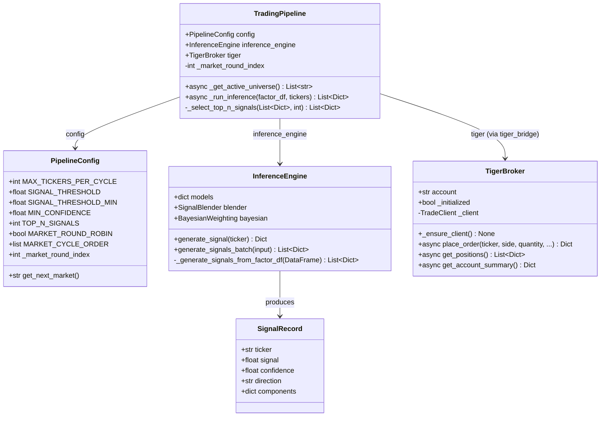
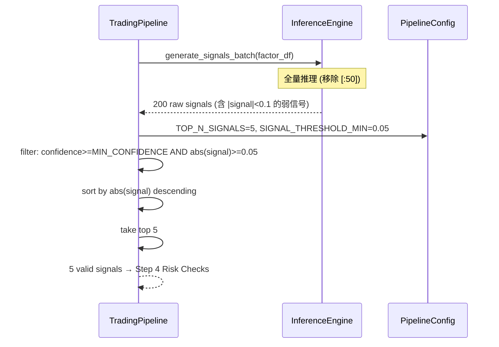
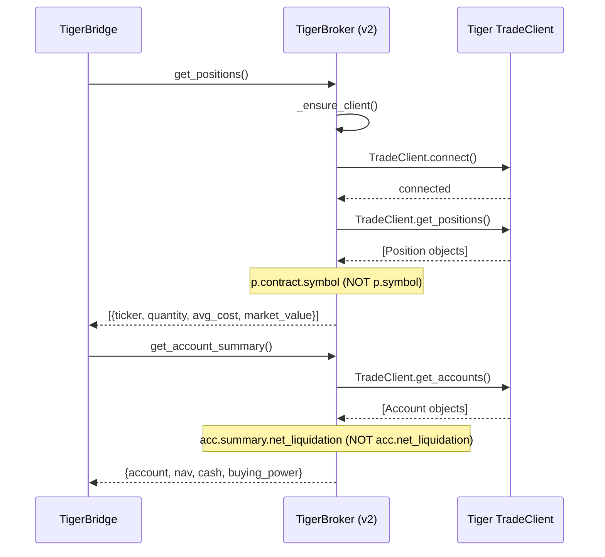
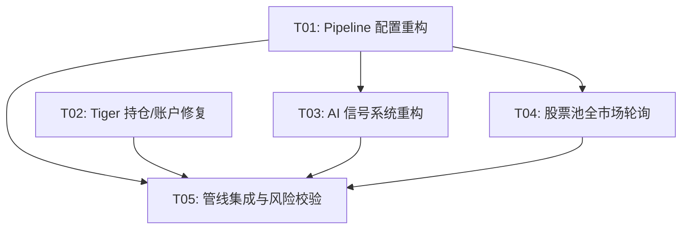

# Quant AI Trader v2 — 增强方案与系统设计

> **Architect**: 高见远 (Bob)  
> **Date**: 2025-07-15  
> **Target**: 全市场股票池 + AI 信号增强 + Tiger 持仓修复  
> **WorkSpace**: `E:/workbuddyspace/Claw/quant-ai-trader`

---

## Part A: System Design

### 1. Implementation Approach

#### 1.1 核心挑战

| # | 问题 | 现状 | 根因 |
|---|------|------|------|
| **P1** | 股票池受限 | MAX_TICKERS_PER_CYCLE=50，仅分析 50/514 只 | inference_engine 内部也有 `[:50]` 硬编码 |
| **P2** | 信号阈值过高 | SIGNAL_THRESHOLD=0.3 → 首轮 0 信号 | ensemble 输出通常 |signal| ∈ [0.01, 0.15]，0.3 永远达不到 |
| **P3** | Tiger 返回空 | get_positions/get_account 返回 0 | v2 TigerBroker 缺少 connect()、字段访问路径错误 |

#### 1.2 修复策略总览

**P1 — 全市场分析**
- **策略**: 移除两道 `[:50]` 限制 → 按市场轮询（每轮一个市场所有股票）→ top-N 信号选择
- **市场轮询**: Cycle 1=US(200), Cycle 2=HK(157), Cycle 3=SG(97), Cycle 4=AU(60), Cycle 5=NZ(30) → 循环
- **关键改动**: `trading_pipeline.py` — `_get_active_universe` 新增 market_round_robin；`inference_engine.py` — 移除 `[:50]`

**P2 — Top-N 信号选择**
- **策略**: 废弃固定 SIGNAL_THRESHOLD → 每轮对所有 ticker 推理，按 |signal| 降序排序取 top N
- **保留 MIN_CONFIDENCE=0.3**（降低）作为质量底线
- **新增**: TOP_N_SIGNALS=5（每轮最多 5 个交易信号）
- **内部 floor**: inference_engine 内部 `abs(strength) >= 0.1` → `>= 0.01`

**P3 — Tiger 持仓修复**
- **策略**: 借鉴 v1 backend `TigerClient` 的成功模式修复 v2 `TigerBroker`
- **根因 1**: TradeClient 创建后未调用 `connect()` → 添加
- **根因 2**: Position ticker 在 `p.contract.symbol` 而非 `p.symbol`
- **根因 3**: Account 字段在 `acc.summary.net_liquidation` 而非 `acc.net_liquidation`

#### 1.3 架构模式

```
┌──────────────────────────────────────────────────────┐
│  trading_pipeline.py  (编排层，不变)                    │
│  Step 0→1→2→3→4→5→6→7                               │
│    │                                                  │
│    ├─ Step 0: MarketRoundRobin (新增)                 │
│    │    └─ US / HK / SG / AU / NZ 轮询               │
│    │                                                  │
│    ├─ Step 3: InferenceEngine (修改)                  │
│    │    ├─ 全量推理 (移除 [:50])                      │
│    │    └─ Top-N 排序选择 (替代固定阈值)               │
│    │                                                  │
│    └─ Step 6: TigerBroker (修复)                      │
│         ├─ connect() → TradeClient                    │
│         ├─ p.contract.symbol (修复字段访问)            │
│         └─ acc.summary.net_liquidation (修复嵌套)     │
└──────────────────────────────────────────────────────┘
```

---

### 2. File List

```
configs/pipeline_config.py              # [MODIFY] 新增 TOP_N_SIGNALS, MARKET_ROUND_ROBIN, SIGNAL_THRESHOLD_MIN
trading_pipeline.py                     # [MODIFY] _get_active_universe 市场轮询, _run_inference top-N 选择
services/model_infer_service/inference_engine.py  # [MODIFY] 移除 [:50] 限制, 降低内部阈值
services/execution_service/live/tiger_broker.py   # [MODIFY] 修复 connect/position/account 查询
shared/tiger_bridge.py                 # [MODIFY] 适配 TigerBroker 修复后的接口
```

---

### 3. Data Structures and Interfaces



---

### 4. Program Call Flow

#### 4.1 Market Round-Robin Universe Selection


#### 4.2 Top-N Signal Selection



#### 4.3 Tiger Position Query (Fixed)



---

### 5. Anything UNCLEAR

1. **Tiger SDK `connect()` 行为**: Tiger SDK 的 `TradeClient` 是否确实需要显式 `connect()` 调用取决于 SDK 版本。v1 backend `TigerClient` 没有调用 `connect()` 也能工作，但创建了 `QuoteClient` + `TradeClient` 两个客户端。v2 `TigerBroker` 仅创建 `TradeClient`，可能需要同时创建 `QuoteClient` 才能正确初始化连接。**假设**: 添加 `QuoteClient` 共初始化 + 增加 `connect()` 调用即可修复。

2. **市场轮询节奏**: 每 5 分钟一轮，5 个市场需要 25 分钟完成全覆盖。在单市场交易时段内（如仅 US 开盘），可能只能跑 US 市场 6-7 轮。**假设**: 在 `is_any_market_open()` 检查后，仅轮询当前开盘的市场，跳过休市市场。

3. **降低阈值后的过度交易风险**: TOP_N_SIGNALS=5 且 MIN_CONFIDENCE=0.3 意味着每轮最多 5 笔。假设每天 6.5 交易小时 × 12 轮 = 最多 60 笔/天。**需要 MAX_DAILY_TRADES 限制**（当前默认 0=不限制，建议设 20）。

4. **HK 市场数据获取**: 当前 `_fetch_market_data_v1_fallback` 使用 `MarketDataEngine` 获取历史数据，HK ticker 需要 Tiger 格式 (5-digit)。`stock_universe.py` 的 `hk_tickers` 属性已做 `.zfill(5)` 处理。

---

## Part B: Task Decomposition

### 6. Required Packages

无新增第三方依赖。所有修改使用已有依赖：

```
- tigeropen: Tiger Broker SDK (已安装)
- numpy, pandas: 数据处理 (已安装)
- loguru: 日志 (已安装)
```

### 7. Task List (ordered by dependency)

#### T01: 项目基础设施 — Pipeline 配置重构

- **Task ID**: T01
- **Task Name**: Pipeline 配置重构
- **Source Files**:
  - `configs/pipeline_config.py` (MODIFY)
- **Dependencies**: 无
- **Priority**: P0

**修改内容**:

1. `MAX_TICKERS_PER_CYCLE`: `50` → `9999`（移除限制）
2. 新增 `TOP_N_SIGNALS: int = 5`（每轮最多 N 个交易信号）
3. 新增 `SIGNAL_THRESHOLD_MIN: float = 0.05`（信号强度绝对下限）
4. `SIGNAL_THRESHOLD`: `0.3` → `0.05`（保留兼容，但实际逻辑改用 top-N）
5. `MIN_CONFIDENCE`: `0.5` → `0.3`（降低置信度门槛）
6. 新增 `MARKET_ROUND_ROBIN: bool = True`（启用市场轮询）
7. 新增 `MARKET_CYCLE_ORDER: list = field(default_factory=lambda: ["US", "HK", "SG", "AU", "NZ"])`
8. 新增 `_market_round_index: int = 0`（私有，当前轮次）
9. 新增方法 `get_next_market() -> str`：返回当前市场并自增 index

---

#### T02: Tiger 持仓/账户查询修复

- **Task ID**: T02
- **Task Name**: Tiger 持仓与账户查询修复
- **Source Files**:
  - `services/execution_service/live/tiger_broker.py` (MODIFY)
  - `shared/tiger_bridge.py` (MODIFY)
  - `services/data_service/ingestion/tiger_client.py` (MODIFY)
- **Dependencies**: T01（需要 config 上下文，但可并行）
- **Priority**: P1

**修改内容**:

**A. `tiger_broker.py`** (核心修复):
1. `_ensure_client()` (line 40-62):
   - 第 49 行: 增加 `from tigeropen.quote.quote_client import QuoteClient`
   - 第 55 行后: 增加 `self._quote_client = QuoteClient(client_config)` + `self._client.connect()`
   - 增加 `try/except` 处理 `connect()` 失败
2. `get_positions()` (line 182-205):
   - 第 196 行: `getattr(p, "symbol", "")` → `p.contract.symbol if hasattr(p, "contract") and hasattr(p.contract, "symbol") else getattr(p, "symbol", "")`
   - 第 197 行: 增加 `market` 和 `currency` 字段推断
3. `get_account_summary()` (line 207-230):
   - 第 222 行: `acc.net_liquidation` → `acc.summary.net_liquidation if hasattr(acc, "summary") and acc.summary else getattr(acc, "net_liquidation", 0.0)`
   - 同上修复 `cash` 和 `buying_power` 字段

**B. `tiger_bridge.py`** (适配层):
1. `get_positions()` (line 167-191): 增加对 TigerBroker 返回结构的调试日志
2. `get_account_info()` (line 142-164): 同上

**C. `ingestion/tiger_client.py`** (fallback 路径修复):
1. `get_positions()` (line 184-212): 第 202 行 `getattr(pos, "symbol")` → 同 tiger_broker 的 contract.symbol 修复
2. `get_account_summary()` (line 214-241): 第 233 行 同 tiger_broker 的 summary 嵌套修复

---

#### T03: 信号系统重构 — Top-N 选择

- **Task ID**: T03
- **Task Name**: AI 信号系统重构
- **Source Files**:
  - `services/model_infer_service/inference_engine.py` (MODIFY)
  - `trading_pipeline.py` (MODIFY — `_run_inference` 方法)
- **Dependencies**: T01
- **Priority**: P0

**修改内容**:

**A. `inference_engine.py`** (移除内部限制):
1. `_generate_signals_from_factor_df()` (line 230-270):
   - 第 249 行: `for ticker in tickers[:50]:` → `for ticker in tickers:`（移除硬限制）
   - 第 259 行: `abs(strength) >= 0.1` → `abs(strength) >= 0.01`（降低 floor）
2. `_generate_signals_from_tickers()` (line 272-293): 无限制，保持不变

**B. `trading_pipeline.py` — `_run_inference()`** (line 698-735):
1. 第 719 行: 调用 `self.inference_engine.generate_signals_batch(factor_df)` 不变
2. 第 722-732 行: **替换固定阈值过滤为 top-N 选择**:

```python
# OLD (lines 722-732):
valid = [s for s in signals
    if abs(s.get("signal", ...)) >= self.config.SIGNAL_THRESHOLD
    and s.get("confidence", ...) >= self.config.MIN_CONFIDENCE]

# NEW logic:
# Step 1: 基础过滤 (confidence >= MIN_CONFIDENCE, |signal| >= SIGNAL_THRESHOLD_MIN)
filtered = [s for s in signals
    if s.get("confidence", 0.0) >= self.config.MIN_CONFIDENCE
    and abs(s.get("signal", 0.0)) >= self.config.SIGNAL_THRESHOLD_MIN]
# Step 2: 按 |signal| 降序排序
filtered.sort(key=lambda s: abs(s.get("signal", 0.0)), reverse=True)
# Step 3: 取 top N
valid = filtered[:self.config.TOP_N_SIGNALS]
```

---

#### T04: 股票池全市场覆盖 — 市场轮询

- **Task ID**: T04
- **Task Name**: 股票池全市场覆盖与轮询
- **Source Files**:
  - `trading_pipeline.py` (MODIFY — `_get_active_universe`)
  - `backend/data_engine/stock_universe.py` (MODIFY)
  - `configs/pipeline_config.py` (MODIFY — market cycle state)
- **Dependencies**: T01
- **Priority**: P1

**修改内容**:

**A. `trading_pipeline.py` — `_get_active_universe()`** (line 510-548):
1. 第 543 行 `tickers = tickers[:self.config.MAX_TICKERS_PER_CYCLE]` → 移除（或保留但不截断）
2. **新增市场轮询逻辑**:

```python
async def _get_active_universe(self) -> List[str]:
    if self.config.MARKET_ROUND_ROBIN:
        market = self.config.get_next_market()
        logger.info(f"Step 0: 市场轮询 → {market}")
        tickers = self._get_universe_for_market(market)
    else:
        tickers = await self._get_all_universe()
    return tickers

def _get_universe_for_market(self, market: str) -> List[str]:
    from backend.data_engine.stock_universe import stock_universe
    market_map = {
        "US": stock_universe.us_tickers,
        "HK": stock_universe.hk_tickers,  # 5-digit
        "SG": stock_universe.sg_tickers,  # .SI
        "AU": stock_universe.au_tickers,  # .AX
        "NZ": stock_universe.nz_tickers,  # .NZ
    }
    tickers = market_map.get(market, stock_universe.us_tickers)
    # HK 需要加 .HK 后缀
    if market == "HK":
        tickers = [f"{t}.HK" for t in tickers]
    return tickers
```

3. **市场时段检查优化**: 在 `run_cycle()` 的 pre-cycle 检查中 (line 301)，仅轮询当前开盘的市场，跳过休市市场。

**B. `stock_universe.py`** (小改动):
1. `hk_tickers` 属性 (line 476-478): 保证返回纯 5-digit 字符串（已正确）

**C. `pipeline_config.py`** (已在 T01 包含):
1. `get_next_market()` 方法实现

---

#### T05: 管线集成与风险校验

- **Task ID**: T05
- **Task Name**: 管线端到端集成与风险校验
- **Source Files**:
  - `trading_pipeline.py` (MODIFY — pre-cycle, MAX_DAILY_TRADES, logging)
  - `shared/risk_gate.py` (MODIFY — 适配更多信号)
  - `configs/pipeline_config.py` (MODIFY — MAX_DAILY_TRADES default)
- **Dependencies**: T02, T03, T04
- **Priority**: P0

**修改内容**:

**A. `trading_pipeline.py` — pre-cycle 检查**:
1. `MAX_DAILY_TRADES` 默认值: 在 `pipeline_config.py` 中从 `0`（不限制）改为 `20`
2. 日志增强: Step 3 输出 top-N 选择详情（前 10 个信号的 ticker + signal + confidence）

**B. `shared/risk_gate.py`** (如需):
1. 确保四道风控（VaR/CVaR/Barra/集中度）在信号数量增加后不退化

**C. 端到端验证**:
1. 确保 Step 0 → Step 3 的 market data fetch 在单市场 200 只时不过载
2. 确保 `_fetch_market_data_v1_fallback` 在 200 tickers 下串行获取的耗时可控

---

### 8. Shared Knowledge

```
- 所有 API 响应使用 HTTP JSON，pipeline 内部使用 Python dict
- Tiger 认证使用 RSA 私钥（PEM 格式），路径由 TIGER_PRIVATE_KEY_PATH 环境变量指定
- HK ticker 格式: 5-digit numeric (如 "00700")，内部需加 .HK 后缀供 yfinance/Tiger
- SG/AU/NZ ticker 自带后缀 (.SI, .AX, .NZ)
- 信号格式: {ticker, signal∈[-1,1], confidence∈[0,1], direction∈{BUY,SELL,HOLD}}
- 所有价格以 USD 计价，HK/SG/AU/NZ 通过 trading_currency_rates_dict 转换
- TradeClient.get_positions() 返回的 Position 对象: ticker 在 contract.symbol 而非 symbol
- TradeClient.get_accounts() 返回的 Account 对象: 财务字段在 summary 子对象中
- Pipeline 单步失败不中断整个 cycle（每步独立 try/except）
```

### 9. Task Dependency Graph



---

## 附录: 风险矩阵

| 风险 | 等级 | 缓解措施 |
|------|------|---------|
| top-N 信号质量低导致亏损交易 | 🔴 高 | MIN_CONFIDENCE=0.3 + 四道风控 + MAX_DAILY_TRADES=20 |
| 200 只/轮导致数据获取超时 | 🟡 中 | 单市场轮询控制并发；futures 并行已有 ThreadPoolExecutor |
| Tiger `connect()` 调用失败 | 🟡 中 | try/except 降级为 paper mode，不阻塞管线 |
| 市场轮询在单市场时段效率低 | 🟢 低 | 仅轮询开盘市场，跳过休市市场 |
| Tiger SDK 版本差异导致 API 不兼容 | 🟡 中 | 保留 hasattr 多态检测，兼容旧版字段路径 |
