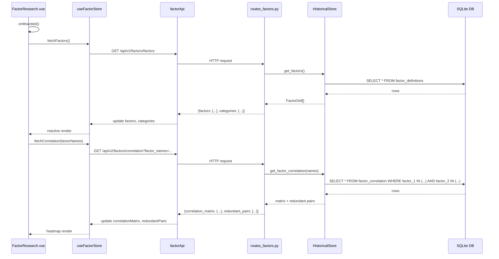
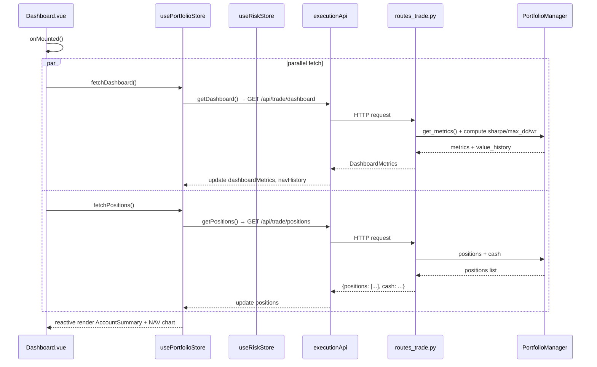
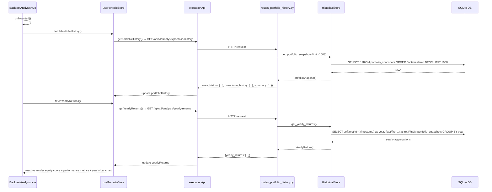
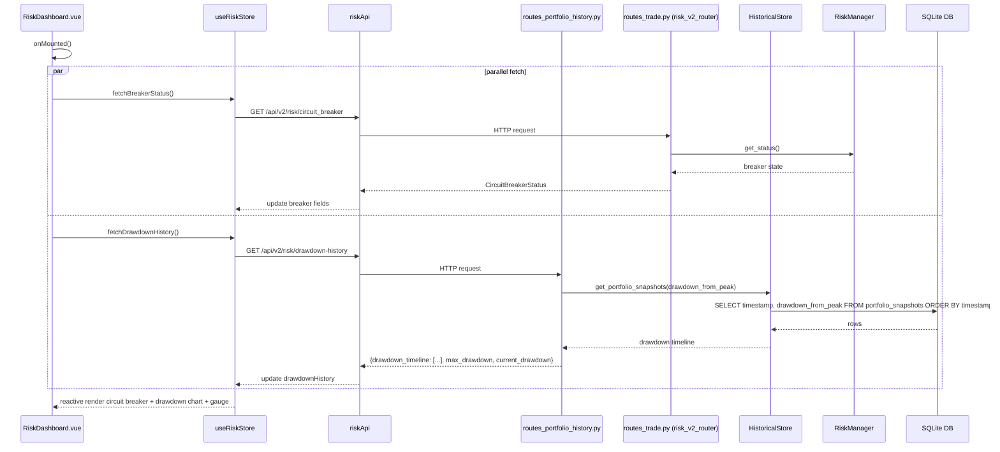
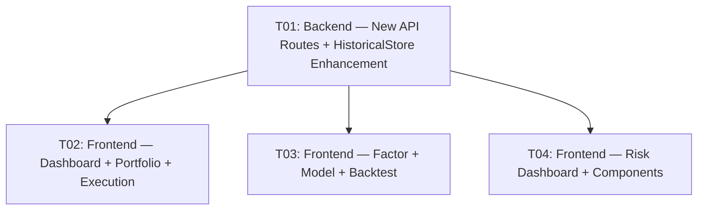

# System Architecture Design — Frontend Real-Data Migration

**Author**: Bob (Architect)  
**Date**: 2025-06-19  
**Based on**: Team Lead requirement — "前端数据真实化改造"

---

## Part A: System Design

### 1. Implementation Approach

#### 1.1 Core Technical Challenges

| # | Challenge | Analysis | Solution |
|---|-----------|----------|----------|
| C1 | Factor data from DB | `factor_definitions`, `factor_ic`, `factor_correlation` tables exist but NO backend API routes expose them | Create `routes_factors.py` with proper SQL queries |
| C2 | Portfolio history from DB | `portfolio_snapshots` has `nav`, `daily_pnl`, `cumulative_return`, `drawdown_from_peak` but no API exposes historical timeline | Create `routes_portfolio_history.py` for NAV/returns/drawdown history |
| C3 | Model metrics from DB | `model_versions` + `model_metrics` tables exist but `/api/models/status` only returns runtime status (stubs), not DB-persisted metrics | Enhance `routes_models.py` to also query DB for historical metrics |
| C4 | 7 frontend pages use hardcoded/random data | Stores and API clients already wired, but views never call `store.fetch*()` — they use `ref([...])` literals | Uncomment store calls, replace `ref()` literals with store reactive state |
| C5 | Training progress simulation | `ModelCenter.vue` uses `setInterval + Math.random()` to fake training progress | Use existing `modelStore.pollTrainingStatus()` + `isTraining`/`trainingProgress` |

#### 1.2 Framework & Library Selections

**No new dependencies required.** All work uses the existing stack:

**Backend** (unchanged):
- FastAPI 0.110+ (REST routes)
- SQLite3 via Python stdlib (direct DB queries)
- pandas (data aggregation)

**Frontend** (unchanged):
- Vue 3.4 + Composition API + `<script setup lang="ts">`
- Pinia (state management — stores already exist)
- ECharts 5 + vue-echarts (charts)
- Axios (HTTP client — apiClient already configured)

#### 1.3 Architecture Pattern

The migration follows a **thin-backend, fat-store** pattern:
- Backend adds minimal new route files exposing existing DB tables as JSON
- Frontend stores already have the API call methods — views just need to call them
- No new state management patterns — all Pinia stores are already defined

```
┌──────────────────────────────────────────────────────────┐
│                   Frontend (Vite :5173)                   │
│  Views (7 pages) ──call──▶ Pinia Stores ──call──▶ API    │
│  Dashboard           usePortfolioStore       executionApi │
│  FactorResearch      useFactorStore          factorApi    │
│  ModelCenter         useModelStore           modelApi     │
│  RiskDashboard       useRiskStore            riskApi      │
│  PortfolioOptimizer  usePortfolioStore       executionApi │
│  BacktestAnalysis    usePortfolioStore       executionApi │
│  ExecutionMonitor    useExecutionStore       executionApi │
└──────────────────────────┬───────────────────────────────┘
                           │ HTTP REST (/api/*)
┌──────────────────────────┴───────────────────────────────┐
│                Backend (FastAPI :8001)                     │
│  NEW: routes_factors.py      → /api/v2/factors/*          │
│  NEW: routes_portfolio_history.py → /api/v2/analysis/*    │
│  MODIFIED: routes_models.py  → /api/v2/train/models       │
│  MODIFIED: historical_store.py → query methods            │
│  EXISTING: routes_trade.py, routes_data.py, etc.          │
└──────────────────────────┬───────────────────────────────┘
                           │ SQL
┌──────────────────────────┴───────────────────────────────┐
│              SQLite DB (quant_trader.db)                   │
│  Tables: factor_definitions, factor_ic, factor_correlation │
│          portfolio_snapshots, trades, model_versions,      │
│          model_metrics, signals, daily_bars, etc.          │
└──────────────────────────────────────────────────────────┘
```

---

### 2. File List

#### 2.1 NEW Files (Backend)

| # | File Path | Purpose |
|---|-----------|---------|
| 1 | `backend/api/routes_factors.py` | Factor CRUD + IC analysis + correlation API endpoints |
| 2 | `backend/api/routes_portfolio_history.py` | Portfolio history, yearly returns, drawdown timeline endpoints |

#### 2.2 MODIFIED Files (Backend)

| # | File Path | Change |
|---|-----------|--------|
| 3 | `backend/main.py` | Register `routes_factors.router` and `routes_portfolio_history.router` |
| 4 | `backend/data_engine/historical_store.py` | Add `get_factors()`, `get_factor_ic()`, `get_factor_correlation()`, `get_portfolio_snapshots()`, `get_model_versions_with_metrics()` query methods |

#### 2.3 MODIFIED Files (Frontend — Views)

| # | File Path | Change |
|---|-----------|--------|
| 5 | `frontend/src/views/Dashboard.vue` | Replace hardcoded `navHistory` ref with `portfolioStore` data from `/api/trade/dashboard` |
| 6 | `frontend/src/views/FactorResearch.vue` | Replace hardcoded `factors` ref + `Math.random()` corr with `factorStore` reactive data |
| 7 | `frontend/src/views/ModelCenter.vue` | Replace hardcoded `models` ref + `setInterval` training with `modelStore` reactive data |
| 8 | `frontend/src/views/RiskDashboard.vue` | Replace hardcoded `drawdownHistory`/`dailyPnlPct`/`currentDrawdown` with `riskStore` data |
| 9 | `frontend/src/views/PortfolioOptimizer.vue` | Replace hardcoded `holdings` ref with `portfolioStore.positions` from API |
| 10 | `frontend/src/views/BacktestAnalysis.vue` | Replace `Math.random()` equity curve + hardcoded metrics with API portfolio history |
| 11 | `frontend/src/views/ExecutionMonitor.vue` | Replace hardcoded `tradeLogs` ref with `/api/trade/history` real data |

#### 2.4 MODIFIED Files (Frontend — Stores)

| # | File Path | Change |
|---|-----------|--------|
| 12 | `frontend/src/stores/usePortfolioStore.ts` | Add `portfolioHistory`, `yearlyReturns`, `dashboardMetrics`; add `fetchDashboard()`, `fetchPortfolioHistory()` |
| 13 | `frontend/src/stores/useExecutionStore.ts` | Add `tradeLogs`, `todayStats` computed; add `fetchTradeLogs()` calling `/api/trade/history` |
| 14 | `frontend/src/stores/useRiskStore.ts` | Add `drawdownHistory: number[]`; add `fetchDrawdownHistory()` calling new drawdown-history API |

#### 2.5 MODIFIED Files (Frontend — API Layer)

| # | File Path | Change |
|---|-----------|--------|
| 15 | `frontend/src/api/executionApi.ts` | Add `getPortfolioHistory()`, `getYearlyReturns()`, `getTradeLogs()` methods |
| 16 | `frontend/src/api/riskApi.ts` | Add `getDrawdownHistory()` method |

#### 2.6 UNCHANGED Files (already correctly wired)

| # | File Path | Reason |
|---|-----------|--------|
| — | `frontend/src/api/factorApi.ts` | Already calls `/api/v2/factors/*` — just needs backend routes to exist |
| — | `frontend/src/api/modelApi.ts` | Already calls `/api/v2/train/*` and `/api/v2/infer/*` — needs backend DB integration |
| — | `frontend/src/stores/useFactorStore.ts` | Already has `fetchFactors()`, `fetchIC()`, `fetchCorrelation()`, `fetchDecay()` |
| — | `frontend/src/stores/useModelStore.ts` | Already has `fetchModels()`, `fetchModelStatus()`, `pollTrainingStatus()` |
| — | `frontend/src/api/dataApi.ts` | Already calls `/api/v2/data/market_status` — works with existing backend |
| — | `frontend/src/router/index.ts` | No route changes needed |
| — | `frontend/src/api/index.ts` | apiClient configuration unchanged |

---

### 3. Data Structures and Interfaces

```mermaid
classDiagram
    class FactorDef {
        +String id
        +String name
        +String category
        +String subcategory
        +String description
        +int lookback_default
        +String frequency
        +float direction
    }

    class ICAnalysis {
        +float rank_ic_mean
        +float rank_ic_std
        +float information_ratio
        +float ic_t_stat
        +float positive_ic_ratio
        +List~ICPoint~ ic_series
        +List~CumICPoint~ ic_cumulative
        +List~MonthlyIC~ monthly_ic
    }

    class ICPoint {
        +String date
        +float ic
    }

    class CumICPoint {
        +String date
        +float cumulative_ic
    }

    class MonthlyIC {
        +int year
        +int month
        +float ic
    }

    class CorrMatrix {
        +Dict~String,Dict~ correlation_matrix
        +List~RedundantPair~ redundant_pairs
    }

    class RedundantPair {
        +String factor_1
        +String factor_2
        +float correlation
    }

    class PortfolioSnapshot {
        +String timestamp
        +float total_value
        +float cash
        +float positions_value
        +float daily_pnl
        +float total_pnl
        +float cumulative_return
        +float drawdown_from_peak
        +float sharpe_ratio
    }

    class PortfolioHistoryResponse {
        +List~NavPoint~ nav_history
        +List~DrawdownPoint~ drawdown_history
        +PortfolioSummary summary
        +int snapshot_count
    }

    class NavPoint {
        +String time
        +float value
        +float cumulative_return
    }

    class DrawdownPoint {
        +String time
        +float drawdown
    }

    class YearlyReturnsResponse {
        +List~YearlyReturn~ yearly_returns
    }

    class YearlyReturn {
        +int year
        +float return_pct
    }

    class ModelVersionWithMetrics {
        +String name
        +String type
        +int version
        +String stage
        +String status
        +float sharpe
        +float pnl
        +float win_rate
        +String last_trained
    }

    class TradeLogEntry {
        +int id
        +String ticker
        +String side
        +float quantity
        +float price
        +float value
        +float commission
        +String timestamp
        +float signal_strength
        +String strategy
        +String status
    }

    class DashboardMetrics {
        +float total_value
        +float cash
        +float positions_value
        +float total_pnl
        +float total_return_pct
        +float sharpe_ratio
        +float max_drawdown
        +float max_drawdown_pct
        +float win_rate
        +float profit_factor
        +float calmar_ratio
        +int num_positions
        +int total_trades
        +int snapshot_count
        +String timestamp
    }

    class HistoricalStore {
        +get_factors(category?) List~FactorDef~
        +get_factor_ic(factor_name, window) ICAnalysis
        +get_factor_correlation(factor_names) CorrMatrix
        +get_portfolio_snapshots(limit, since) List~PortfolioSnapshot~
        +get_yearly_returns() List~YearlyReturn~
        +get_model_versions_with_metrics() List~ModelVersionWithMetrics~
        +get_trades(ticker, limit, since) DataFrame
    }

    HistoricalStore --> FactorDef : queries factor_definitions
    HistoricalStore --> ICAnalysis : queries factor_ic
    HistoricalStore --> CorrMatrix : queries factor_correlation
    HistoricalStore --> PortfolioSnapshot : queries portfolio_snapshots
    HistoricalStore --> YearlyReturn : aggregates portfolio_snapshots
    HistoricalStore --> ModelVersionWithMetrics : joins model_versions+model_metrics
    HistoricalStore --> TradeLogEntry : queries trades
```



---

### 4. Program Call Flow

#### 4.1 FactorResearch Page — Full Data Flow



#### 4.2 Dashboard — NAV History Data Flow



#### 4.3 BacktestAnalysis — Portfolio History Data Flow



#### 4.4 RiskDashboard — Drawdown History + Circuit Breaker Data Flow



---

### 5. Anything UNCLEAR

| # | Issue | Assumption |
|---|-------|------------|
| Q1 | `factor_values` table schema unknown (column names, how factor values are stored per ticker) | Not needed for this migration — only `factor_definitions`, `factor_ic`, `factor_correlation` are queried for display |
| Q2 | `model_versions` + `model_metrics` exact schema unknown | Assume standard columns: `model_versions(name, version, stage, status, created_at)`, `model_metrics(model_name, version, metric_name, metric_value)` — will inspect DB at implementation time |
| Q3 | `portfolio_snapshots` column name for drawdown | Assumed `drawdown_from_peak` as specified in the brief; will verify against actual `portfolio_snapshots` schema |
| Q4 | Training progress — is real training happening in background? | The `ModelTrainer` runs async; `ModelCenter.vue` will poll `modelStore.isTraining` + `trainingProgress` which comes from `trainer.get_training_summary()` |
| Q5 | Efficient Frontier in PortfolioOptimizer — still random? | Yes, efficient frontier computation is algorithmic (Monte Carlo simulation), not DB-driven. The holdings table IS what needs real data. Frontier stays computed client-side. |
| Q6 | BacktestAnalysis benchmark curve | We only have strategy portfolio snapshots in DB. Benchmark (SPY) curve will be derived from `daily_bars` for SPY — if unavailable, benchmark line is omitted with note. |

---

## Part B: Task Decomposition

### 6. Required Packages

No new packages required. All dependencies already exist in the project:

```
# Backend (already in pyproject.toml / requirements)
- fastapi>=0.110.0
- pandas>=2.0.0
- loguru

# Frontend (already in package.json)
- vue@^3.4
- pinia@^2.1
- vue-router@^4.3
- vue-echarts@^6.7
- echarts@^5.5
- axios@^1.7
- tailwindcss@^3.4
- typescript@^5.4
```

---

### 7. Task List (ordered by dependency)

#### T01 — 后端新增 API 端点 + HistoricalStore 增强

- **Task ID**: T01
- **Task Name**: Backend — New Factor & Portfolio History API Routes
- **Source Files**:
  - `backend/api/routes_factors.py` (NEW) — Factor list, IC analysis, correlation endpoints
  - `backend/api/routes_portfolio_history.py` (NEW) — Portfolio history, yearly returns, drawdown history endpoints
  - `backend/main.py` (MODIFY) — Register new routers: `routes_factors.router`, `routes_portfolio_history.router`
  - `backend/data_engine/historical_store.py` (MODIFY) — Add `get_factors()`, `get_factor_ic()`, `get_factor_correlation()`, `get_portfolio_snapshots()`, `get_yearly_returns()`, `get_model_versions_with_metrics()` query methods
- **Dependencies**: None (foundational)
- **Priority**: P0

#### T02 — 前端核心页面接入真实数据 (Dashboard + PortfolioOptimizer + ExecutionMonitor)

- **Task ID**: T02
- **Task Name**: Frontend — Core Trading Pages Real-Data Integration
- **Source Files**:
  - `frontend/src/views/Dashboard.vue` (MODIFY) — Use `portfolioStore.dashboardMetrics` + real navHistory; remove hardcoded `navHistory` ref
  - `frontend/src/views/PortfolioOptimizer.vue` (MODIFY) — Use `portfolioStore.positions` + API data for holdings table and summary cards
  - `frontend/src/views/ExecutionMonitor.vue` (MODIFY) — Use `executionStore.tradeLogs` from `/api/trade/history`; remove hardcoded tradeLogs ref
  - `frontend/src/stores/usePortfolioStore.ts` (MODIFY) — Add `dashboardMetrics`, `navHistory`; add `fetchDashboard()` calling `/api/trade/dashboard`
  - `frontend/src/stores/useExecutionStore.ts` (MODIFY) — Add `tradeLogs`, `todayStats` computed; add `fetchTradeLogs()` calling `/api/trade/history`
  - `frontend/src/api/executionApi.ts` (MODIFY) — Add `getDashboard()` and `getTradeLogs()` API methods
  - `frontend/src/components/dashboard/AccountSummary.vue` (MODIFY) — Adapt props to use real API response shape (already compatible)
- **Dependencies**: T01
- **Priority**: P0

#### T03 — 前端分析页面接入真实数据 (FactorResearch + ModelCenter + BacktestAnalysis)

- **Task ID**: T03
- **Task Name**: Frontend — Analysis Pages Real-Data Integration
- **Source Files**:
  - `frontend/src/views/FactorResearch.vue` (MODIFY) — Call `factorStore.fetchFactors()` + `fetchCorrelation()` on mount; bind to reactive store data
  - `frontend/src/views/ModelCenter.vue` (MODIFY) — Call `modelStore.fetchModels()` + `fetchModelStatus()`; remove simulated training; use `modelStore.isTraining`/`trainingProgress`
  - `frontend/src/views/BacktestAnalysis.vue` (MODIFY) — Call `portfolioStore.fetchPortfolioHistory()` + `fetchYearlyReturns()`; remove `Math.random()` curve generation
  - `frontend/src/stores/usePortfolioStore.ts` (MODIFY) — Add `portfolioHistory`, `yearlyReturns`; add `fetchPortfolioHistory()` + `fetchYearlyReturns()` calling new APIs from T01
  - `frontend/src/stores/useFactorStore.ts` (MODIFY) — Ensure `fetchFactors()` returns usable data; add `allFactorNames` computed for correlation call
  - `frontend/src/stores/useModelStore.ts` (MODIFY) — Adapt `fetchModels()` to use new `/api/v2/train/models` DB endpoint
  - `frontend/src/api/executionApi.ts` (MODIFY) — Add `getPortfolioHistory()` + `getYearlyReturns()` methods
- **Dependencies**: T01
- **Priority**: P1

#### T04 — 前端风控页面接入真实数据 + 组件适配 (RiskDashboard)

- **Task ID**: T04
- **Task Name**: Frontend — Risk Dashboard Real-Data Integration
- **Source Files**:
  - `frontend/src/views/RiskDashboard.vue` (MODIFY) — Replace hardcoded `drawdownHistory`, `dailyPnlPct`, `currentDrawdown`, `var95` with `riskStore` reactive data
  - `frontend/src/stores/useRiskStore.ts` (MODIFY) — Add `drawdownHistory: number[]`; add `fetchDrawdownHistory()` calling new drawdown-history API from T01
  - `frontend/src/api/riskApi.ts` (MODIFY) — Add `getDrawdownHistory()` method calling `GET /api/v2/risk/drawdown-history`
  - `frontend/src/components/risk/CircuitBreakerStatus.vue` (MODIFY) — Ensure props align with API response shape (already mostly compatible)
  - `frontend/src/components/risk/VaRGauge.vue` (MODIFY) — Use real VaR data from `riskStore.varData` instead of hardcoded values
- **Dependencies**: T01
- **Priority**: P1

---

### 8. Shared Knowledge

```
- All API responses use {data, ...} wrapper pattern (frontend apiClient strips via `data.data`)
- Backend new routes follow existing pattern: APIRouter with prefix, init() for dependency injection
- HistoricalStore uses SQLite3 direct queries (no ORM) — follow existing `get_trades()` pattern
- Frontend API layer: executionApi, riskApi, dataApi extend apiClient; factorApi uses raw axios
- Pinia stores use Composition API style (`defineStore('name', () => { ... })`)
- ECharts options are `computed()` refs with TypeScript `as const` type assertions
- All dates stored/returned as ISO 8601 strings
- NAV values in USD, percentages as decimals (0.03 = 3%)
- Trade side values: 'buy' / 'sell' (lowercase)
- Model status values: 'active', 'training', 'error', 'archived'
- Factor direction: +1 (positive expected IC), -1 (negative expected IC)
```

---

### 9. Task Dependency Graph



---

### Appendix A: New API Contracts

#### A.1 Factor APIs (`routes_factors.py`)

**`GET /api/v2/factors/factors`**

Query params: `?category=Momentum` (optional)

Response:
```json
{
  "factors": [
    {
      "id": "momentum_20d",
      "name": "20-Day Momentum",
      "category": "Momentum",
      "subcategory": "Price",
      "description": "20-day price momentum factor",
      "lookback_default": 20,
      "frequency": "daily",
      "direction": 1
    }
  ],
  "categories": {
    "Momentum": 3,
    "Technical": 4,
    "Volume": 2,
    "Risk": 2,
    "Value": 3,
    "Sentiment": 1
  }
}
```

**`GET /api/v2/factors/ic-analysis`**

Query params: `?factor_name=momentum_20d&window=252`

Response:
```json
{
  "rank_ic_mean": 0.045,
  "rank_ic_std": 0.12,
  "information_ratio": 0.375,
  "ic_t_stat": 3.2,
  "positive_ic_ratio": 0.68,
  "ic_series": [
    {"date": "2025-01-02", "ic": 0.052},
    {"date": "2025-01-03", "ic": -0.018}
  ],
  "ic_cumulative": [
    {"date": "2025-01-02", "cumulative_ic": 0.052},
    {"date": "2025-01-03", "cumulative_ic": 0.034}
  ],
  "monthly_ic": [
    {"year": 2025, "month": 1, "ic": 0.038},
    {"year": 2025, "month": 2, "ic": 0.051}
  ]
}
```

**`GET /api/v2/factors/correlation`**

Query params: `?factor_names=momentum_20d,rsi_14,volume_ratio`

Response:
```json
{
  "correlation_matrix": {
    "momentum_20d": {"momentum_20d": 1.0, "rsi_14": 0.45, "volume_ratio": 0.12},
    "rsi_14": {"momentum_20d": 0.45, "rsi_14": 1.0, "volume_ratio": -0.08},
    "volume_ratio": {"momentum_20d": 0.12, "rsi_14": -0.08, "volume_ratio": 1.0}
  },
  "redundant_pairs": [
    {"factor_1": "momentum_20d", "factor_2": "rsi_14", "correlation": 0.45}
  ]
}
```

#### A.2 Portfolio History APIs (`routes_portfolio_history.py`)

**`GET /api/v2/analysis/portfolio-history`**

Query params: `?limit=252&since=2025-01-01` (optional)

Response:
```json
{
  "nav_history": [
    {"time": "2025-01-02T00:00:00", "value": 1000000.00, "cumulative_return": 0.0},
    {"time": "2025-01-03T00:00:00", "value": 1008500.00, "cumulative_return": 0.0085}
  ],
  "drawdown_history": [
    {"time": "2025-01-02T00:00:00", "drawdown": 0.0},
    {"time": "2025-01-03T00:00:00", "drawdown": 0.0}
  ],
  "summary": {
    "start_value": 1000000.00,
    "end_value": 1185000.00,
    "total_return_pct": 0.185,
    "max_drawdown_pct": 0.12,
    "sharpe_ratio": 1.85,
    "snapshot_count": 252
  }
}
```

**`GET /api/v2/analysis/yearly-returns`**

Response:
```json
{
  "yearly_returns": [
    {"year": 2024, "return_pct": 0.22},
    {"year": 2025, "return_pct": 0.08}
  ]
}
```

**`GET /api/v2/risk/drawdown-history`**

Query params: `?limit=252` (optional, default 252)

Response:
```json
{
  "drawdown_timeline": [
    {"time": "2025-01-02T00:00:00", "drawdown": 0.0},
    {"time": "2025-06-15T00:00:00", "drawdown": 0.03}
  ],
  "max_drawdown": 0.12,
  "current_drawdown": 0.03,
  "peak_value": 1250000.00,
  "snapshot_count": 252
}
```

#### A.3 Enhanced Model API

**`GET /api/v2/train/models`** (enhanced — add DB fallback)

Response:
```json
{
  "models": [
    {
      "name": "PatchTST Transformer",
      "type": "Transformer",
      "version": 3,
      "stage": "production",
      "status": "active",
      "sharpe": 1.85,
      "pnl": 45200.00,
      "win_rate": 0.62,
      "last_trained": "2025-06-07T10:30:00"
    }
  ]
}
```

---

### Appendix B: DB Schema Reference (for implementation)

```sql
-- factor_definitions: id, name, category, subcategory, description, lookback_default, frequency, direction
-- factor_ic: factor_name, date, rank_ic
-- factor_correlation: factor_1, factor_2, correlation
-- portfolio_snapshots: id, timestamp, total_value, cash, positions_value, daily_pnl, total_pnl, drawdown, sharpe_ratio
-- model_versions: name, version, stage, status, created_at
-- model_metrics: model_name, version, metric_name, metric_value
-- trades: id, ticker, side, quantity, price, value, commission, timestamp, signal_strength, strategy, status
```
