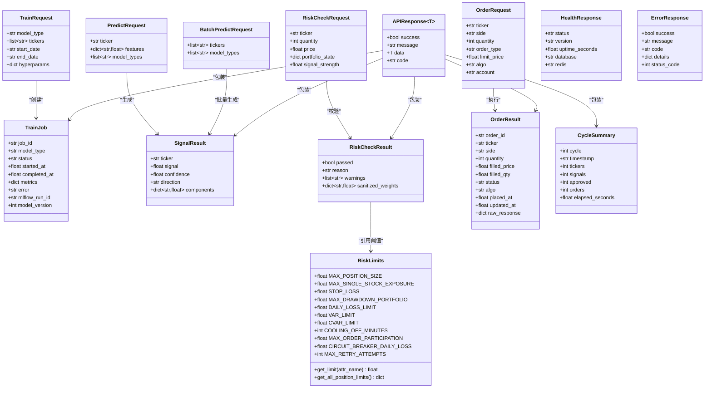
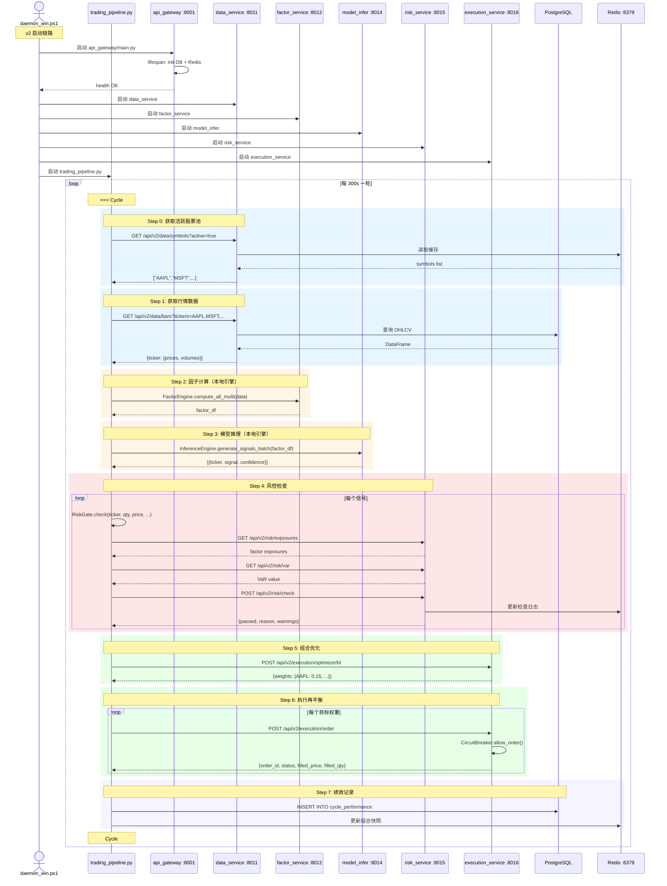
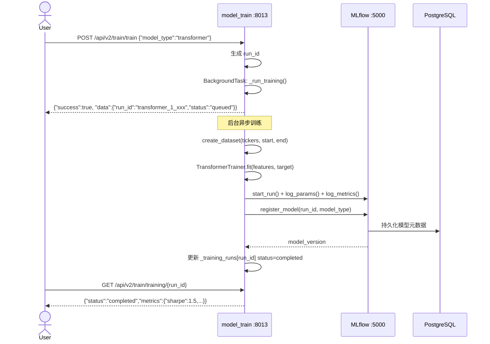
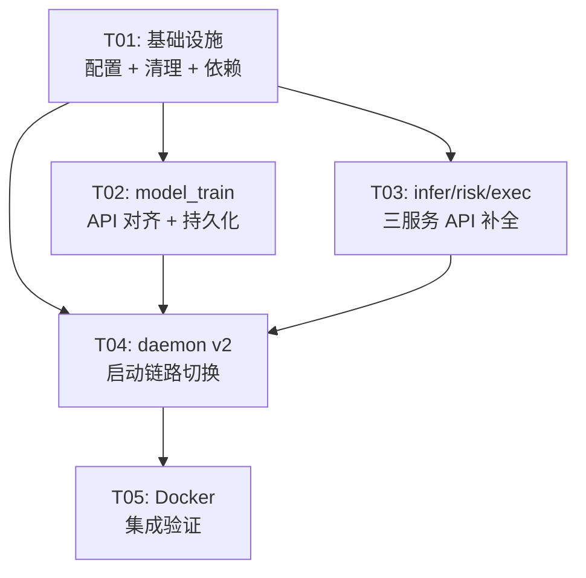

# Quant AI Trader v2.1 — 系统架构设计 & 任务分解

> 架构师：Bob（高见远）| 日期：2025-07-01 | 版本：v1.0

---

## 目录

1. [实现方案与框架选型](#1-实现方案与框架选型)
2. [文件列表及相对路径](#2-文件列表及相对路径)
3. [数据结构与接口（类图）](#3-数据结构与接口类图)
4. [程序调用流程（时序图）](#4-程序调用流程时序图)
5. [任务列表](#5-任务列表)
6. [依赖包列表](#6-依赖包列表)
7. [共享知识（跨文件约定）](#7-共享知识跨文件约定)
8. [待明确事项](#8-待明确事项)

---

## 1. 实现方案与框架选型

### 1.1 代码库现状评估

经过全面阅读现有代码，**六个微服务的骨架已全部存在**（均有 `main.py` + `config.py` + `api/routes.py`），并非从零开始。核心问题不是"缺失服务"，而是：

| 问题类别 | 严重程度 | 说明 |
|----------|----------|------|
| API 契约不完整 | 🔴 阻塞 | risk_service 缺少 `POST /check`；execution_service 需要 `GET /order/{id}` |
| 部分路由与 PRD 不一致 | 🟡 需修正 | model_train 路由是 `/train/{model_type}` 而非 PRD 的 `/train` |
| daemon 仍调用 v1 路径 | 🔴 阻塞 | `daemon_win.ps1` 启动 `run_backend.py` + `auto_trader.py`，非 v2 入口 |
| .env 严重不完整 | 🟡 质量债 | 只有 4 行，缺少所有服务端口/DB/Redis 等变量 |
| 硬编码路径 | 🟡 质量债 | daemon 脚本硬编码 `E:\workbuddyspace\...` |
| 端口不统一 | 🟡 需修正 | docker-compose 使用 8011-8016（环境变量），PRD 要求 8002-8007。以 docker-compose 已有的环境变量命名为准 |

### 1.2 技术栈决策

| 组件 | 选型 | 理由 |
|------|------|------|
| **6 个微服务** | FastAPI + uvicorn | 已有骨架全部基于 FastAPI；与 api_gateway 同技术栈；内置 async、自动 OpenAPI、Pydantic 验证 |
| **API Gateway** | FastAPI（已有） | 已实现 CORS、Auth 中间件、全局异常处理、health check；无需更换 |
| **交易编排器** | 独立 asyncio 脚本（Python） | `trading_pipeline.py` 已有完整七步流程；轻量无状态，适合 daemon 管理 |
| **配置管理** | Pydantic Settings（v2） | `configs/settings.py` + 各服务独立 config；环境变量前缀 `QAT_` |
| **数据库** | PostgreSQL 16 + SQLAlchemy 2.0 async | docker-compose 已定义；`shared/database/` 已有引擎 |
| **缓存/消息** | Redis 7 | docker-compose 已定义；`shared/redis_client.py` 已封装 |
| **模型训练** | PyTorch + MLflow | pyproject.toml 已依赖；MLflow 已有 Docker 容器 |
| **模型推理** | PyTorch 本地引擎 | `InferenceEngine` 已实现多模型加载 + ensemble |
| **风控** | 本地 RiskGate + risk_service HTTP | 四道风控已在 `shared/risk_gate.py` 实现 |
| **执行** | 模拟盘默认，实盘预留 | TigerBroker 已封装 paper/live 双模 |

### 1.3 架构模式

```
┌─────────────────────────────────────────────────────────┐
│                   daemon_win.ps1 / Docker                │
│                      (进程守护层)                          │
├─────────────────────────────────────────────────────────┤
│                   trading_pipeline.py                    │
│                  (交易编排层, asyncio)                     │
├──────────┬──────────┬──────────┬──────────┬─────────────┤
│  data    │  factor  │model-    │model-    │  risk       │
│  :8011   │  :8012   │train     │infer     │  :8015      │
│  FASTAPI │  FASTAPI │:8013     │:8014     │  FASTAPI    │
│          │          │FASTAPI   │FASTAPI   │             │
├──────────┴──────────┴──────────┴──────────┴─────────────┤
│              execution :8016 (FASTAPI)                    │
├─────────────────────────────────────────────────────────┤
│         PostgreSQL :5432  │  Redis :6379  │  MLflow :5000│
└─────────────────────────────────────────────────────────┘
```

**关键设计原则**：
- 每个微服务独立 FastAPI 进程，通过 HTTP 互相调用
- `trading_pipeline.py` 作为中心编排器，依次调用各服务
- daemon 负责启动 api_gateway + 6 个微服务 + trading_pipeline
- Docker Compose 提供容器化部署，裸 Python 提供开发模式

---

## 2. 文件列表及相对路径

### 2.1 新建文件

| # | 相对路径 | 用途 |
|---|----------|------|
| 1 | `ctl_win.ps1` | **恢复** Windows 服务控制脚本（start/stop/restart/status/logs） |
| 2 | `requirements.txt` | 从 pyproject.toml 导出的 pip 依赖清单 |
| 3 | `services/risk_service/api/schemas.py` | risk check 请求/响应 Pydantic 模型 |
| 4 | `services/execution_service/api/schemas.py` | execution order 请求/响应 Pydantic 模型 |
| 5 | `services/model_train_service/api/schemas.py` | train 请求/响应 Pydantic 模型（补充 TrainJob） |
| 6 | `start_v2.bat` | 统一 v2 启动脚本（替代散乱的 .bat） |

### 2.2 修改文件

| # | 相对路径 | 修改内容 | 优先级 |
|---|----------|----------|--------|
| 1 | `.env` | 补全所有 `.env.example` 键，含 PROJECT_ROOT、服务端口、DB 连接串 | P0 |
| 2 | `configs/settings.py` | 添加 PROJECT_ROOT 字段；添加各服务端口字段 | P0 |
| 3 | `daemon_win.ps1` | 切换启动目标从 v1 → v2（api_gateway/main.py + trading_pipeline.py） | P0 |
| 4 | `daemon_forever.bat` | 同上，切换 v2 启动链路 | P0 |
| 5 | `services/risk_service/main.py` | lifespan 中加载 RiskChecker；暴露 risk_checker 全局引用 | P0 |
| 6 | `services/risk_service/api/routes.py` | 新增 `POST /check` + `GET /limits` 端点 | P0 |
| 7 | `services/execution_service/api/routes.py` | 新增 `GET /order/{order_id}` + 增强 `POST /execute/order` 状态追踪 | P0 |
| 8 | `services/model_train_service/api/routes.py` | 新增 `POST /train`（无 model_type 路径参数版本）；`POST /train/{model_type}` 保留兼容 | P0 |
| 9 | `services/model_infer_service/api/routes.py` | 新增 `GET /health/models` 端点；增加模型热加载逻辑 | P0 |
| 10 | `services/execution_service/config.py` | 添加 ORDER_STATUS_TTL 字段 | P1 |
| 11 | `services/model_train_service/config.py` | 添加 TRAIN_JOB_TTL 持久化配置 | P1 |
| 12 | `trading_pipeline.py` | 修复端口引用（统一使用环境变量）；增强 Step 7 持久化 | P0 |
| 13 | `api_gateway/main.py` | 更新 `/api/v2/status` 端口表为 8011-8016；添加各服务健康代理 | P1 |
| 14 | `docker-compose.yml` | 确认所有服务端口映射正确；添加 trading_pipeline 容器（可选） | P1 |
| 15 | `pyproject.toml` | 更新 packages.find.include 包含 services/* | P1 |
| 16 | `configs/pipeline_config.py` | SERVICE_BASE_URLS 改为从环境变量读取 | P1 |

### 2.3 移动/归档文件

| # | 源路径 | 目标路径 | 原因 |
|---|--------|----------|------|
| 1 | `auto_trader.py` | `_legacy_archive/misc/auto_trader.py` | v1 已废弃，由 trading_pipeline.py 替代 |
| 2 | `run_backend.py` | `_legacy_archive/misc/run_backend.py` | v1 已废弃，由 api_gateway/main.py 替代 |
| 3 | `dashboard.py` | `_legacy_archive/misc/dashboard.py` | 散乱文件 |
| 4 | `generate_*.py`（如有） | `scripts/` | 工具脚本归类 |
| 5 | `tmp_repo.json`（如有） | `_legacy_archive/misc/` | 临时文件 |
| 6 | `start.bat`, `start_all.bat`, `start_daemon.bat`, `start_frontend.bat`, `start_trader.bat`, `setup_runner.bat`, `do_push.bat`, `monitor.bat` | 保留 `start_v2.bat` + `daemon_forever.bat`，其余移入 `_legacy_archive/boot_scripts_v1/` | P1-6：bat 减少到 ≤3 个 |

---

## 3. 数据结构与接口（类图）

### 3.1 核心数据模型



### 3.2 微服务端点总览

| 服务 | 端口 | 关键端点 | HTTP 方法 |
|------|------|----------|-----------|
| **api-gateway** | 8001 | `/health`, `/api/v2/status` | GET |
| **data-service** | 8011 | `/health`, `/api/v2/data/bars`, `/api/v2/data/symbols`, `/api/v2/data/realtime/{ticker}` | GET |
| **factor-service** | 8012 | `/health`, `/api/v2/factors/compute` | GET/POST |
| **model-train** | 8013 | `/health`, `/api/v2/train/models`, `/api/v2/train/train`, `/api/v2/train/train/{model_type}`, `/api/v2/train/training/{run_id}`, `/api/v2/train/hyperopt` | GET/POST |
| **model-infer** | 8014 | `/health`, `/api/v2/infer/predict`, `/api/v2/infer/predict/batch`, `/api/v2/infer/signal`, `/api/v2/infer/signal/all`, `/api/v2/infer/models/status` | GET/POST |
| **risk** | 8015 | `/health`, `/api/v2/risk/check` ⭐新增, `/api/v2/risk/limits` ⭐新增, `/api/v2/risk/var`, `/api/v2/risk/cvar`, `/api/v2/risk/exposures`, `/api/v2/risk/drawdown`, `/api/v2/risk/stress_test` | GET/POST |
| **execution** | 8016 | `/health`, `/api/v2/execution/order` ⭐统一, `/api/v2/execution/order/{order_id}` ⭐新增, `/api/v2/execution/optimizer/bl`, `/api/v2/execution/positions`, `/api/v2/execution/alerts` | GET/POST |

---

## 4. 程序调用流程（时序图）

### 4.1 端到端交易循环（trading_pipeline → 6 服务）



### 4.2 训练流程（model_train_service）



---

## 5. 任务列表

### 任务总览

| Task ID | 任务名称 | 对应 PRD | 优先级 |
|---------|----------|----------|--------|
| **T01** | 项目基础设施：配置补全 + 文件清理 + 依赖管理 | P1-1~P1-6 + P0-6 | P0 |
| **T02** | model_train_service 完善：训练 API 对齐 + 持久化 | P0-1 | P0 |
| **T03** | model_infer + risk + execution 三服务 API 补全 | P0-2, P0-3, P0-4 | P0 |
| **T04** | daemon v2 切换：启动链路 + trading_pipeline 修复 | P0-5 | P0 |
| **T05** | Docker Compose 集成 + 端到端验证 | 全链路联调 | P1 |

### 详细任务

#### T01: 项目基础设施：配置补全 + 文件清理 + 依赖管理

**目标**：消除硬编码、统一配置、清理散乱文件、补全环境变量

**源文件**（修改 5 个 + 新建 2 个 + 移动 8+ 个）：
- **修改**: `.env`, `configs/settings.py`, `configs/pipeline_config.py`, `pyproject.toml`, `api_gateway/main.py`
- **新建**: `ctl_win.ps1`, `requirements.txt`, `start_v2.bat`
- **移动**: `auto_trader.py`, `run_backend.py`, `dashboard.py` → `_legacy_archive/misc/`
- **归档**: 7 个散乱 .bat → `_legacy_archive/boot_scripts_v1/`

**核心变更**：

1. **`.env` 补全**：从 `.env.example` 复制全部键，添加：
   ```env
   QAT_PROJECT_ROOT=.
   QAT_DATA_PORT=8011
   QAT_FACTOR_PORT=8012
   QAT_MODEL_TRAIN_PORT=8013
   QAT_MODEL_INFER_PORT=8014
   QAT_RISK_PORT=8015
   QAT_EXEC_PORT=8016
   ```

2. **`configs/settings.py` 补全**：添加 `PROJECT_ROOT: str = Field(default=".")` 字段

3. **`configs/pipeline_config.py`**：`SERVICE_BASE_URLS` 改为从 `settings.py` 动态读取：
   ```python
   from configs.settings import settings
   SERVICE_BASE_URLS = {
       "data": f"http://localhost:{settings.DATA_PORT}",
       ...
   }
   ```

4. **`ctl_win.ps1` 恢复**：从 `_legacy_archive/daemon_scripts_legacy/ctl_win.ps1` 副本改写为 v2 版本（端口 8011-8016，启动 trading_pipeline.py）

5. **`pyproject.toml`**：`packages.find.include` 添加 `"services*"`

6. **`requirements.txt`**：从 pyproject.toml 导出（`pip-compile` 或手动复制 dependencies）

7. **`api_gateway/main.py`**：`/api/v2/status` 更新端口信息为 8011-8016

8. **文件清理**：bat 减少到 3 个（`start_v2.bat`, `daemon_forever.bat`, `install_boot.ps1`）；散乱脚本归档

**依赖**：无
**优先级**：P0

---

#### T02: model_train_service 完善

**目标**：API 对齐 PRD 规格 + 训练结果持久化

**源文件**（修改 3 个 + 新建 1 个）：
- **修改**: `services/model_train_service/api/routes.py`, `services/model_train_service/main.py`, `services/model_train_service/config.py`
- **新建**: `services/model_train_service/api/schemas.py`

**核心变更**：

1. **新增 `schemas.py`**：定义 `TrainJob` Pydantic 模型（job_id, model_type, status, metrics, error, mlflow_run_id, model_version, created_at, completed_at）

2. **`routes.py` 新增端点**：
   - `POST /train` — 无路径参数的统一训练入口（body 含 model_type）
   - 原 `POST /train/{model_type}` 保留向后兼容
   - `GET /train/{job_id}` — 别名指向 `GET /training/{run_id}`（PRD 语义对齐）

3. **持久化增强**：`_training_runs` 内存字典 → 写入 `cache/training_jobs.json`（JSON 文件持久化），启动时回读

4. **`config.py`**：添加 `TRAIN_JOB_TTL: int = 604800`（7 天过期）

5. **`main.py`**：lifespan 启动时从磁盘恢复 `_training_runs` 历史记录

**依赖**：T01（需要 `QAT_MODEL_TRAIN_PORT` 等环境变量）
**优先级**：P0

---

#### T03: model_infer + risk + execution 三服务 API 补全

**目标**：补齐三个服务的核心缺口端点

**源文件**（修改 5 个 + 新建 2 个）：
- **修改**: `services/model_infer_service/api/routes.py`, `services/risk_service/api/routes.py`, `services/risk_service/main.py`, `services/execution_service/api/routes.py`, `services/execution_service/config.py`
- **新建**: `services/risk_service/api/schemas.py`, `services/execution_service/api/schemas.py`

**核心变更**：

**model_infer（P0-2）**：
1. `routes.py` 新增 `POST /predict/hot-reload` — 热加载最新模型（从 MLflow 拉取 production stage 模型）
2. `GET /health/models` — 返回各模型加载状态和最后加载时间

**risk（P0-3）**：
1. 新增 `schemas.py`：定义 `RiskCheckRequest`, `RiskCheckResult` Pydantic 模型
2. `routes.py` 新增 `POST /check` — 订单级风控校验（仓位/金额/交易次数/回撤熔断），返回 `RiskCheckResult`
3. `routes.py` 新增 `GET /limits` — 返回当前生效的风控阈值（从 `configs/risk_limits.py` 读取）
4. `main.py`：lifespan 中初始化 `RiskChecker` 实例（组合 CircuitBreaker + RiskLimits），暴露为模块全局变量

**execution（P0-4）**：
1. 新增 `schemas.py`：定义标准化的 `OrderRequest`, `OrderResult` 模型
2. `routes.py` 新增 `GET /order/{order_id}` — 订单状态追踪（queued → submitted → partial_fill → filled → cancelled）
3. `routes.py` 增强 `POST /execute/order` — 统一别名为 `POST /order`
4. 订单结果写入 `cache/orders.jsonl`（JSON Lines 持久化）
5. `config.py`：添加 `ORDER_STATUS_TTL: int = 86400`（24h）

**依赖**：T01（端口配置）
**优先级**：P0

---

#### T04: daemon v2 切换 + trading_pipeline 修复

**目标**：让一次启动跑完端到端 v2 交易循环

**源文件**（修改 3 个）：
- **修改**: `daemon_win.ps1`, `daemon_forever.bat`, `trading_pipeline.py`

**核心变更**：

**daemon_win.ps1（P0-5）**：
1. 启动目标从 `run_backend.py` → `api_gateway/main.py`（uvicorn 启动）
2. 启动目标从 `auto_trader.py` → `trading_pipeline.py`
3. 新增启动 6 个微服务的逻辑（可选：通过 Docker 或裸 Python）
4. 健康检查端口改为 8001（api_gateway）
5. 路径硬编码消除：使用相对路径 + `$PSScriptRoot`
6. 添加 v2 服务状态展示（6 个微服务 + pipeline）

**daemon_forever.bat（P0-5）**：
1. 同样切换 v2 启动链路
2. 路径改为相对路径
3. 健康检查改为 api_gateway :8001 + trading_pipeline 进程检查

**trading_pipeline.py（修复）**：
1. 端口引用修复：`service_urls` 从 `pipeline_config.SERVICE_BASE_URLS` 读取（已在 T01 改为动态读取）
2. Step 7 持久化补全：实现 `shared/database/` 写入（cycle_performance 表）
3. `__init__` 中的 `InferenceEngine` 和 `FactorEngine` 导入路径确认可正常加载
4. 添加 `--once` 命令行参数支持（单次运行 + 退出，方便测试）

**依赖**：T01, T02, T03
**优先级**：P0

---

#### T05: Docker Compose 集成 + 端到端验证

**目标**：确认 docker-compose 9 容器全部可启动 + 服务连通

**源文件**（验证/微调 3 个）：
- **验证**: `docker-compose.yml`, `Dockerfile.api`, `Dockerfile.data`, `Dockerfile.factor`, `Dockerfile.model-train`, `Dockerfile.model-infer`, `Dockerfile.risk`, `Dockerfile.execution`
- **可能修改**: `docker-compose.yml`（补充环境变量映射）

**核心变更**：

1. **docker-compose.yml 验证**：
   - 确认所有 8 个 Dockerfile 存在且可构建
   - 环境变量 `${QAT_*}` 全部映射（已有大部分）
   - 服务 depends_on 链正确
   - 可选：添加 `trading-pipeline` 容器（以 `--once` 模式 + cron 调度，或独立 Python 容器运行 asyncio loop）
   
2. **网络连通性**：确认 `qat-network` 内各服务通过容器名互访

3. **端到端烟雾测试**：
   - `docker-compose up -d`
   - 等待全部 9 容器 healthy
   - curl api-gateway:8001/health
   - curl data:8011/health
   - curl model-train:8013/health
   - curl risk:8015/api/v2/risk/limits
   - curl execution:8016/api/v2/execution/positions

**依赖**：T04
**优先级**：P1

---

## 6. 依赖包列表

### 6.1 已有依赖（pyproject.toml 中）

所有核心依赖已在 `pyproject.toml` 的 `dependencies` 中声明，无需新增第三方包。

### 6.2 导出 requirements.txt

```text
# 从 pyproject.toml 导出的核心依赖（运行时）
fastapi>=0.110.0
uvicorn[standard]>=0.27.0
numpy>=1.26.0
pandas>=2.2.0
scipy>=1.12.0
pyarrow>=15.0.0
asyncpg>=0.29.0
sqlalchemy[asyncio]>=2.0.25
alembic>=1.13.0
psycopg2-binary>=2.9.9
redis[hiredis]>=5.0.1
scikit-learn>=1.4.0
xgboost>=2.0.3
lightgbm>=4.3.0
catboost>=1.2.3
torch>=2.2.0
transformers>=4.30.0
stable-baselines3>=2.2.0
gymnasium>=0.29.0
optuna>=3.5.0
mlflow>=2.10.0
cvxpy>=1.4.1
yfinance>=0.2.36
ta>=0.10.2
gplearn>=0.4.1
statsmodels>=0.14.1
pydantic>=2.6.0
pydantic-settings>=2.1.0
python-dotenv>=1.0.1
loguru>=0.7.2
httpx>=0.26.0
orjson>=0.3.9
tqdm>=4.66.0
python-dateutil>=2.8.2
pytz>=2024.1
schedule>=1.2.0
psutil>=5.9.0
slack-sdk>=3.27.0
matplotlib>=3.8.0
seaborn>=0.13.0
```

### 6.3 非 pip 依赖

| 依赖 | 版本 | 用途 | 如何安装 |
|------|------|------|----------|
| Docker | 24+ | 容器化部署 | 官方安装 |
| Docker Compose | v2+ | 多容器编排 | Docker Desktop 自带 |
| PostgreSQL | 16 | 数据库（Docker 内） | docker-compose |
| Redis | 7 | 缓存/消息（Docker 内） | docker-compose |
| CUDA Toolkit | 12.x | GPU 训练（可选） | NVIDIA 官方 |

---

## 7. 共享知识（跨文件约定）

### 7.1 统一 API 响应格式

所有 v2 服务使用 `shared/schema.py` 中的 `APIResponse[T]`：

```json
{
  "success": true,
  "message": "OK",
  "data": { ... },
  "code": "SUCCESS"
}
```

错误响应：
```json
{
  "success": false,
  "message": "Resource not found",
  "code": "NOT_FOUND",
  "details": { "resource": "model", "id": "abc-123" },
  "status_code": 404
}
```

### 7.2 统一健康检查

每个服务暴露 `GET /health`，返回：
```json
{"service": "<name>", "status": "healthy", "uptime_seconds": 123.45}
```

### 7.3 统一配置读取

```python
# 服务级配置（有独立前缀）
from services.xxx_service.config import xxx_config
port = xxx_config.PORT

# 全局配置（QAT_ 前缀）
from configs.settings import settings
db_url = settings.POSTGRES_URL

# 风控参数
from configs.risk_limits import RISK_LIMITS
max_pos = RISK_LIMITS.MAX_POSITION_SIZE
```

**禁止**：直接使用 `os.environ.get()` 读取配置（除 `config.py` 文件内部）。

### 7.4 统一日志格式

使用 `loguru`（已在 `shared/core/logger.py` 中封装 `setup_logger()`）：

```python
from shared.core.logger import setup_logger, get_logger

# main.py 中
setup_logger()

# 模块中
log = get_logger(__name__)
log.info("message")
```

日志输出到 `logs/` 目录（按 `configs/settings.py` 的 `LOG_DIR`），保留 7 天 + 自动轮转（50MB/文件）。

### 7.5 服务间通信约定

| 约定 | 值 |
|------|-----|
| 协议 | HTTP/1.1 REST + JSON |
| 超时 | 30s（httpx.Timeout） |
| 重试 | 3 次（指数退避：1s → 2s → 4s） |
| 熔断 | 连续 3 次失败 → 冷却 15 分钟（CircuitBreaker） |
| 失败处理 | Fail-open（非致命错误不阻塞管线） |

### 7.6 端口分配

| 服务 | 端口 | 环境变量 |
|------|------|----------|
| api-gateway | 8001 | `QAT_API_PORT` |
| data-service | 8011 | `QAT_DATA_PORT` |
| factor-service | 8012 | `QAT_FACTOR_PORT` |
| model-train | 8013 | `QAT_MODEL_TRAIN_PORT` |
| model-infer | 8014 | `QAT_MODEL_INFER_PORT` |
| risk-service | 8015 | `QAT_RISK_PORT` |
| execution-service | 8016 | `QAT_EXEC_PORT` |
| PostgreSQL | 5432 | `QAT_POSTGRES_PORT` |
| Redis | 6379 | `QAT_REDIS_PORT` |
| MLflow | 5000 | `QAT_MLFLOW_PORT` |

### 7.7 路径约定

- 所有文件路径使用 `pathlib.Path`，禁止字符串拼接
- `PROJECT_ROOT` 从 `configs/settings.py` 读取
- 数据目录：`<PROJECT_ROOT>/cache/`（Parquet 文件、模型检查点、训练作业）
- 日志目录：`<PROJECT_ROOT>/logs/`
- 配置文件：`<PROJECT_ROOT>/.env`（不纳入版本控制）

---

## 8. 待明确事项

### 8.1 PRD 中 7 个待确认问题的回答

| # | 问题 | 建议答案 |
|---|------|----------|
| **1** | model_train_service 是否需要 GPU 直通？Docker Compose 中如何处理？ | **默认不需要**。Docker Compose 中 CPU 模式足够（model-train 已有 `QAT_TRAIN_DEVICE=cpu` 默认）。如需 GPU，可在 docker-compose.yml 的 model-train 服务添加 `deploy.resources.reservations.devices: [{driver: nvidia, count: 1, capabilities: [gpu]}]`。建议注明为 optional。 |
| **2** | trading_pipeline.py 的调用顺序和错误恢复策略是否正确？ | **调用顺序正确**（7 步流程符合量化交易标准管线）。错误恢复策略良好（每步独立 try/except + fail-open）。**建议不改动核心逻辑**，仅修复端口引用 + 补全 Step 7 持久化。 |
| **3** | v1 的 backend/main.py + auto_trader.py 删除还是保留？ | **移入 `_legacy_archive/` 保留但不删除**。`trading_pipeline.py` 完全替代 `auto_trader.py`；`api_gateway/main.py` 完全替代 `run_backend.py`。归档保留为历史参考，不从版本控制删除。 |
| **4** | configs/settings.py(v2) 和 backend/config.py(v1) 如何合并？ | **不合并**。`configs/settings.py` 已是完整的 v2 Pydantic 配置。`backend/config.py` 在文件头部添加 `# DEPRECATED: Use configs/settings.py instead` 注释标记废弃，内部代码保持不变以免破坏 v1 兼容性。 |
| **5** | execution_service 的实盘接口预留方案？ | **已预留**。`exec_config.LIVE_TRADING_REQUIRE_CONFIRM=True` + `EXECUTION_MODE=paper` 双保险。实盘切换只需：① 设置 `QAT_EXECUTION_MODE=live`；② 配置 Tiger 凭证。执行逻辑已通过 `TigerBroker` 封装，`OrderRequest.algo` 支持 twap/vwap/pov/direct 四种算法。 |
| **6** | 最终启动方式：纯 Docker 还是保留裸 Python？ | **两者都保留**。Docker 用于生产部署（`docker-compose up -d`）；裸 Python + daemon 用于开发调试（`python trading_pipeline.py --once`）。daemon_win.ps1 同时支持两种模式（环境变量 `QAT_USE_DOCKER=true` 切换）。 |
| **7** | .env.example 是否存在？ | **已存在**（`E:\workbuddyspace\Claw\quant-ai-trader\.env.example`），83 行，包含全部 `QAT_*` 键。当前 `.env` 仅 4 行，需补全。 |

### 8.2 仍需产品经理/用户确认的技术决策

1. **GPU 策略**：Docker Compose 中 model-train 容器默认使用 CPU。如果用户有 NVIDIA GPU 且需要 GPU 训练，需额外配置 nvidia-container-toolkit。是否需要作为 P1 需求加入？

2. **trading_pipeline 的因子和推理目前使用本地引擎而非 HTTP 调用微服务**。当前设计保持本地调用（降低延迟、减少故障点）。是否需要改为完全微服务 HTTP 调用？（不建议，会增加 ~200ms 延迟）

3. **model-train 的训练结果持久化策略**：当前使用 JSON 文件 + MLflow。是否需要改用 PostgreSQL 存储训练作业元数据？（建议先用 JSON 文件，后续迁移到 PostgreSQL）

4. **daemon 启动微服务的策略**：trading_pipeline.py 的本地引擎已经涵盖了 factor + infer 的计算，因此 daemon 的"全启动"可以有两种策略：
   - **策略 A**：启动 api_gateway + 6 个微服务 + trading_pipeline（8 进程，完整模式）
   - **策略 B**：启动 api_gateway + data + risk + execution + trading_pipeline（5 进程，精简模式，factor/infer 本地计算）
   
   建议默认策略 A，通过环境变量切换。请确认。

5. **日志轮转策略**：PRD 要求"保留近 7 天"。当前 daemon 脚本有简单的 >50MB 轮转。是否需要引入 Python `logging.handlers.TimedRotatingFileHandler` 或继续使用 loguru 的 `rotation="1 day" + retention="7 days"`？（建议用 loguru 内置，已在 `shared/core/logger.py` 支持）

---

## 附录 A：任务依赖图



## 附录 B：PRD 需求 → 任务映射

| PRD ID | 需求 | 对应任务 |
|--------|------|----------|
| P0-1 | model_train_service | T02 |
| P0-2 | model_infer_service | T03 |
| P0-3 | risk_service | T03 |
| P0-4 | execution_service | T03 |
| P0-5 | daemon v2 切换 | T04 |
| P0-6 | ctl_win.ps1 恢复 | T01 |
| P1-1 | 清理散乱文件 | T01 |
| P1-2 | 修复硬编码路径 | T01 |
| P1-3 | 补全 .env | T01 |
| P1-4 | requirements.txt | T01 |
| P1-5 | 日志清理/轮转 | T01 |
| P1-6 | 整合启动脚本 | T01 |
